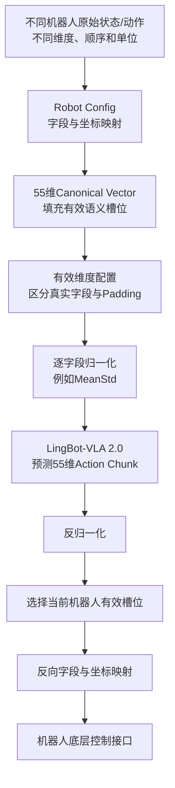
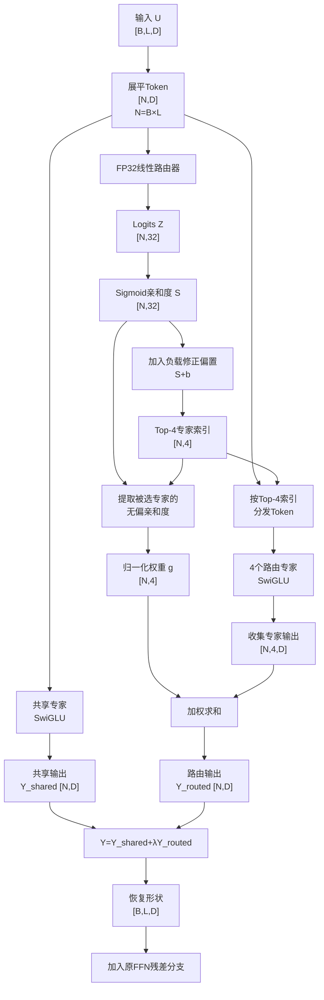
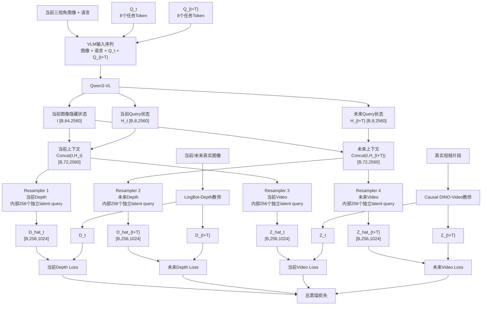

> 主题：LingBot-VLA 2.0 的设计出发点、MoE-based VLA Model，以及通过 Dual-Query Distillation 实现空间与时间感知。
>
> 本笔记重点记录学习过程中容易混淆的问题，并区分论文中的抽象写法与当前公开代码的具体实现。

---

# 第一部分：设计出发点与统一动作表示

## 1. 一页总结

LingBot-VLA 2.0 要解决的核心问题是：

```text
实验室基准中的成功
        ↓
如何转化为真实世界中的可靠机器人能力？
```

作者认为，仅扩大模型和数据规模还不够，还必须同时改善：

```text
跨任务、跨本体泛化
        +
更完整的全身动作空间
        +
对当前几何和未来动态的理解
```

对应的主要设计是：

```text
约60,000小时预训练数据
        +
55维统一状态/动作表示
        +
Action Expert中的Sparse MoE
        +
Q_t、Q_{t+T}双时间Query蒸馏
```

其中：

- Sparse MoE解决“共享控制规律与本体/任务特殊规律如何共存”；
- $Q_t$ 学习当前几何和当前视频中的动态线索；
- $Q_{t+T}$ 学习与一个Action Chunk时间跨度对应的未来几何和视频特征；
- LingBot-Depth与DINO-Video只在训练阶段作为教师使用。

---

## 2. 真实部署挑战与三项核心改进

VLA模型已经能够利用预训练视觉语言模型获得：

- 图像与语言的多模态对齐；
- 物体、场景和任务语义；
- 从自然语言指令到机器人动作的条件建模能力。

扩大机器人数据的数量和多样性，也能够提升VLA的跨任务能力。

但真实部署仍然面临三个主要问题。

**跨任务与跨本体泛化。**

不同机器人具有不同的：

- 关节数量；
- 身体结构；
- 相机配置；
- 控制频率；
- 动作单位与表示方式；
- 动力学特性；
- 数据采集质量和任务分布。

因此：

```text
会控制多项任务
不等于
会控制多种机器人
```

**更完整的全身动作空间。**

真实长时程任务可能需要：

```text
底盘移动
→ 转头观察
→ 调整腰部
→ 双臂协作
→ 夹爪或灵巧手操作
```

因此，动作空间不能只覆盖双臂和夹爪，还需要覆盖：

- 手臂；
- 末端执行器；
- 普通夹爪；
- 灵巧手；
- 腰部；
- 头部；
- 移动底盘。

**从反应式控制走向预测式控制。**

纯反应式控制是：

```text
当前观察 o_t → 当前动作 a_t
```

真实操作更需要：

```text
当前观察
    ↓
推测执行一段操作后场景如何变化
    ↓
生成更合适的动作
```

例如，机器人需要预判：

- 继续移动是否会碰倒物体；
- 抓取后物体会移动到哪里；
- 当前动作是否有利于下一阶段；
- 门、抽屉或柔性物体会如何变化。

---



**三个对应改进。**

**数据与泛化。**

最终预训练数据约为：

```text
50,000小时高质量机器人轨迹
        +
10,000小时第一人称人类视频
        =
约60,000小时预训练数据
```

机器人数据覆盖20种配置，包括：

- 单臂；
- 双臂；
- 移动机器人；
- 夹爪；
- 灵巧手；
- 半人形及人形形态。

作者最初收集约90,000小时机器人数据，清洗后保留约50,000小时。

这说明数据质量与数据规模同等重要。

**统一全身动作接口。**

模型使用55维语义槽位容纳不同本体的手臂、末端执行器、夹爪、灵巧手、腰、头和底盘状态，并通过Robot Config与有效维度掩码映射到具体机器人；第3、4章会展开这套接口及其能力边界。

**未来特征与动态先验。**

模型不仅学习“当前场景是什么样”，还学习“一个Action Chunk时间跨度之后，场景可能变成什么样”。LingBot-VLA 2.0使用LingBot-Depth提供几何监督、DINO-Video提供语义和时间动态监督，并以 $Q_t$ 和 $Q_{t+T}$ 分别表示当前与未来。这里学习的是当前观察和指令条件下的未来特征先验，不是读取候选动作后预测其后果的action-conditioned动力学模型。


## 3. 55维统一状态/动作表示

**为什么要扩展动作空间？**

LingBot-VLA 1.0及许多早期VLA主要控制双臂和夹爪，无法统一学习长时程任务中的移动、主动观察、全身姿态调整和灵巧手操作。因此，2.0的第二项核心改进是：

> 把动作空间从标准双臂扩展为覆盖手臂、末端执行器、夹爪、灵巧手、腰、头和移动底盘的全身控制空间。

这里需要区分两个相关概念：

```text
Expanded Action Space
→ 模型能够控制更多身体部件

Unified Action Representation
→ 不同机器人都映射到同一个55维接口
```

**55维标准向量的完整布局。**

LingBot-VLA 2.0为状态和动作定义相同的55维标准槽位：

```text
索引0～13      手臂关节位置         14维
索引14～27     末端执行器位姿       14维
索引28～29     夹爪位置              2维
索引30～41     灵巧手关节位置       12维
索引42～45     腰部位置              4维
索引46～47     头部位置              2维
索引48～50     移动信号              3维
索引51～54     预留字段              4维
----------------------------------------
总计                                 55维
```

可以写成：

$$
x=
\left[
x_{\text{arm}},
x_{\text{EEF}},
x_{\text{gripper}},
x_{\text{hand}},
x_{\text{waist}},
x_{\text{head}},
x_{\text{base}},
x_{\text{reserved}}
\right]
$$

状态与动作使用相同布局：

```text
s_t [55]
→ 当前机器人各身体部件的状态

a_t [55]
→ 对应身体部件的动作目标或动作变化
```

**各字段的物理含义。**

**手臂关节位置（14维）。**

按照双臂机器人每条手臂最多7个关节设计：

```text
左臂：7维
右臂：7维
```

单臂机器人只使用其中6维或7维，剩余字段padding。

**末端执行器位姿（14维）。**

每条手臂的末端位姿使用7维：

```text
[x,y,z,qw,qx,qy,qz]
```

- $x,y,z$表示三维位置；
- $q_w,q_x,q_y,q_z$是表示朝向的四元数；
- 双臂共14维。

**夹爪与灵巧手。**

```text
夹爪：  2维，通常左右夹爪各1维
灵巧手：12维，用于一只或两只手的关节信号
```

具体关节与标准槽位的对应关系由Robot Config定义。

**腰、头和移动底盘。**

```text
腰部：4维
头部：2维
底盘：3维
```

底盘3维通常承载平面移动相关信号，但具体表示位置、速度还是增量，以及每个维度的坐标语义，仍由机器人配置决定。

**预留字段。**

最后4维用于未来增加新的身体部件或控制信号，而不立即改变整个标准接口。

## 4. 跨本体映射、执行流程与能力边界

**“统一语义槽位”是什么意思？**

不同机器人的原始动作长度、顺序和含义不同。

单臂机器人可能使用：

```text
[q1,...,q7,gripper]
```

移动双臂机器人可能使用：

```text
[left_q1...q7,
 right_q1...q7,
 left_gripper,
 right_gripper,
 base_x,
 base_y,
 base_yaw]
```

55维标准向量规定：

```text
手臂关节 → 手臂槽位
末端位姿 → EEF槽位
夹爪     → 夹爪槽位
灵巧手   → Hand槽位
底盘     → Mobility槽位
```

因此，它不是简单把不同数组补到相同长度，而是让相同位置尽量代表相同身体部件和控制语义。

**三种映射示例。**

**单臂关节控制机器人。**

```text
原始动作：
[Δq1,...,Δq7,gripper]

映射后：
手臂槽位 [Δq1,...,Δq7,PAD,...,PAD]
夹爪槽位 [gripper,PAD]
其他身体部件全部padding
```

**双臂EEF控制机器人。**

```text
原始动作：
[left_xyz_quat,
 right_xyz_quat,
 left_gripper,
 right_gripper]

映射后：
EEF槽位  [左臂7维,右臂7维]
夹爪槽位 [左夹爪,右夹爪]
其他无效字段padding
```

**移动全身机器人。**

```text
双臂关节或EEF
+ 夹爪或灵巧手
+ 腰部
+ 头部
+ 移动底盘
```

这些字段可以同时进入一个55维Action Chunk，使模型统一表示全身协调动作。

**Padding与有效维度。**

55维是最大标准容器，不代表每个机器人都有55个有效自由度。

```text
单臂机器人：
右臂槽位无效

固定底座机器人：
底盘槽位无效

普通夹爪机器人：
灵巧手槽位无效
```

训练和部署必须结合Robot Config确定：

- 原始字段映射到哪个标准槽位；
- 哪些维度有效，哪些是padding；
- 各字段单位、范围和归一化方式；
- 模型输出如何反向映射到机器人接口。

**Joint与EEF为什么同时存在？**

Joint动作直接描述关节运动，更能表达机器人姿态、可达性和构型约束；EEF动作描述末端在笛卡尔空间中的运动，与任务空间几何更直接，但通常还需要逆运动学或底层控制器转换。55维接口同时预留两类字段以兼容不同机器人和数据集，但不要求每个样本同时使用：

```text
Joint控制数据 → 主要填Joint字段
EEF控制数据   → 主要填EEF字段
同时提供两者  → 由Robot Config决定有效训练目标
```

**55维布局与相对动作不是同一概念。**

55维布局决定“动作放在哪个语义槽位”，相对或绝对动作决定“槽位中的数值表达什么”。相对动作的公式和实验结论放在第13章讨论；无论采用相对/绝对表示还是MeanStd等归一化方法，都不会改变55维槽位结构。

**完整数据和执行流程。**



**如何连接机器人数据与人类视频？**

机器人数据可能提供关节、EEF、夹爪、灵巧手和底盘轨迹。

第一人称人类视频经过SLAM和手部姿态重建后，主要提供手部位置、方向和手部轨迹。

统一表示为不同来源提供共同接口：

```text
机器人关节/EEF轨迹 ─┐
机器人全身动作 ──────┼→ 55维Canonical Representation
人类手部轨迹 ────────┘
```

模型可以从人类视频学习手—物交互和任务过程，从机器人数据学习可执行控制。

**扩展动作空间解决了什么？**

它为不同机器人提供统一动作字段，使单臂、双臂、移动及人形数据可以共同预训练，并让移动与操作进入同一个Action Chunk；同一接口也能承载重建后的人类手部轨迹。

**它没有解决什么？**

需要注意：

> 统一55维表示只统一了数据接口，并没有让不同机器人的物理控制规律变得相同。

它不能自动消除：

- 动力学、关节范围和控制频率差异；
- 坐标系和相机外参差异；
- EEF到Joint转换中的逆运动学问题；
- 不同身体部件的数据量不均衡；
- 高维全身动作的协调难度；
- Padding带来的稀疏无效维度；
- 特定本体的可达性、碰撞和稳定性约束。

这些剩余差异正是Sparse MoE要处理的问题之一。

最终需要三者配合：

```text
55维统一表示
→ 统一数据和控制接口

Robot Config与归一化
→ 处理具体字段、坐标和数值尺度

Sparse MoE与跨本体训练
→ 学习共享规律和本体/任务特殊规律
```

# 第二部分：Sparse MoE动作专家

## 5. 为什么需要MoE，以及它作用在哪里

跨本体VLA预训练中的一个动作token，会同时受到多种因素影响：

```text
机器人本体动力学
        +
任务相关控制逻辑
        +
当前动作阶段
        +
身体部件
        +
部署场景差异
```

如果所有数据都使用同一个Dense FFN：

```text
所有机器人、任务、运动阶段
            ↓
       同一组FFN参数
```

不同控制规律可能产生梯度冲突和负迁移。

Sparse MoE的目标是：

1. 减少不同本体和任务之间的参数干扰；
2. 同时保留共享知识和专业化能力；
3. 在不同比增加计算量的情况下扩大总参数容量。

一句话总结：

> Sparse MoE让不同动作token按需使用不同参数，在控制活跃计算量的同时，兼顾跨机器人共享规律和特殊控制模式。

---

**MoE替换模型中的哪个部分？**

LingBot-VLA 2.0并没有把整个Qwen3-VL改成MoE。

替换范围是：

> Action Expert中每个Transformer Block的FFN。

原结构：

```text
Action Hidden
    ↓
Self-Attention
    ↓ Residual
Dense FFN
    ↓ Residual
输出
```

修改后：

```text
Action Hidden
    ↓
Self-Attention
    ↓ Residual
Sparse MoE FFN
    ↓ Residual
输出
```

可以抽象为：

$$
x' = x+\operatorname{Attention}(\operatorname{Norm}(x))
$$

$$
x'' = x'+\operatorname{MoE}(\operatorname{Norm}(x'))
$$

VLM部分仍然由Qwen3-VL处理。

MoE直接处理的是Action Expert隐藏状态，不直接处理全部图像和文本token。

但是，Action隐藏状态已经通过Attention读取了视觉语言上下文，因此MoE是在多模态条件下进行动作建模。

---

**Sparse MoE的输入和输出。**

设：

```text
B：batch size
L_action：Action Expert token数
D_action：Action Expert隐藏维度
N_r：路由专家总数
K：每个token选择的路由专家数
```

MoE输入：

$$
U\in\mathbb{R}^{B\times L_{action}\times D_{action}}
$$

MoE输出：

$$
Y\in\mathbb{R}^{B\times L_{action}\times D_{action}}
$$

输入输出形状不变，因此可以直接替换原FFN。

```text
[B,L_action,D_action]
        ↓ Sparse MoE
[B,L_action,D_action]
```

MoE不负责token之间的信息交换。

- Self-Attention负责token之间交互；
- MoE负责对每个token进行不同的非线性变换。

---

## 6. 专家配置、内部结构与完整计算流程

**官方配置中的专家数量。**

LingBot-VLA 2.0官方配置使用：

```yaml
token_num_experts: 32
token_top_k: 4
token_moe_intermediate_size: 512
token_shared_intermediate_size: 704
```

每个MoE层包含：

```text
1个独立共享专家
        +
32个独立路由专家
```

共享专家不属于32个路由专家池，也不参与Top-K选择。

每个token实际激活：

```text
1个共享专家 + 4个路由专家 = 5个专家MLP
```

默认在Action Expert的第0～35层启用MoE，共36层。

如果按模块实例计数：

```text
共享专家：36 × 1  = 36
路由专家：36 × 32 = 1152
总计：1188个专家MLP
```

但每个token在每一层只计算1个共享专家和4个路由专家。

---

**Sparse MoE完整流程。**



公式为：

$$
m_l(u_{l,t})
{}=
E_l^{(s)}(u_{l,t})
{}+
\lambda\sum_{j\in R(u_{l,t})}
g_{l,j}(u_{l,t})E_{l,j}^{(r)}(u_{l,t})
$$

其中：

- $E^{(s)}$：始终运行的共享专家；
- $E_j^{(r)}$：第 $j$ 个路由专家；
- $R(u)$：选中的Top-K专家集合；
- $g_j$：选中专家的融合权重；
- $\lambda$：路由输出缩放系数。

---

**单个专家内部如何计算？**

共享专家和路由专家都使用SwiGLU MLP：

$$
E(u)
{}=
W_{\text{down}}
\left(
\operatorname{SiLU}(W_{\text{gate}}u)
\odot
W_{\text{up}}u
\right)
$$

假设专家收到 $n_j$ 个token：

```text
专家输入 X_j              [n_j,D]
```

Gate分支：

```text
X_j                       [n_j,D]
↓ Linear(D→H)
Gate                      [n_j,H]
↓ SiLU
Activated Gate            [n_j,H]
```

内容分支：

```text
X_j                       [n_j,D]
↓ Linear(D→H)
Up Feature                [n_j,H]
```

合并：

```text
Activated Gate            [n_j,H]
⊙ Up Feature              [n_j,H]
↓
Hidden                    [n_j,H]
↓ Linear(H→D)
专家输出                   [n_j,D]
```

形状总览：

```text
[n_j,D]
   ├→ Gate Linear → SiLU ─┐
   └→ Up Linear ──────────×
                           ↓
                        [n_j,H]
                           ↓ Down Linear
                        [n_j,D]
```

路由权重在专家外部应用：

```text
专家输出                  [n_j,D]
路由权重                  [n_j,1]
↓ 逐token相乘
加权专家输出              [n_j,D]
```

不同专家的结果通过scatter-add放回原token位置。

---

## 7. Sigmoid路由与负载均衡

**Sigmoid路由。**

对于token隐藏状态 $u_{l,t}$，先计算：

$$
z_{l,j}(u_{l,t})=u_{l,t}^{\top}e_{l,j}
$$

形状：

```text
Token Hidden              [N,D]
Router Embedding          [32,D]
↓
Router Logits             [N,32]
```

然后使用Sigmoid：

$$
s_{l,j}=\operatorname{Sigmoid}(z_{l,j})
$$

Softmax会让专家之间发生较强的互斥竞争。

Sigmoid独立计算每个token与每个专家的亲和度，因此同一个token可以同时与多个专家高度匹配。

这适合动作token同时受到本体、任务、动作阶段和场景等多种因素影响的情况。

---

**无辅助损失负载均衡。**

**为什么需要负载均衡？**

如果完全按照原始亲和度路由，可能发生：

```text
专家1：接收绝大多数token
专家2：很少使用
专家3：几乎不使用
```

传统方案会加入：

$$
L=L_{action}+\alpha L_{balance}
$$

但负载均衡辅助损失可能干扰动作学习目标。

**选择与权重解耦。**

Top-K专家选择使用：

$$
R(u)=\operatorname{TopK}(s+b,K)
$$

选中后的输出权重只使用无偏置亲和度：

$$
g_j
{}=
\frac{s_j}{\sum_{k\in R(u)}s_k}
$$

因此：

```text
选哪些专家：使用 s+b
专家占多大权重：只使用原始s
```

修正偏置只促进负载均衡，不伪造模型原始路由置信度。

**偏置更新。**

统计第 $l$ 层专家 $j$ 的全局token负载 $n_{l,j}$。

平均负载：

$$
\bar n_l=\frac{1}{N_r}\sum_{k=1}^{N_r}n_{l,k}
$$

偏置更新：

$$
b_{l,j}
\leftarrow
b_{l,j}
{}-
\gamma\operatorname{sign}(n_{l,j}-\bar n_l)
$$

规则是：

```text
负载高于平均值
→ b_j减小
→ 以后更难进入Top-K

负载低于平均值
→ b_j增大
→ 以后更容易进入Top-K
```

token计数会跨micro-batch和分布式训练rank累计，以反映全局专家使用情况。

可选的偏置中心化：

$$
b_j\leftarrow b_j-\operatorname{mean}(b)
$$

用于防止所有偏置整体漂移。

**论文与当前训练配置的区别。**

论文重点描述无辅助损失的负载均衡方法。

官方训练指南中的预训练示例使用非零`bias_update_speed`。

当前`real_robot.yaml`后训练配置则可以将`bias_update_speed`设为0，并启用sequence-wise辅助损失与router z-loss。

因此，理解论文方法时要以偏置更新公式为主；运行具体配置时要检查实际YAML。

---

# 第三部分：Dual-Query时空蒸馏

## 8. 双时间Query的定义、序列位置与可见性

**2.0与1.0的关键区别。**

LingBot-VLA 1.0主要针对当前时刻的多视角几何蒸馏：

```text
Q_t^1、Q_t^2、Q_t^3
→ 对应三个当前相机视角
```

LingBot-VLA 2.0改为两个时间查询：

```text
Q_t
→ 当前场景

Q_{t+T}
→ 一个action chunk之后的未来场景
```

因此，2.0的重点不再是“为三个视角分别设置query”，而是：

```text
融合当前多视角上下文
        ↓
当前Query + 未来Query
```

2.0仍然输入三个相机：

- 顶部相机；
- 左腕相机；
- 右腕相机。

但不再使用1.0中显式的三组视角query。

---

**$Q_t$ 和 $Q_{t+T}$ 到底是什么？**

论文写成两个query：

$$
[Q_t,Q_{t+T}]
$$

官方实现中，每个 $Q$ 是一组8个token：

```text
Q_t初始                 [B,8,2560]
Q_{t+T}初始             [B,8,2560]
```

所以启用当前与未来query后，一共插入16个任务query token。

需要特别区分：

```text
图像token：每个相机约64个
语言token：L_text个
当前任务query：8个
未来任务query：8个
```

8个任务query并不表示图像和语言只有8个token。

简化的VLM序列是：

```text
[三个相机图像token]
[语言token]
[Q_t的8个token]
[Q_{t+T}的8个token]
```

忽略特殊token时，三个相机对应约192个图像token：

```text
VLM前缀长度
≈ 192 + L_text + 8 + 8
```

---

**为什么一个 $Q$ 使用8个token？**

一个query向量可能形成过强的信息瓶颈。

8个query token可以形成多个可学习信息槽位，分别关注不同的场景内容。

可能包括：

- 机器人和夹爪；
- 被操作物体；
- 桌面与背景；
- 物体间空间关系；
- 与任务相关的几何变化；
- 当前运动和交互状态。

这些语义没有被人工分配，而是在训练中自动形成。

---

**双Query在序列中的可见性。**

官方配置使用：

```yaml
vlm_causal: true
block_future_depth_to_action: false
block_suffix_to_future_video: false
```

序列顺序：

```text
当前图像 I_t
    ↓
语言 L
    ↓
当前Q_t
    ↓
未来Q_{t+T}
    ↓
机器人状态 S_t
    ↓
Action Chunk
```

**$Q_t$ 的可见性。**

$Q_t$ 可以看到：

- 当前多视角图像；
- 语言指令；
- 同组中位置更早的 $Q_t$ token。

$Q_t$ 看不到：

- $Q_{t+T}$；
- 状态和Action后缀；
- 真实未来图像；
- 教师未来特征。

对于第 $i$ 个当前query token：

$$
Q_t^{(i)}
\leftarrow
[I_t,L,Q_t^{(\le i)}]
$$

**$Q_{t+T}$ 的可见性。**

$Q_{t+T}$ 可以看到：

- 当前多视角图像；
- 语言指令；
- 全部 $Q_t$；
- 同组中位置更早的 $Q_{t+T}$ token。

$Q_{t+T}$ 看不到：

- 状态和Action后缀；
- 真实未来图像；
- 教师未来特征。

$$
Q_{t+T}^{(i)}
\leftarrow
[I_t,L,Q_t,Q_{t+T}^{(\le i)}]
$$

可见性是不对称的：

```text
Q_t看不到Q_{t+T}
Q_{t+T}可以看到Q_t
```

**Action token的可见性。**

默认配置没有阻断Action到未来query的Attention。

因此Action Expert可以读取：

```text
图像 + 语言 + Q_t + Q_{t+T} + 状态
```

但是：

```text
Action可以读取Query
Query不能读取Action
```

$Q_{t+T}$ 并不是显式根据候选action预测动作后果，而是根据当前观察、指令和训练中学到的任务规律预测未来。

**三种“因果”不要混淆。**

1. VLM token因果性  
   query只能读取序列中自己之前的token。

2. DINO-Video时间因果性  
   时刻 $t$ 的视频特征只能使用不晚于 $t$ 的视频帧。

3. Perceiver Resampler  
   Resampler内部的256个latent query不是时间序列，不使用上述时间因果限制。

---

## 9. 教师—学生架构与四分支蒸馏

**蒸馏的整体目标。**

两个query分别接受两种教师监督：

```text
Q_t
 ├→ 当前Depth目标 D_t
 └→ 当前Video目标 Z_t

Q_{t+T}
 ├→ 未来Depth目标 D_{t+T}
 └→ 未来Video目标 Z_{t+T}
```

LingBot-Depth主要提供：

- 三维几何；
- 物体距离；
- 空间结构；
- 当前及未来几何配置。

DINO-Video主要提供：

- 物体和场景语义；
- 运动信息；
- 手与物体交互；
- 当前到未来的动态变化。

一句话：

```text
Depth回答“在哪里、空间结构怎样”
Video回答“正在怎样变化、未来会怎样”
```

---

**教师分支。**

训练样本包含：

```text
当前多视角图像 I_t
未来图像 I_{t+T}
语言指令
机器人状态
未来Action Chunk
```

未来图像不会进入学生VLM，只用于教师产生训练目标。

**LingBot-Depth教师。**

```text
当前真实图像
    ↓ LingBot-Depth
D_t                    [B,256,1024]

未来真实图像
    ↓ LingBot-Depth
D_{t+T}                [B,256,1024]
```

这些目标是深度模型的隐空间几何token，不是简单的单通道深度图。

**DINO-Video教师。**

```text
真实视频片段
    ↓ Causal DINO-Video
Z_t                    [B,256,1024]
Z_{t+T}                [B,256,1024]
```

DINO-Video使用因果时间注意力：

```text
Z_t只能使用≤t的帧
Z_{t+T}可以使用≤t+T的帧
```

所有教师目标在loss中都会`detach`，教师模型不接受学生梯度。

---

**学生VLM分支。**

官方配置中：

```text
Qwen3-VL隐藏维度：2560
每个相机图像token：64
相机数量：3
任务query：当前8个、未来8个
```

三个相机经过视觉编码：

```text
顶部相机               [B,64,2560]
左腕相机               [B,64,2560]
右腕相机               [B,64,2560]
↓ concat
全部图像token           [B,192,2560]
```

这192个图像token都会进入学生VLM前缀，但当前公开对齐实现只将`hidden_states`中的第一段图像token送入四个Resampler，即第一路图像的64个token；具体对应哪个物理视角取决于数据和配置中的相机顺序。因此下文Projection Head的上下文长度是`64 + 8 = 72`，并不表示VLM只看了一路相机。

语言：

```text
语言token               [B,L_text,2560]
```

经过Qwen3-VL后提取：

```text
H_t                     [B,8,2560]
H_{t+T}                 [B,8,2560]
```

其中：

- $H_t$ 是上下文化后的当前query状态；
- $H_{t+T}$ 是只根据当前上下文形成的未来预测状态。

---

**只有两组VLM Query，但有四个Perceiver Resampler。**

这是本部分最重要的区分。

VLM序列中只插入：

```text
Q_t：8个token
Q_{t+T}：8个token
```

VLM之后有四个独立的Projection Head：

```text
1. 当前Depth Resampler
2. 未来Depth Resampler
3. 当前Video Resampler
4. 未来Video Resampler
```

对应代码中的模块是：

```text
depth_align_head
future_depth_align_head
current_video_align_head
future_video_align_head
```

它们结构相同，但参数不共享。

论文为了简化，在当前和未来公式中重复写同一个：

$$
\operatorname{Proj}_{depth}
\quad\text{和}\quad
\operatorname{Proj}_{video}
$$

当前公开实现实际上分别使用当前和未来两个独立Head。

---

**8-token任务Query与256个latent Query不是同一回事。**

**8-token任务Query。**

它们进入VLM序列：

```text
Q_t                    [B,8,2560]
Q_{t+T}                [B,8,2560]
```

作用：

- 读取图像和语言；
- 形成当前和未来的上下文表征；
- 被Action token读取。

**256个Perceiver latent Query。**

每个Resampler内部都有自己的256个可学习输出槽位：

```text
P_depth_t              [B,256,2560]
P_depth_{t+T}          [B,256,2560]
P_video_t              [B,256,2560]
P_video_{t+T}          [B,256,2560]
```

作用：

- 通过Cross-Attention读取VLM上下文；
- 生成256个与教师token一一对齐的预测特征。

这四组256-query参数彼此独立。

配置中的：

```yaml
share_future_depth_query: true
```

表示未来Depth和Video共享VLM序列中的8-token $Q_{t+T}$ 表征。

它不表示两个未来Resampler共享256个latent query，也不表示它们共享参数。

---

**四个Resampler的输入关系。**

当前两条分支共享上下文：

```text
当前图像隐藏状态        [B,64,2560]
当前H_t                 [B, 8,2560]
↓ concat
X_t                     [B,72,2560]
```

但使用不同的Resampler与latent query：

$$
\hat D_t
{}=
\operatorname{DepthHead}_t(X_t,P^{depth}_t)
$$

$$
\hat Z_t
{}=
\operatorname{VideoHead}_t(X_t,P^{video}_t)
$$

未来两条分支共享：

```text
当前图像隐藏状态        [B,64,2560]
未来H_{t+T}             [B, 8,2560]
↓ concat
X_{t+T}                 [B,72,2560]
```

分别生成：

$$
\hat D_{t+T}
{}=
\operatorname{DepthHead}_{t+T}(X_{t+T},P^{depth}_{t+T})
$$

$$
\hat Z_{t+T}
{}=
\operatorname{VideoHead}_{t+T}(X_{t+T},P^{video}_{t+T})
$$

所以：

```text
当前Depth、当前Video：共享H_t上下文
未来Depth、未来Video：共享H_{t+T}上下文

四个Resampler：不共享参数
四组256 latent query：不共享参数
```

---

## 10. Perceiver Resampler的结构与完整流程

**单个Projection Head的精确形状。**

以当前Depth Head为例，图像隐藏状态与当前Query状态先组成上下文，256个latent query作为输出槽位：

```text
图像隐藏状态 [B,64,2560] + H_t [B,8,2560]
                     ↓ concat
上下文 X_t                     [B,72,2560]
latent query P_t              [B,256,2560]
```

**Attention与输出投影。** 官方配置为`num_heads=4`、`dim_head=32`，因此内部注意力维度为128。代码把投影后的上下文和latent query拼成长度328的K/V来源：

```text
Q                       [B,4,256,32]
K、V                    [B,4,328,32]
Attention Weights       [B,4,256,328]
        ↓ 读取V、合并Head、残差与FFN
Resampler Hidden        [B,256,2560]
        ↓ Linear(2560→1024) + LayerNorm
学生预测                 [B,256,1024]
教师目标                 [B,256,1024]
```

由于K/V同时包含上下文和latent query，输出槽位既能读取图像与任务Query，也能相互交换信息。另外三个Resampler使用相同结构和形状，但参数独立。

---

**双查询蒸馏完整流程图。**



图中只有 $Q_t$ 和 $Q_{t+T}$ 两组token进入VLM。

四组256 latent query位于四个Resampler内部，不是额外的VLM输入。

---

## 11. 蒸馏损失、Query更新及训练—部署流程

**蒸馏损失。**

论文中的Depth损失：

$$
\mathcal L_{depth}
{}=
\mathbb E
\left[
\left\|
\operatorname{Proj}_{depth,t}(Q_t)-D_t
\right\|_1
{}+
\left\|
\operatorname{Proj}_{depth,t+T}(Q_{t+T})-D_{t+T}
\right\|_1
\right]
$$

论文中的Video损失：

$$
\mathcal L_{video}
{}=
\mathbb E
\left[
\left\|
\operatorname{Proj}_{video,t}(Q_t)-Z_t
\right\|_F^2
{}+
\left\|
\operatorname{Proj}_{video,t+T}(Q_{t+T})-Z_{t+T}
\right\|_F^2
\right]
$$

这里为了反映当前公开实现，给当前和未来Projection加了不同下标。

当前公开代码中：

```text
Depth：Smooth L1
Video：MSE + 0.2×Cosine Loss
```

总训练损失可概括为：

$$
\mathcal L_{total}
{}=
\mathcal L_{action}
{}+
\alpha\mathcal L_{depth,current}
{}+
\beta\mathcal L_{depth,future}
{}+
\eta\mathcal L_{video}
{}+
\text{其他MoE训练项}
$$

官方配置中主要蒸馏权重约为`0.004`。

---

**同一个 $Q_t$ 同时学习Depth和Video会不会混？**

会形成共享的多任务表征，但不是让同一个输出直接承担两种目标。

同一个 $H_t$ 被两个独立Head读取：

```text
共享H_t
 ├→ 当前Depth Head
 │    → 几何特征
 │
 └→ 当前Video Head
      → 动态语义特征
```

同一个2560维隐藏状态可以在不同子空间中编码：

- 几何；
- 物体语义；
- 运动；
- 交互状态。

模型通过以下机制降低冲突：

1. Depth与Video使用独立Resampler；
2. Depth与Video使用独立的256 latent query；
3. 当前与未来使用独立任务query组；
4. 蒸馏损失权重较小，Action Loss仍是主要目标；
5. 两种教师信息本身具有互补性。

但多任务梯度冲突并非理论上完全不存在，最终仍需要消融实验验证收益。

---

**两组8-token Query如何产生和更新？**

官方共享任务query配置中，每个时间分支分别拥有Depth和Video的256-query参数池。

**当前Query初始化。**

当前Depth参数池：

```text
E_depth_t               [256,2560]
↓ reshape
                        [8,32,2560]
↓ 每组平均
q_depth_t               [8,2560]
```

当前Video参数池：

```text
E_video_t               [256,2560]
↓ reshape + 分组平均
q_video_t               [8,2560]
```

融合：

```text
q_depth_t               [8,2560]
q_video_t               [8,2560]
↓ concat
                        [8,5120]
↓ Linear(5120→2560)
Q_t初始                 [8,2560]
↓ repeat batch
                        [B,8,2560]
```

未来 $Q_{t+T}$ 使用相同流程，但参数独立。

因此四组256-query参数具有双重作用：

```text
作用1：分组平均后生成8-token VLM任务Query
作用2：完整256个token作为各自Resampler latent Query
```

**前向传播更新。**

在每个Qwen3-VL Transformer层中：

$$
Q^{l\prime}
{}=
Q^l
{}+
\operatorname{Attention}
\left(
\operatorname{Norm}(Q^l),
H_{\leq Q}^l
\right)
$$

$$
Q^{l+1}
{}=
Q^{l\prime}
{}+
\operatorname{FFN}
\left(
\operatorname{Norm}(Q^{l\prime})
\right)
$$

最终得到：

```text
H_t                     [B,8,2560]
H_{t+T}                 [B,8,2560]
```

这些隐藏状态随当前样本动态变化，不是固定参数。

**反向传播更新。**

当前Query主要收到：

```text
当前Depth Loss
+ 当前Video Loss
+ Action Loss
```

未来Query主要收到：

```text
未来Depth Loss
+ 未来Video Loss
+ Action Loss
```

因为 $Q_{t+T}$ 可以读取 $Q_t$，未来蒸馏梯度也可能通过Attention间接流向 $Q_t$。

梯度路径：

```text
蒸馏Loss / Action Loss
        ↓
四个Resampler与Action路径
        ↓
H_t、H_{t+T}
        ↓
Qwen3-VL各层
        ↓
初始任务Query
        ↓
四组256-query参数池与共享融合Linear
```

教师目标已经`detach`，LingBot-Depth和DINO-Video不接受这些梯度。

---

**训练与部署的区别。**

训练阶段需要：

```text
当前图像
未来图像
LingBot-Depth
DINO-Video
四个Perceiver Resampler
蒸馏损失
```

部署阶段只需要：

```text
当前多视角图像
+ 语言指令
+ 机器人状态
        ↓
LingBot-VLA 2.0
        ↓
Action Chunk
```

教师模型和真实未来图像不会参与部署推理。

训练后，双时间query已经将几何与动态先验编码进VLA内部表征。

---

# 第四部分：实验结论、能力边界与心智模型

> 本部分只记录实验设计和可以得到的结论，不抄录逐任务表格与具体分数。

## 12. 评估方法与通用、长时程实验结论

**评估指标。**

长时程任务不能只用“成功/失败”评价。

论文同时使用：

- 任务进展分数：根据完成了哪些细粒度步骤给予部分得分；
- 完整成功率：只有完成整条任务流程才算成功。

二者需要结合理解：

```text
进展高、成功低
→ 模型经常能完成前半段
→ 但容易在精确放置、释放或收尾阶段失败

进展高、成功也高
→ 模型不仅能够推进任务
→ 还能较稳定地完成整条轨迹
```

逐步骤评分比二元成功率更适合分析长时程任务，并能帮助定位模型经常在哪个阶段失败。

---

**通用双臂操作实验结论。**

实验采用generalist mixed-training：

```text
每种机器人本体各训练一个策略
该策略联合学习多项双臂任务
```

它不是一个策略同时控制两个不同机器人平台。

总体结论：

1. LingBot-VLA 2.0的跨任务平均表现优于对比模型；
2. 提升在不同任务之间并不均匀；
3. 优势较明显的任务通常需要较强的目标物体定位和目标导向执行；
4. 一些任务只有进展提升，完整成功率仍然较低；
5. 模型仍然容易在任务最后的精确放置、释放和完成判定阶段失败；
6. 不同机器人平台之间仍有明显性能差距。

平台差异说明，统一55维动作空间并没有完全消除：

- 运动学差异；
- 相机视角差异；
- 可达性和关节约束；
- 动作范围与控制频率差异；
- 不同本体的数据分布差异。

因此，更准确的结论是：

> LingBot-VLA 2.0改善了通用双臂操作的总体趋势，但不是所有任务都稳定提升，精细收尾控制和跨本体适配仍然是明显短板。

---

**长时程移动操作实验结论。**

实验同时测试：

- 移动底盘；
- 物体操作；
- 双臂和身体协调；
- 多阶段任务执行；
- 对活动关节物体的操作；
- 分布内与受控分布外泛化。

分布外设置主要改变：

- 机器人初始位置；
- 部分任务中的操作物体类别。

总体结论：

1. LingBot-VLA 2.0在两个机器人平台的分布内和分布外设置中都呈现更好的结果；
2. 所有模型在分布外设置下都会明显退化；
3. 同时改变机器人初始位置和物体类别，比只改变初始位置更困难；
4. 长时程任务中的小误差会沿任务阶段不断累积；
5. 模型仍然没有解决开放世界中的任意物体、任意场景和大范围位置变化。

需要谨慎解释：

- 每个任务设置的独立试验次数较少；
- 成功率对单次成败较敏感；
- 论文没有在这一部分提供置信区间或统计显著性检验。

因此，实验支持“方向一致的提升趋势”，但不应将其夸大为已经解决长时程OOD泛化。

---

## 13. 动作表示、分布对齐、归一化与损失消融

**动作目标与动作空间消融结论。**

**相对关节动作优于绝对关节动作。**

绝对动作要求模型预测全局关节构型：

$$
a^{abs}=q_{target}
$$

相对动作只预测局部变化：

$$
a^{rel}=q_{target}-q_{current}
$$

相对动作的优势来自：

- 分布更接近零中心；
- 方差更小；
- 将全局姿态回归转化为局部运动回归；
- 更符合机器人连续控制中“小幅修正占多数”的特点。

相对动作仍可能累积误差，因此适合与持续观察、滚动预测结合。

**EEF与Joint没有统一赢家。**

Joint动作直接描述关节变化：

```text
[Δq1,Δq2,...,Δqn]
```

它更适合：

- 机械臂整体姿态很重要的任务；
- 受可达性和关节限制影响明显的任务；
- 狭窄空间和构型依赖任务。

EEF动作描述末端在笛卡尔空间中的运动：

```text
[Δx,Δy,Δz,Δrotation]
```

它更适合：

- 末端轨迹规律明显的任务；
- 擦拭、舀取、挤压等接触型任务；
- 主要由物体与末端空间关系决定的任务。

最佳动作空间由两个因素共同决定：

1. 任务动作分布与总体训练分布是否对齐；
2. 动作表示是否符合任务的物理结构。

这也解释了为什么55维标准表示同时为Joint和EEF预留字段。

---

**动作分布对齐的含义。**

作者先使用总体训练数据的逐维均值和标准差，对不同动作维度进行MeanStd标准化：

$$
\hat a_d=\frac{a_d-\mu_d}{\sigma_d}
$$

这样可以消除不同关节、EEF和夹爪维度的数值尺度差异。

然后比较：

```text
单项任务每个动作维度的分布
            vs.
全部任务合并后的总体动作分布
```

分布对齐差距主要根据每维的：

- 中位数差异；
- 四分位距差异；

进行聚合。

```text
Gap小
→ 单项任务动作模式接近总体训练分布

Gap大
→ 单项任务需要较特殊的动作模式
```

但这种指标只能解释部分结果，因为逐维边缘分布没有完整描述：

- 多关节相关性；
- 动作时间顺序；
- 接触动力学；
- 轨迹几何；
- 可达性和构型约束。

---

**归一化与损失函数消融结论。**

**MeanStd优于MinMax和Q01–Q99。**

MinMax容易被少量极值决定缩放范围，使大多数普通动作被压缩到很窄的区间。

Q01–Q99减轻了极值的影响，但在论文实现中并没有裁剪数据。它的主要问题不是信息被截断，而是归一化后的动作目标相对MeanStd仍然较压缩。

MeanStd：

$$
\hat x=\frac{x-\mu}{\sigma}
$$

不会强制把动作限制在固定区间，因此能够保留：

- 微小调整；
- 中等运动；
- 较大的恢复和纠错动作；
- 相对动作分布的长尾结构。

实验结论是：

> 对连续机器人动作，保留不同动作幅度之间的有效动态范围，比强制压入固定范围更重要。

**L2整体优于L1，但不是所有任务都如此。**

L2：

$$
L_2=(\hat a-a)^2
$$

更适合：

- 以零为中心；
- 平滑连续；
- 小幅修正密集；
- 噪声相对较小；

的相对动作分布。

L1：

$$
L_1=|\hat a-a|
$$

对长尾、异常值和接触突变更鲁棒，因此在部分强接触任务中可能更好。

推荐组合可以概括为：

```text
相对关节动作
+ MeanStd归一化
+ L2损失
```

但强接触、重尾或噪声较大的任务仍值得单独比较L1。

---

## 14. Dual-Query证据、归因边界与最终心智模型

**Dual-Query感知实验能说明什么？**

Figure 13展示：

```text
当前：
学生Q_t预测的Depth/DINO特征
vs.
当前教师目标

未来：
学生Q_{t+T}预测的Depth/DINO特征
vs.
真实未来帧产生的教师目标
```

它提供的主要是定性表征证据：

- $Q_t$ 能恢复当前几何和语义结构；
- $Q_{t+T}$ 能预测部分未来几何和语义变化；
- 学生特征确实进入了教师可解释的特征空间。

但论文没有给出完整的Dual-Query动作性能消融，例如：

```text
无蒸馏
Depth-only
Depth + DINO
只有Q_t
Q_t + Q_{t+T}
```

因此，不能从Figure 13或完整系统对比中单独量化Dual-Query对最终动作成功率的贡献。

LingBot-VLA 2.0相对1.0同时改变了：

- 数据规模与数据来源；
- VLM骨干；
- Sparse MoE；
- 动作空间；
- 双查询和双教师蒸馏；
- 训练配置。

完整模型性能提升无法直接归因于某一个模块。

---

**Figure 13中的Depth Image如何产生？**

VLA Student并不直接预测深度图，而是预测：

```text
Depth Features           [B,256,1024]
```

公开可视化代码执行：

```text
[B,256,1024]
↓ reshape
[B,16,16,1024]
↓ permute
[B,1024,16,16]
↓ 冻结的LingBot-Depth Decoder
Depth Map
↓ 颜色映射
Figure中的Depth Image
```

学生特征与教师特征都使用同一个LingBot-Depth Decoder解码，再进行并排比较。

公开代码还向Decoder传入LingBot-Depth提供的`cls_token`。

因此，Figure 13更准确地证明：

> VLA预测的特征已经进入LingBot-Depth Decoder可以解释的几何特征空间。

它不能严格证明：

- VLA默认动作推理会直接输出深度图；
- VLA完全脱离教师组件就能产生标定准确的深度；
- 可视化相似必然带来动作成功率提升。

DINO-Video输出不经过Depth Decoder，而是把高维patch特征通过PCA降到3维后映射成颜色。PCA颜色表示特征相似性，不是图像的真实颜色。

---

**MoE心智模型。**

```text
视觉语言上下文
        ↓
Action Hidden
        ↓ Self-Attention
不同Action token获得不同控制语义
        ↓ Sparse MoE
共享专家学习通用规律
+ Top-4路由专家学习专业化模式
        ↓
Action Hidden继续传播
```

**双查询心智模型。**

```text
当前多视角图像 + 指令
          ↓
       Qwen3-VL
     ┌────┴────┐
     │         │
    H_t      H_{t+T}
     │         │
当前几何/动态线索  未来几何/动态先验
     │         │
     └────┬────┘
          ↓
Action Expert读取两组表征
          ↓
生成Action Chunk
```

训练时：

```text
LingBot-Depth教“空间”
DINO-Video教“时间和运动”
```

部署时：

```text
教师移除
学生保留训练得到的时空先验
```

---

**附：参考资料**

- LingBot-VLA 2.0论文：<https://arxiv.org/abs/2607.06403>
- LingBot-VLA 2.0代码：<https://github.com/Robbyant/lingbot-vla-v2>
- 官方训练配置：<https://github.com/Robbyant/lingbot-vla-v2/blob/main/configs/vla/real_robot/real_robot.yaml>
- Depth Head：<https://github.com/Robbyant/lingbot-vla-v2/blob/main/lingbotvla/models/vla/vision_models/align_heads/depth_head.py>
- Perceiver Resampler：<https://github.com/Robbyant/lingbot-vla-v2/blob/main/lingbotvla/models/vla/vision_models/align_heads/resampler.py>
- LingBot-VLA 2.0模型实现：<https://github.com/Robbyant/lingbot-vla-v2/blob/main/lingbotvla/models/vla/lingbot_vla/modeling_lingbot_vla_v2.py>

