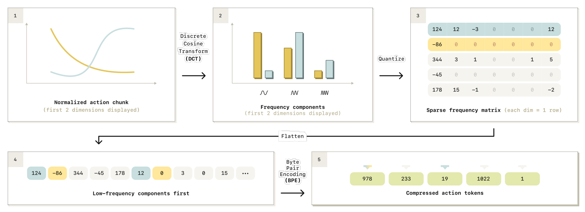
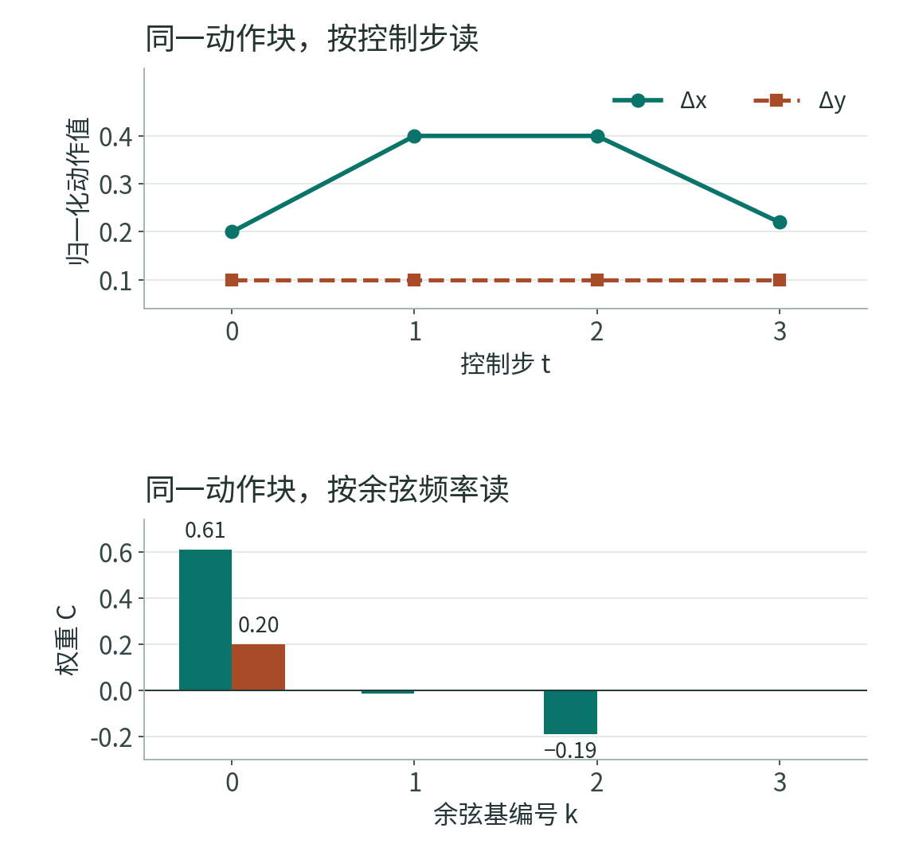
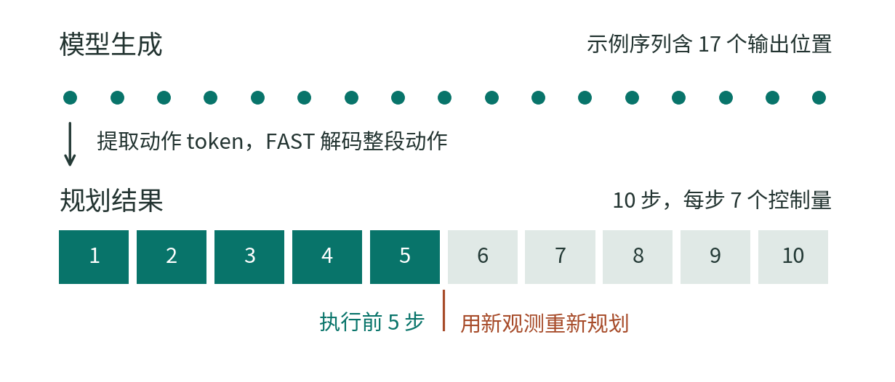

在 SAFE 仓库的一条 π₀-FAST 记录里，模型生成了 **17 个输出 token**，交给机器人的却是 **10 步动作，每步 7 维**。为什么两个长度可以不同？想象机械臂把手伸向摩卡壶。连续十步的平移、旋转和夹爪命令组成七条短曲线。一串 token 可以编码这七条曲线，解码器再把每条曲线还原为十个采样点。 [SAFE 的数据样例](https://github.com/vla-safe/SAFE/blob/main/failure_prob/data/pizero_fast.py#L94)

**FAST**（Frequency-space Action Sequence Tokenization）定义连续动作块和离散 token 之间的转换。**π₀-FAST** 是使用这种编码的机器人策略。以本文的 LIBERO 配置为例，训练和推理分别这样使用 FAST。 [FAST 论文](https://arxiv.org/html/2501.09747v1)

- **训练时**，从示范里取出未来 10 步、每步 7 维的动作。FAST 把这段动作编码成一串 token，作为模型要学习预测的答案。
- **推理时**，模型拿到相机图像、指令和当前机器人状态，逐个预测 token。FAST 再把整串动作 token 解码成 10 × 7 的动作块，机器人按行执行。因此，**生成多少个 token 和规划多少步动作是两个不同的数**。

## 为什么要编码整段动作

假设在七维控制空间里预测未来十步。如果每一步的每一维都独立分桶、各用一个 token，需要预测 70 个动作 token。提高控制频率后，相邻时刻的命令往往很接近，许多 token 只重复了上一步已有的信息。FAST 利用这种时间上的相关性，把平滑运动的主要变化集中到少数频率系数里，再压缩常见的系数组合。 [FAST 论文图 3 和 §V](https://arxiv.org/html/2501.09747v1#S5)

*图 1 · Pertsch 等，FAST 原论文图 4。顺着上排从左读到右，再看下排。右上矩阵的每一行代表一个控制维度，所以左下序列开头的 124、−86、344、−45、178 来自它的同一列，都是最低频系数。* [作者原图](https://arxiv.org/html/2501.09747v1/dct_method.svg)

## 算一次 DCT，看看“沿时间轴”到底沿哪里

取一个已经归一化的示例动作块。论文对每个控制维度分别用训练数据的第 1 和第 99 百分位 \(l,u\) 设定尺度。该维的原始值 \(a\) 对应归一化值 \(x=2(a-l)/(u-l)-1\)。下表按环境返回动作的习惯排列，**一行是一个控制步，一列是一个控制量**。

| 控制步 \(t\) | \(\Delta x\) | \(\Delta y\) |
| ---: | ---: | ---: |
| 0 | 0.20 | 0.10 |
| 1 | 0.40 | 0.10 |
| 2 | 0.40 | 0.10 |
| 3 | 0.22 | 0.10 |

用手指沿第一列向下读，就得到了四个连续时刻的 \(\Delta x\)。**沿时间轴做 DCT**，就是先对这四个数做一次离散余弦变换，再对第二列单独做一次。对真实的 10 × 7 动作块，同样是做 7 次长度为 10 的变换。 [官方编码实现](https://huggingface.co/physical-intelligence/fast/blob/main/processing_action_tokenizer.py#L48)

**为什么每列要算 10 个系数？** 一列有 10 个时间采样值。要能还原任意这样的序列，DCT 选了 10 条互相正交的余弦曲线，每条也有 10 个采样点。第一条是平线，记录整段的平均水平，其余九条描述从慢到快的起伏。对每条曲线各算一个权重，一共得到 10 个数。原表的第 3 行是第 3 步的七个动作值，新表的第 3 行是第 3 条曲线在七个控制维度上的权重。两张表都是 10 × 7。

*图 2 · 四步动作的数值示例。上图横轴的 2 指第三个控制步，下图横轴的 2 指第 2 号余弦基。颜色始终代表同一个控制量。*

**DCT 如何计算一个权重？** 设 \(X_{t,d}\) 是第 \(t\) 步、第 \(d\) 维的归一化动作，\(H\) 是控制步数。对一列动作，取第 \(k\) 条固定的余弦曲线，与该列逐项相乘再相加。FAST 使用正交归一化的 DCT-II。

$$
b_{k,t}=\alpha_k\cos\!\left(\frac{\pi}{H}\left(t+\tfrac12\right)k\right)
$$

$$
C_{k,d}=\sum_{t=0}^{H-1}X_{t,d}\,b_{k,t}
$$

其中 \(\alpha_0=1/\sqrt H\)，其余频率取 \(\alpha_k=\sqrt{2/H}\)。对上表第一列，取 \(H=4\)，就可以直接算出决定这条曲线形状的两个权重。

- \(k=0\) 的曲线是 [0.5, 0.5, 0.5, 0.5]。四个动作值各乘 0.5，点积为 0.10 + 0.20 + 0.20 + 0.11 = **0.61**。
- \(k=2\) 的曲线是 [0.5, −0.5, −0.5, 0.5]。中间两项换号，点积为 0.10 − 0.20 − 0.20 + 0.11 = **−0.19**。

把 \(k=2\) 的曲线乘上权重 −0.19，得到四个时刻的贡献 **[−0.095, +0.095, +0.095, −0.095]**。它把中间两步抬高、两端压低。平线决定整体水平，剩余两个较小的系数补足两端的不对称。这样，时间表的一个值描述**某一步动多少**，系数表的一个值描述**某条曲线给整段动作贡献多少**。

## 从系数到 token，再还原回动作

1. **量化。** 用 \(Q_{k,d}=\operatorname{round}(\gamma C_{k,d})\) 把系数缩放并取整。取 \(\gamma=10\)，第一列的四个系数约为 [0.6100, −0.0131, −0.1900, −0.0054]，变成 **[6, 0, −2, 0]**。第二列是常数，四个量化系数为 **[2, 0, 0, 0]**。
2. **展开并做 BPE。** 按频率从低到高，每次读完该频率的所有控制维度。两列交错后得到 **[6, 2, 0, 0, −2, 0, 0, 0]**。字节对编码（BPE）的词表从动作数据中学到常见的相邻符号组合。例如，若词表学到了连续两个零，就能用一个 token ID 表示这一段。所需 token 数随具体动作和词表变化。 [论文算法 1](https://arxiv.org/html/2501.09747v1#S5.SS2)
3. **逆变换。** BPE 解码先恢复整数序列和矩阵，再除回尺度，得到 \(\widehat C=Q/\gamma\)。最后把各条余弦曲线按权重相加，即 \(\widehat X_{t,d}=\sum_{k=0}^{H-1}\widehat C_{k,d}\,b_{k,t}\)。第一列还原为 **[0.20, 0.40, 0.40, 0.20]**。原来最后一步是 0.22，这 0.02 的误差来自量化取整。 [官方解码实现](https://huggingface.co/physical-intelligence/fast/blob/main/processing_action_tokenizer.py#L79)

## π₀-FAST 如何用这些 token 控制机器人

π₀-FAST 用 PaliGemma 的语言 Transformer 生成动作 token。普通 π₀ 则通过 flow matching 的动作专家预测连续动作。两者在 SAFE 里都可以使用隐藏特征，取特征的位置随架构而变。以 π₀-FAST 的 LIBERO 配置为例，动作规划会经过以下四个环节。 [训练目标的构造](https://github.com/vla-safe/openpi/blob/main/src/openpi/models/tokenizer.py#L62) · [LIBERO 配置](https://github.com/vla-safe/openpi/blob/main/src/openpi/training/config.py#L475)

*图 3 · 17 是一条记录的生成长度，10 是配置的规划长度，5 是 LIBERO 示例默认执行的步数。三者分别由自回归生成、模型配置和环境循环决定。*

1. **读取观测。** 外部和腕部相机各提供一张 RGB 图，策略同时接收任务指令，以及由末端位置、旋转轴角、夹爪关节位置组成的 8 维状态。SigLIP 把图像变成视觉向量。归一化的状态分桶后写入文本前缀，与指令一起变成文本向量，再与视觉向量拼接。 [输入编码](https://github.com/vla-safe/openpi/blob/main/src/openpi/models/pi0_fast.py#L154)
2. **生成 token。** PaliGemma 的语言 Transformer 读完整个前缀，缓存注意力的键和值，用最后一个位置的隐藏状态预测第一个 token。随后把刚生成的 token 送回模型，依次预测后续 token，直到结束符或长度上限。 [推理循环](https://github.com/vla-safe/openpi/blob/main/src/openpi/models/pi0_fast.py#L256)
3. **解码动作块。** 从输出序列中取出动作内容，移去格式标记，将动作 token 映射回 FAST 词表。BPE 解码与逆 DCT 恢复 10 × 7 个连续值，反归一化和 LIBERO 的输出变换把它们转成环境接收的命令。 [FAST 解码入口](https://github.com/vla-safe/openpi/blob/main/src/openpi/models/tokenizer.py#L107) · [输出变换顺序](https://github.com/vla-safe/openpi/blob/main/src/openpi/policies/policy_config.py#L75)
4. **执行与重规划。** 环境一次接收一行 7 维命令。示例把前 5 行放进执行队列，队列用完后重新拍照、读取状态并预测下一块动作。 [环境循环](https://github.com/vla-safe/openpi/blob/main/examples/libero/main.py#L140)

回到开头那条记录，形状为 17 × 2048 的 \(\texttt{pre\_logits}\) 保存了预测 17 个输出 token 时的隐藏向量。SAFE 可以沿这 17 行取平均，得到一个 2048 维向量，表示**这一次动作规划**。下一次重新观测并规划时，再得到下一个向量。这就把 FAST 的 token 和 SAFE 图 1 的点接起来了。 [SAFE 默认特征配置](https://github.com/vla-safe/SAFE/blob/main/failure_prob/conf/__init__.py#L74) · [SAFE 论文图 1](https://arxiv.org/html/2506.09937v2#S2.F1)
