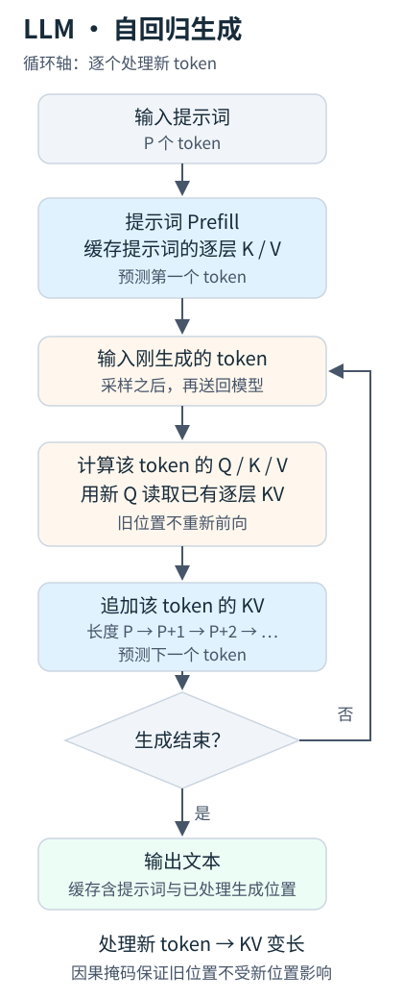
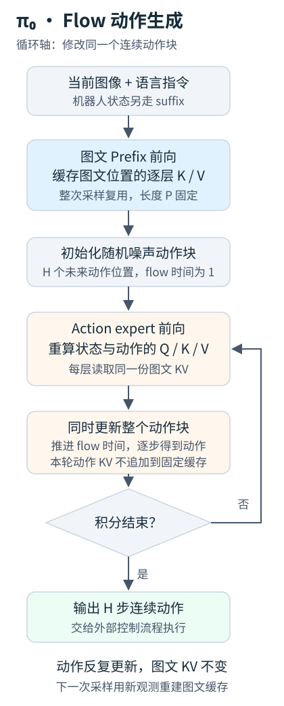

**π₀ 缓存的是图文 token 的 KV，对吗？** 对。具体到 OpenPI 的基础 π₀ 实现，一次动作块采样开始时，模型把当前图像和语言指令送入 Transformer，保存它们在**每一层注意力中产生的 Key 和 Value**。之后的多轮 flow matching 更新，都读取这份固定的图文 KV；当前动作对应的 Q、K、V 则每轮重新计算。

这和 LLM 使用 KV cache 的数学原理相同，但复用的对象、循环的含义和缓存的生命周期不同：**LLM 处理越来越长的已确定 token 前缀；π₀ 则在固定观测下，反复修改同一个连续动作块。**

本文以官方 OpenPI 的 **JAX 基础 π₀ 路径，即 `pi05=False`** 为代码依据，并将链接固定到提交 [`215abfb217db`](https://github.com/Physical-Intelligence/openpi/tree/215abfb217dbac7d5f1273282331b9b1866c0479)。π₀.₅、π₀-FAST 和其他推理后端需要分别检查，不能仅凭模型名字套用本文的缓存范围。

## 先看流程：增长的文本前缀，固定的图文条件

两幅图中的循环分别发生在 **token 生成维度**和 **flow 积分维度**。右侧的一次循环，会同时更新整段动作，不代表机器人向前执行了一步。


<style>
  .kv-cache-flow {
    display: grid;
    grid-template-columns: minmax(0, 1fr);
    gap: 24px;
    margin: 24px 0;
  }
  .kv-cache-flow figure { min-width: 0; margin: 0; }
  .kv-cache-flow img { display: block; width: 100%; max-width: 420px; height: auto; margin: 0 auto; }
  .kv-cache-flow figcaption { margin-top: 8px; text-align: center; font-size: 0.9em; }
  @media (min-width: 640px) {
    .kv-cache-flow { grid-template-columns: repeat(2, minmax(0, 1fr)); }
  }
</style>
<div class="kv-cache-flow" role="group" aria-label="LLM 与 π₀ 的 KV cache 推理流程对比">
  <figure>
    <a href="./llm-kv-flow.svg" aria-label="查看 LLM KV cache 流程原图">
      
    </a>
    <figcaption>LLM：处理新 token，追加 KV。</figcaption>
  </figure>
  <figure>
    <a href="./pi0-kv-flow.svg" aria-label="查看 π₀ KV cache 流程原图">
      
    </a>
    <figcaption>π₀：读取固定 KV，重算动作块。</figcaption>
  </figure>
</div>


*流程图按照 OpenPI 基础 π₀ 的实际缓存边界绘制：图文在 prefix，机器人状态和动作在 suffix。窄屏会将两幅图上下排列；点击可查看原图。*

## KV cache 保存的到底是什么

### 从 token 到每一层的 Key、Value

先把三件不同的东西分开：

| 对象 | 是什么 | 是否就是本文讨论的 KV cache |
| --- | --- | --- |
| 输入 token / embedding | 文本 ID 对应的向量，或图像编码器输出的视觉向量 | 否 |
| Transformer 隐藏状态 | 各层残差流中表示一个位置的向量 | 否 |
| 注意力中的 K、V | 每一层从该层输入投影得到的键和值 | 是 |

设第 \(\ell\) 层输入隐藏状态为 \(H^{(\ell-1)}\)。省略归一化、多头和位置编码，注意力可以写成：

$$
Q^{(\ell)}=H^{(\ell-1)}W_Q^{(\ell)},\qquad
K^{(\ell)}=H^{(\ell-1)}W_K^{(\ell)},\qquad
V^{(\ell)}=H^{(\ell-1)}W_V^{(\ell)}
$$

$$
\operatorname{Attn}(Q,K,V)
=\operatorname{softmax}\!\left(\frac{QK^\top}{\sqrt{d_h}}+M\right)V
$$

\(M\) 是注意力掩码：允许读取的位置加 0，不允许的位置加负无穷。Q 决定“当前位置要查什么”，K 决定“哪些位置与查询匹配”，V 提供最终加权读取的内容。

**缓存不是只保存最后一层。** 第 1 层的动作查询需要第 1 层的图文 KV，第 2 层需要第 2 层的图文 KV，以此类推。如果只留下最后一层图文特征，就无法直接替代这些逐层注意力输入。

还有一个细节：第一层 K、V 来自进入该层的输入表示；更深层的 K、V 来自已经做过前面几层上下文交互的表示。因此，“缓存图文 token 的 KV”指的是**各个图文位置在不同层中的注意力张量**，不能理解成把视觉编码器输出复制一份。

### 为什么缓存 KV，通常不缓存过去的 Q

当模型计算一个新位置的输出时，需要这个位置的 Q，以及所有允许读取位置的 K、V。过去位置的 Q 已经完成了过去位置的查询，通常不会参与当前输出的计算。

同样，在 π₀ 的后续动作更新中，需要的是当前动作的查询，以及可供动作读取的图文 KV。图文自己的 Q 已在前缀前向时使用过，后续无须再次用它计算图文输出。

这里缓存的是**运行时激活**，不是模型参数，也不是 token 的历史注意力权重。当前 Q 变了，\(QK^\top\) 和 softmax 都要重新算，注意力权重并没有固定下来。

## LLM：为什么过去的 KV 可以一直留下来

以普通因果语言模型为例，提示词有 \(P\) 个 token。

1. **Prefill。** 并行处理整个提示词，保存各层提示词 KV，并用最后位置的输出预测第一个新 token \(y_1\)。
2. **Decode。** 将刚生成的 \(y_1\) 送回模型。它产生自己的逐层 Q/K/V，读取提示词的 KV；把自己的 KV 加入缓存，然后预测 \(y_2\)。
3. 重复处理 \(y_2,y_3,\ldots\)，直到结束。

注意这个容易差一拍的顺序：**采样出一个 token，并不意味着它的 KV 已经计算好了。** 它被送回模型处理后，才会有自己的逐层 KV。

为什么不用更新旧 KV？因为因果掩码规定，过去的 token 不能关注后来出现的 token。在固定模型、位置和推理设置下，新增 token 不会改变旧位置的隐藏状态，也就不会改变旧位置的 K、V。

因此，缓存的有效序列长度通常这样增长：

$$
P\;\longrightarrow\;P+1\;\longrightarrow\;P+2\;\longrightarrow\;\cdots
$$

这里说的是逻辑长度。实际系统可能预分配缓存、使用分页或滑动窗口，不一定真的在显存里反复拼接数组。

## π₀：为什么一段动作需要算很多轮

### VLA 不等于自回归动作 token 模型

VLA 指 Vision-Language-Action，即根据视觉、语言等条件生成动作的模型类别；它没有规定动作必须逐 token 生成。

自回归 VLA 可以把动作离散化成 token，再像 LLM 一样生成。π₀ 的基础模型采用另一条路线：**用 flow matching 直接生成连续动作块**。它在预训练 VLM 的基础上加入动作专家，让图文表示为连续动作生成提供条件。[π₀ 论文 §IV](https://arxiv.org/html/2410.24164v1#S4)

设机器人当前时刻是 \(t\)，预测未来 \(H\) 步、每步 \(D_a\) 维动作：

$$
A_t=[a_t,a_{t+1},\ldots,a_{t+H-1}]
\in\mathbb{R}^{H\times D_a}
$$

π₀ 为每个未来动作位置构造一个连续的 action token。这里的 token 指 Transformer 序列里的一个向量位置，**不是必须从文本词表中采样出的离散 ID**。

### 机器人时间与 flow 时间是两根轴

用 \(t\) 表示机器人时间，用 \(\tau\) 表示 flow 时间，用 \(k\) 表示积分迭代次数：

| 维度 | 含义 | 一次采样中如何变化 |
| --- | --- | --- |
| 机器人未来步 \(t+i\) | 动作块里的第 \(i\) 个控制时刻 | 这些位置一起参与每轮计算 |
| 积分轮次 \(k\) / flow 时间 \(\tau_k\) | 当前动作块被更新到了哪个阶段 | 每轮都推进 |

OpenPI 默认动作块长度为 50，采样默认使用 10 次 flow 更新。这表示**用 10 轮更新得到一段 50 步的动作计划**，不表示生成 10 个动作，也不表示每轮只更新其中 5 步。[模型配置](https://github.com/Physical-Intelligence/openpi/blob/215abfb217dbac7d5f1273282331b9b1866c0479/src/openpi/models/pi0_config.py#L19) · [采样默认值](https://github.com/Physical-Intelligence/openpi/blob/215abfb217dbac7d5f1273282331b9b1866c0479/src/openpi/models/pi0.py#L217)

本文采用 OpenPI 代码的时间约定：\(\tau=1\) 是噪声，\(\tau=0\) 是最终动作，积分步长为负。它与原论文的时间方向相反，阅读两者时要区分。

$$
X^{(0)}\sim\mathcal{N}(0,I),\qquad
\tau_0=1,\qquad \Delta\tau=-\frac{1}{N}
$$

$$
X^{(k+1)}=X^{(k)}+\Delta\tau\,
v_\theta\!\left(X^{(k)},\tau_k;I_t,c,s_t\right)
$$

其中 \(I_t\) 是当前相机图像，\(c\) 是指令，\(s_t\) 是机器人状态。**这三个条件在一次动作块采样中固定，动作块 \(X^{(k)}\) 和 flow 时间 \(\tau_k\) 每轮改变。** 最后才把预测动作交给执行流程；执行多少步再重新观测，由外部控制循环决定。[OpenPI 采样实现及时间约定](https://github.com/Physical-Intelligence/openpi/blob/215abfb217dbac7d5f1273282331b9b1866c0479/src/openpi/models/pi0.py#L225)

## 为什么固定图文能缓存：关键在注意力掩码

“图像没变”只是必要背景。更关键的是：**图文表示也不能被不断变化的动作反向影响。** 如果图文 token 可以读取当前噪声动作，那么即使原始图像和文字没变，图文的深层隐藏状态也会随动作变化，旧 KV 就不再有效。

π₀ 使用三个块的注意力结构。行是发出 Q 的位置，列是提供 K、V 的位置：

| 查询方 \ 被读取方 | 图像与语言 \(P\) | 机器人状态 \(S\) | 当前动作块 \(A\) |
| --- | :---: | :---: | :---: |
| 图像与语言 \(P\) | 允许 | 禁止 | 禁止 |
| 机器人状态 \(S\) | 允许 | 允许 | 禁止 |
| 当前动作块 \(A\) | 允许 | 允许 | 允许 |

同一块内允许双向关注，块之间只允许读取自己及前面的块。具体而言：

- 图像、语言 token 之间可以相互关注，但看不到状态或动作。
- 状态可以读取图文，但看不到动作。
- 每个动作位置可以读取图文、状态，以及动作块中其他所有动作位置。

这也是为什么未来第 10 步动作可以与未来第 20 步动作相互协调：**动作块内部不是逐位置因果生成。** [论文附录 A-B 的 attention mask](https://arxiv.org/html/2410.24164v1#A1.SS2) · [OpenPI 掩码构造](https://github.com/Physical-Intelligence/openpi/blob/215abfb217dbac7d5f1273282331b9b1866c0479/src/openpi/models/pi0.py#L140)

从层与层的依赖关系看，缓存为什么有效可以逐层推出：

1. 当前采样的图文输入固定。
2. 第一层图文位置只读取图文位置，所以图文输出与当前动作无关。
3. 第二层接收的图文隐藏状态因此也固定，第二层图文 KV 可以复用。
4. 同样的关系在所有层成立。

**精确缓存复用要求被缓存位置的计算依赖保持不变。** LLM 靠因果掩码满足这一点；π₀ 靠分块注意力掩码满足这一点。固定的模型参数、位置编号和推理设置也是前提。

## action expert 每轮怎样使用这份 KV

### 不同专家的投影参数可以不同

π₀ 的图文位置走 VLM 那套权重；状态、动作位置走动作专家的权重。可以把它理解成同一个 Transformer 层里，不同类型的位置使用不同的投影和前馈网络，但在注意力中交换信息。

因此，动作专家并不是把“最后一层图文特征”当成普通输入再编码一遍。它在**每一层**读取该层缓存的图文 KV。两套专家的隐藏宽度可以不同，但注意力头的维度等配置必须兼容，才能执行 Q 与 K 的匹配。OpenPI 在 `Attention` 中显式检查这些条件。[专家投影及维度检查](https://github.com/Physical-Intelligence/openpi/blob/215abfb217dbac7d5f1273282331b9b1866c0479/src/openpi/models/gemma.py#L157)

对第 \(\ell\) 层、第 \(k\) 次更新，记 \(R=[S;A]\) 为状态与动作 suffix，忽略多头布局后：

$$
Q=Q_R^{(\ell,k)},\qquad
K=[K_P^{(\ell)};K_R^{(\ell,k)}],\qquad
V=[V_P^{(\ell)};V_R^{(\ell,k)}]
$$

\(K_P^{(\ell)},V_P^{(\ell)}\) 来自缓存；suffix 的 Q/K/V 来自本轮前向。状态行仍通过掩码禁止读取动作，动作行则可以读取整个序列。

这里表现得很像“动作查询图文记忆”，但实现上是**分块掩码下共享的注意力计算**，不必另设一个独立的 cross-attention 模块。[KV 拼接与注意力计算](https://github.com/Physical-Intelligence/openpi/blob/215abfb217dbac7d5f1273282331b9b1866c0479/src/openpi/models/gemma.py#L201)

### 动作 KV 为什么不能直接留到下一轮

每轮动作输入 \(X^{(k)}\) 改变，flow 时间也改变。OpenPI 基础 π₀ 把时间编码和动作表示一起送入 MLP，生成动作位置的输入。因此，即使某一轮动作数值变化很小，也不能假定下一轮对应的隐藏状态和 KV 完全相同。

如果直接复用上一轮动作 KV，当前动作的 Q 就会读取上一轮动作的 K、V，得到的已不是原本定义的完整前向。这可以被研究成一种近似加速方法，但不属于这里的精确前缀缓存。

**每轮需要的都是“同一份图文 KV + 本轮状态与动作 KV”。** 不能把历轮动作 KV 不断追加，让本轮读取第 1 轮、第 2 轮、第 3 轮动作的混合历史。

## 对照 OpenPI：缓存在哪里创建，在哪里复用

### 第一步：`embed_prefix()` 只构造图文前缀

`embed_prefix()` 依次将多路相机图像编码成视觉 token，再把指令映射成语言 embedding，并沿序列维度拼接。它为图文位置设置相同的注意力块，因此图文前缀内部是双向注意力。

基础 π₀ 的机器人状态不在这里，而在 `embed_suffix()` 中被映射成单个状态 token，放在动作位置之前。[图文前缀](https://github.com/Physical-Intelligence/openpi/blob/215abfb217dbac7d5f1273282331b9b1866c0479/src/openpi/models/pi0.py#L99) · [状态与动作 suffix](https://github.com/Physical-Intelligence/openpi/blob/215abfb217dbac7d5f1273282331b9b1866c0479/src/openpi/models/pi0.py#L140)

### 第二步：在积分循环外做一次 prefix 前向

下面摘出 `sample_actions()` 的前缀计算，省略前面的预处理和噪声初始化：

```python
prefix_tokens, prefix_mask, prefix_ar_mask = self.embed_prefix(observation)
prefix_attn_mask = make_attn_mask(prefix_mask, prefix_ar_mask)
positions = jnp.cumsum(prefix_mask, axis=1) - 1

_, kv_cache = self.PaliGemma.llm(
    [prefix_tokens, None],
    mask=prefix_attn_mask,
    positions=positions,
)
```

`[prefix_tokens, None]` 表示本次只计算图文分支，不计算动作专家分支。返回的 `kv_cache` 包含所有 Transformer 层的图文 K、V。

### 第三步：循环内只计算 suffix，反复传入原缓存

每轮用当前 `x_t` 和 `time` 构造状态、动作 suffix，再计算 suffix 的输出。省略掩码和位置编号的构造后，关键调用为：

```python
(prefix_out, suffix_out), _ = self.PaliGemma.llm(
    [None, suffix_tokens],
    mask=full_attn_mask,
    positions=positions,
    kv_cache=kv_cache,
    adarms_cond=[None, adarms_cond],
)
v_t = self.action_out_proj(suffix_out[:, -self.action_horizon :])
return x_t + dt * v_t, time + dt
```

`[None, suffix_tokens]` 表示不重新计算图文位置。`suffix_out` 的最后 \(H\) 个位置对应整个动作块的更新方向，而不是文本词表上的概率分布。[完整采样循环](https://github.com/Physical-Intelligence/openpi/blob/215abfb217dbac7d5f1273282331b9b1866c0479/src/openpi/models/pi0.py#L233)

尤其值得看返回值里的 `_`：底层注意力会把缓存 KV 和本轮 suffix KV 拼起来，并返回组合后的 KV；**采样循环没有把这份返回缓存保存为下一轮的缓存**。下一轮继续传入循环外最初那份图文 KV。这从代码上避免了“把多轮动作历史越攒越长”的误读。

### 论文说状态也能缓存，为什么这里没有

从前面的掩码表可见，状态只读取固定图文和状态自身，不读取动作。在基础 π₀ 中，状态表示也没有注入变化的 flow 时间。所以，它的逐层 KV 在一次采样内同样具备复用条件。论文附录正是以此解释为什么把状态单独放成一个块。

但**结构上允许缓存，不等于当前代码一定缓存了它**：本文固定版本的 JAX 实现，把状态放在 suffix 中，每轮与动作一起前向；实际持久复用的 `kv_cache` 只有图文部分。若要进一步缓存状态，需要让它在相应层通过动作专家计算，并正确处理位置和掩码，不能简单将原始状态 embedding 塞进图文 KV。

| 内容 | 一次采样内是否固定 | 当前基础 π₀ JAX 实现是否纳入复用缓存 |
| --- | :---: | :---: |
| 图像、语言位置的逐层 KV | 是 | 是 |
| 机器人状态位置的逐层 KV | 是 | 否，放在 suffix 中重算 |
| 动作位置的逐层 KV | 否 | 否 |

## 缓存的形状与生命周期

### 存多少：看 KV 头数，不是只看隐藏宽度

OpenPI 的 `KVCache` 是一对按层堆叠的 K、V 张量，每个张量的布局可以写成：

$$
[L,B,P,n_{kv},d_h]
$$

分别表示层数、batch size、图文前缀长度、KV 头数、每个头的维度。在使用 RoPE 的实现中，缓存 K 还包含对应位置的旋转变换，复用时也必须保持位置语义一致。[缓存类型](https://github.com/Physical-Intelligence/openpi/blob/215abfb217dbac7d5f1273282331b9b1866c0479/src/openpi/models/gemma.py#L336) · [RoPE 与缓存拼接顺序](https://github.com/Physical-Intelligence/openpi/blob/215abfb217dbac7d5f1273282331b9b1866c0479/src/openpi/models/gemma.py#L201)

若每个元素占 \(b\) 字节，K 和 V 的元素宽度相同，缓存数据本身约占：

$$
\text{bytes}=2LBPn_{kv}d_hb
$$

例如，仅作算量示例，取 \(L=18,B=1,P=800,n_{kv}=1,d_h=256,b=2\)，得到约 **14.1 MiB**。这不包括模型参数、当前 suffix、注意力中间张量和运行时缓冲区，也不是所有 π₀ 配置的固定显存开销。

这解释了一个常见疑问：即使模型隐藏宽度很大，采用 MQA/GQA 后，缓存大小也不能直接按“隐藏宽度 × 注意力查询头数”来推。应使用实际的 KV 头数和 head dimension。

### 用多久：主要跨本次 flow 更新复用

图文 KV 在一次 `sample_actions()` 内保持不变。下一次输入新观测时，该实现重新编码图像并构建前缀缓存，默认没有跨策略调用保留上一份缓存。

即使任务指令仍是“把杯子放到盘子上”，也不能直接认为语言部分的所有深层 KV 都能留下来：π₀ 的图文前缀内部允许双向关注，新图像会改变语言位置的深层表示。**文字相同，不等于带视觉上下文的逐层 KV 相同。**

同理，这份缓存不自动代表机器人过去几秒的长期记忆。它首先是当前观测条件的一次精确计算结果。跨帧复用、历史记忆或近似特征缓存，都需要额外的架构或推理策略。

## 节省了什么，还有哪些计算没省掉

用一个粗略的成本拆分说明：设图文前缀前向成本为 \(C_P\)，每次 suffix 更新成本为 \(C_R\)，积分 \(N\) 轮。不使用缓存、每轮都完整计算图文和 suffix 时，成本约为：

$$
C_{\text{no cache}}\approx N(C_P+C_R)
$$

缓存后约为：

$$
C_{\text{cache}}\approx C_P+NC_R
$$

这只是解释复用收益的简化模型，省略了缓存读写、视觉编码器是否单独复用等因素。它不表示使用 10 轮积分就必然快 10 倍。

被省掉的是重复的**图文 Transformer 前向**，包括其逐层表示、Q/K/V、注意力和前馈计算。图像编码器也可以在本次采样开始时运行一次。仍然需要计算的是：

- 每轮状态、动作 suffix 的前向和动作输出投影。
- 当前 suffix Q 与缓存图文 K 的匹配，以及对缓存 V 的加权读取。
- 动作块内部的双向注意力，以及状态相关的合法注意力。

若忽略固定的头数和维度因素，suffix 到图文的注意力仍有约 \(O((H+1)P)\) 的计算，suffix 内部还有约 \(O((H+1)^2)\) 的部分。**缓存让图文不用重新编码，但动作读取图文的成本仍然存在。**

训练也应单独看：该实现的 `compute_loss()` 为样本采一个 flow 时间，将 prefix 和 suffix 一起前向，然后回传梯度；它没有沿用推理时“缓存后跑多轮积分”的流程。若训练期间更新了模型参数，旧参数计算出的 KV 更不能跨优化步骤直接复用。[训练前向](https://github.com/Physical-Intelligence/openpi/blob/215abfb217dbac7d5f1273282331b9b1866c0479/src/openpi/models/pi0.py#L185)

## 把 LLM 与 π₀ 放在同一张表里

| 对比项 | 普通自回归 LLM | OpenPI 基础 π₀ |
| --- | --- | --- |
| 每轮正在处理什么 | 一个刚生成的新 token | 当前的整个连续动作块及状态 suffix |
| 反复读取什么 | 提示词和已处理生成 token 的逐层 KV | 固定图文前缀的逐层 KV |
| 复用为什么成立 | 旧位置看不到后来新增的位置 | 图文位置看不到变化的动作位置 |
| 缓存逻辑长度 | 随已处理 token 增长 | 在本次动作采样中固定 |
| 本轮输出能否成为下一轮的固定 KV | 新 token 被处理后可以追加 | 动作还会被修改，不能原样留下 |
| 动作 / 输出位置间的依赖 | 逐 token 因果生成 | 动作块内部双向注意力 |
| 循环终止条件 | 结束符或生成长度上限 | 完成 flow 积分 |
| 新图像到来后 | 取决于具体多模态架构与上下文策略 | 下一次采样重新构建前缀缓存 |

读 π₀ 的代码时，可以沿这三个问题检查自己的理解：**哪些位置的依赖不变？它们在哪一层生成 KV？循环下一轮传回去的究竟是哪份缓存？** 对本文的基础实现，答案分别是固定的图文前缀、每一层注意力，以及循环外生成的原始图文 KV。

## 参考资料

- [π₀ 原论文：A Vision-Language-Action Flow Model for General Robot Control](https://arxiv.org/abs/2410.24164)，重点看 §IV、附录 A-B 和 A-D。
- [OpenPI `pi0.py`：输入分块、注意力掩码、训练与采样](https://github.com/Physical-Intelligence/openpi/blob/215abfb217dbac7d5f1273282331b9b1866c0479/src/openpi/models/pi0.py)。
- [OpenPI `gemma.py`：专家投影、RoPE、KV 拼接与逐层缓存](https://github.com/Physical-Intelligence/openpi/blob/215abfb217dbac7d5f1273282331b9b1866c0479/src/openpi/models/gemma.py)。
- [OpenPI `pi0_config.py`：基础 π₀ 与 π₀.₅ 配置边界](https://github.com/Physical-Intelligence/openpi/blob/215abfb217dbac7d5f1273282331b9b1866c0479/src/openpi/models/pi0_config.py)。
