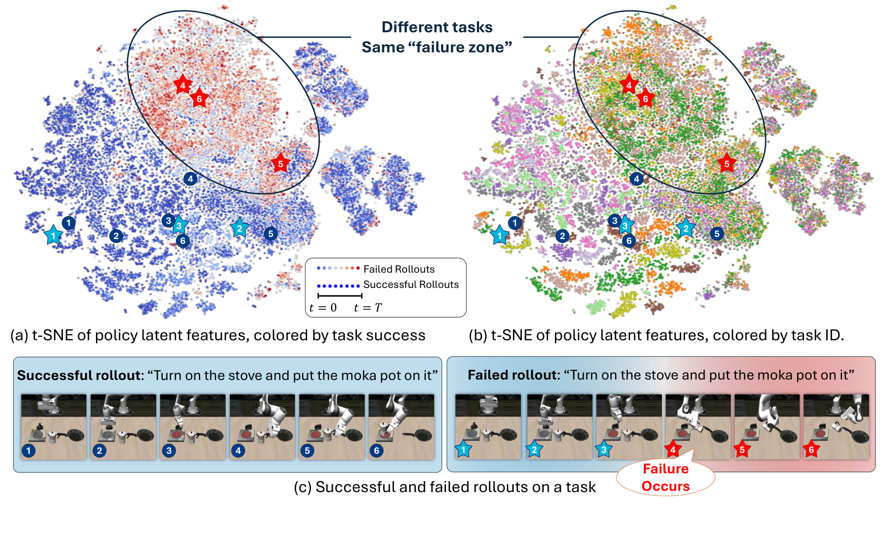
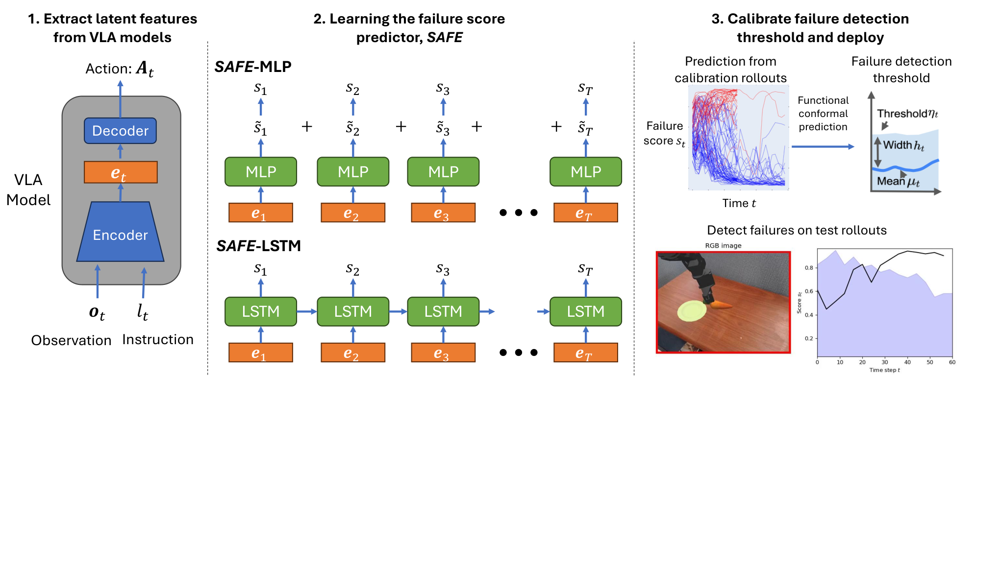
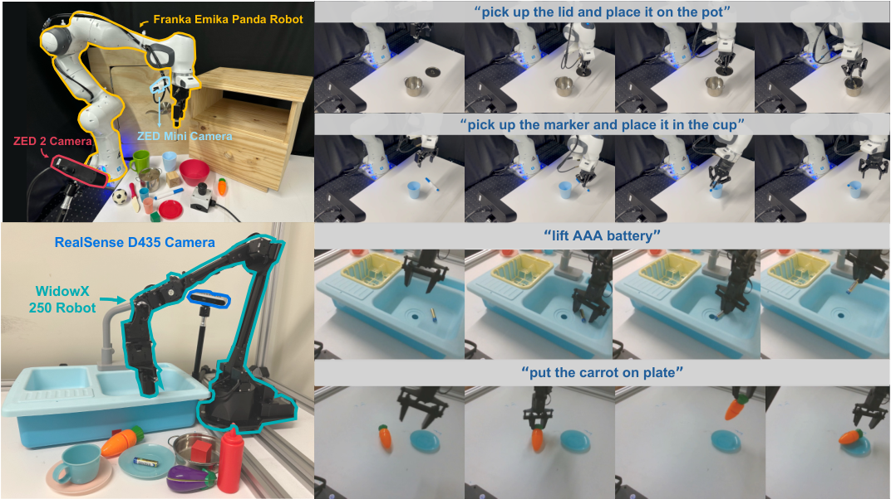
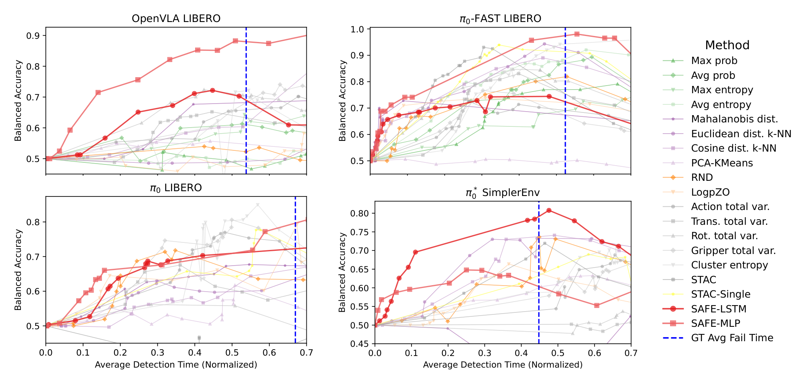
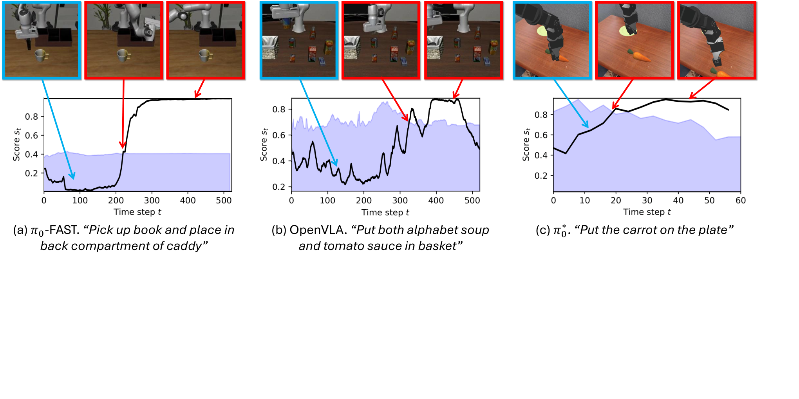
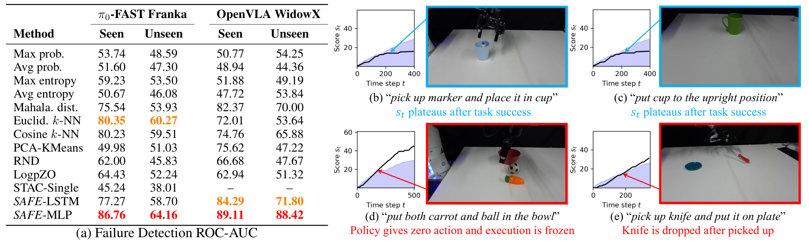

机器人抓起摩卡壶，半路掉了壶，机械臂却还在执行放置动作。**如果这局还没结束，能不能从 VLA 自己的内部状态发现异常，及时提醒上层控制程序介入？** Qiao Gu 等人在 NeurIPS 2025 的论文 *SAFE: Multitask Failure Detection for Vision-Language-Action Models* 中，用 VLA 每轮推理留下的隐藏向量训练一个小型打分器，并用成功轨迹校准报警阈值。整篇论文的关键检验是，把一个任务整体从检测器的训练集中留出，SAFE 还能否识别这个任务的失败。 [论文原文](https://arxiv.org/html/2506.09937v2) · [NeurIPS 正式发表页](https://proceedings.neurips.cc/paper_files/paper/2025/hash/392d0d05e2f514063e6ce6f8b370834c-Abstract-Conference.html) · [官方代码](https://github.com/vla-safe/SAFE)

## 前置知识｜π₀-FAST 怎样生成动作块

以论文用到的 `pi0_fast_libero` 为例。**一次策略调用规划未来 10 个控制步，每步 7 个控制量**，所以返回的动作形状是 `[10, 7]`。LIBERO 示例默认把前 5 行放进队列，一行一行执行。队列清空后，程序读取新的相机画面和机器人状态，再调用策略。每局第一次调用是初始规划，后续才是重规划。下文统一按策略调用次数计数。 [模型配置](https://github.com/vla-safe/openpi/blob/main/src/openpi/training/config.py#L475) · [控制循环](https://github.com/vla-safe/openpi/blob/main/examples/libero/main.py#L140)

| 一次策略调用 | 输入 | 处理和输出 |
| --- | --- | --- |
| 构造前缀 | 相机图像、机器人状态、任务指令 | SigLIP 编码图像。指令与离散化后的机器人状态一起转成文本 token。两路向量拼成 `[S, 2048]` 的前缀，`S` 是前缀位置数。 |
| 自回归生成 | 前缀及已生成的 token | PaliGemma 先处理前缀并建立 KV cache，再逐个预测下一个 token。词表投影前的隐藏向量是 `2048` 维。 |
| FAST 解码 | 生成序列里的动作 token | 解开 BPE 压缩，恢复量化后的频率系数，再沿时间轴做逆离散余弦变换。经反归一化和输出变换，得到 `[10, 7]` 的环境动作。 |

训练时，π₀-FAST 要学会根据当前观测，生成由**未来整段示范动作**编码出的 token。可以把 `[10, 7]` 看成 7 条各有 10 个采样点的控制曲线，FAST token 压缩的是这些曲线的频率系数。仓库样例中，**17 个输出 token** 解码为 **10 个控制步**，同时留下 `[17, 2048]` 的隐藏状态。这里有三个不同的数：生成 17 个 token、规划 10 步、实际先执行 5 步。**SAFE 按整个策略调用来打分，这一次调用对应一个分数。** [FAST 论文 §V](https://arxiv.org/html/2501.09747v1#S5) · [π₀-FAST 推理](https://github.com/vla-safe/openpi/blob/main/src/openpi/models/pi0_fast.py#L230) · [记录样例](https://github.com/vla-safe/SAFE/blob/main/failure_prob/data/pizero_fast.py#L94)

## 1 引言｜为什么要监控执行过程

一局结束后，任务成败已经确定。运行过程中，控制程序还要回答另一个问题：现在是否值得暂停或请人接管？掉壶后的放置动作可能看上去流畅，但已经无法达到当初的目的。通用 VLA 又会遇到各种任务，如果每换一个任务都要重新收集轨迹、训练和校准检测器，部署成本就会随任务数增长。SAFE 想在几个任务上学到共通的失败信号，再用于新的任务。 [论文 §1](https://arxiv.org/html/2506.09937v2#S1)

## 2 相关工作｜已有方法从哪里找失败信号

分布偏移检测常把成功经验当作参考，当前执行离参考越远就越可疑。对于通用策略，机器人做对一个陌生任务时，特征也可能偏离训练数据。另一些方法用动作 token 的熵，或用多次采样得到的动作差异来度量不确定性。后者会增加推理开销。SAFE 采用有监督的路线，复用 VLA 正常推理已经计算出的内部特征，用实际成败学习哪些变化和任务失败有关。 [论文 §2](https://arxiv.org/html/2506.09937v2#S2)

## 3 问题定义｜一局轨迹与任务划分

**一局（rollout）是机器人从初始状态出发，对一个任务做的一次完整尝试。** 一局调用 VLA 共 `T` 次，就有 `T` 个特征向量和 `T` 个失败分数。第 `t` 个分数只依赖截至本次调用的特征。训练只需要一局最终成功还是失败，一个标签监督这局的所有有效时间步。 [论文 §3](https://arxiv.org/html/2506.09937v2#S3)

| 划分 | LIBERO-10 示例 | 用途 |
| --- | --- | --- |
| `train` | 7 个已见任务，各取约 60% 的轨迹 | 用成功和失败轨迹训练 SAFE。 |
| `val_seen` | 同样 7 个任务，各自剩余约 40% 的轨迹 | 验证和选配置。其中成功轨迹用来校准报警阈值。 |
| `val_unseen` | 另外 3 个完整任务的轨迹 | 检验 SAFE 换到新任务后的表现。 |

「未见」以 **SAFE 的训练集**为准。底层 VLA 使用已有检查点收集轨迹。即使 VLA 曾在 LIBERO 上微调，仍然可以把某个任务整体留出，用来检验检测器对该任务的泛化。 [论文附录 B.5](https://arxiv.org/html/2506.09937v2#A2.SS5) · [划分代码](https://github.com/vla-safe/SAFE/blob/main/failure_prob/data/utils.py#L140)

## 4 方法｜从隐藏特征到报警

### 4.1 图 1 里的失败区域

*图 1 · π₀-FAST 在 LIBERO-10 上的隐藏特征。圆点和星号将相机帧与散点图中的位置对应起来。* [原图与图注](https://arxiv.org/html/2506.09937v2#S2.F1)

从 **(c)** 下方失败那局的星号 `3 → 4` 开始读。机器人在这段过程中掉了壶。回到 **(a)**，星号 3 在圈外，4 已经进入圈内。左图的蓝色有两种来源，成功轨迹全程为蓝色，最终失败的轨迹按时间从蓝渐变到红。**(b)** 保持相同的点和位置，换成按任务 ID 着色。圈里混有多种颜色，提示不同任务的失败后段可能共享一些特征。 [论文 §4.1](https://arxiv.org/html/2506.09937v2#S4.SS1)

t-SNE 尽量在二维图里保留高维向量的近邻关系。图 1 用来提出假设，留出任务实验检验这些特征能否支持跨任务检测。SAFE 的打分器直接读取高维特征。 [论文 §4.2](https://arxiv.org/html/2506.09937v2#S4.SS2)

### 4.2 图 2 里的两种打分器

*图 2 · 从左往右看，每次策略调用提取一个向量，任选一种打分器得到分数，再用校准好的阈值判断是否报警。* [原图与图注](https://arxiv.org/html/2506.09937v2#S4.F2)

**先把一次策略调用的特征压成一个向量。** π₀-FAST 的 `pre_logits` 样例为 `[17, 2048]`，沿生成 token 取平均得到 `[2048]`。标准 π₀ 用 flow matching 生成动作。它每次调用默认做 10 次欧拉更新，仓库样例保存速度场投影之前的 action expert 隐藏状态 `pre_velocity`，形状是 `[10, 50, 1024]`。如果沿 50 个未来动作位置和 10 次积分都取平均，就得到 `[1024]`。二者都在**一次策略调用结束后更新一个分数**。论文也比较了取首步、末步与拼接等聚合方式。 [论文附录 B.1](https://arxiv.org/html/2506.09937v2#A2.SS1) · [π₀-FAST 特征加载](https://github.com/vla-safe/SAFE/blob/main/failure_prob/data/pizero_fast.py#L146) · [标准 π₀ 特征加载](https://github.com/vla-safe/SAFE/blob/main/failure_prob/data/pizero.py#L69)

一局有 `T` 次调用，每次得到 `D` 维向量，按顺序堆起来是 `[T, D]`。批量训练时，较短的轨迹补齐并用 mask 标记有效步，模型输入是 `[B, T, D]`，两个版本都输出 `[B, T, 1]`。 [批量数据](https://github.com/vla-safe/SAFE/blob/main/failure_prob/data/utils.py#L182)

| 打分器 | 默认结构 | 怎样利用历史 |
| --- | --- | --- |
| SAFE-MLP | 每步独立经过 `D → 256 → 1`，中间用 ReLU，最后用 sigmoid，再沿 `T` 维累加。 | 如果三步各贡献 `0.12、0.30、0.07`，累计分数就是 `0.12、0.42、0.49`。 |
| SAFE-LSTM | 单层 LSTM 先产生 `[B, T, 256]` 的隐藏状态序列，再对每步用 `256 → 1` 的线性层与 sigmoid 打分。 | 每轮更新记忆，可以学习「先夹住壶、后来空了」与「先空着、后来夹住壶」的差异。 |

两种打分器分别训练。MLP 压低成功轨迹的累计分数、推高失败轨迹的累计分数，LSTM 使用逐步二元交叉熵。**分数越高，表示模型认为这局的失败迹象越强**。是否需要报警，还要看这一轮的正常分数能高到哪里。 [论文 §4.2](https://arxiv.org/html/2506.09937v2#S4.SS2) · [MLP 代码](https://github.com/vla-safe/SAFE/blob/main/failure_prob/model/indep.py#L49) · [LSTM 代码](https://github.com/vla-safe/SAFE/blob/main/failure_prob/model/lstm.py#L75)

### 4.3 用成功轨迹校准阈值曲线

**阈值曲线就是按策略调用次数排列的报警线。** 成功轨迹在初始规划时和执行后段的正常分数可能不同，SAFE-MLP 甚至会在正常执行中持续累加。训练完打分器后，作者对 `val_seen` 的成功轨迹跑一次 SAFE。仓库把来自不同已见任务的成功轨迹混在一起，按整局随机分成两组，约 30% 估计正常中心和波动，约 70% 决定报警线离中心多远。 [论文 §4.3](https://arxiv.org/html/2506.09937v2#S4.SS3) · [校准代码](https://github.com/vla-safe/SAFE/blob/main/failure_prob/utils/metrics.py#L530)

用 10 条假想的成功轨迹和 3 次策略调用来算一遍。**第一组 3 局，按列估计正常范围。** 第一列是每局第一次调用 VLA 的分数，也就是初始规划时的分数。这个小样本例子中，波动尺度取本列分数离平均值的最大距离。

| 成功轨迹 | 第 1 次 | 第 2 次 | 第 3 次 |
| --- | ---: | ---: | ---: |
| A | 0.05 | 0.10 | 0.25 |
| B | 0.10 | 0.20 | 0.35 |
| C | 0.15 | 0.30 | 0.45 |
| 正常中心 | **0.10** | **0.20** | **0.35** |
| 波动尺度 | **0.05** | **0.10** | **0.10** |

**第二组 7 局，按行找最大的标准化向上偏差。** 例如某局分数为 `0.10、0.35、0.40`。每轮先减去本轮的正常中心，再除以本轮的波动尺度，得到 `0、1.5、0.5`。这局只记最大值 `1.5`，因为成功轨迹**只要有一轮越线，整局就算误报**。若七局的最大偏差排好序是 `0.5、1.0、1.2、1.5、2.0、2.0、3.0`，取 α = 0.20，仓库计算 80% 分位数，得到余量系数 `q = 2.0`。 [共形预测带实现](https://github.com/vla-safe/SAFE/blob/main/failure_prob/utils/conformal/functional_predictor.py#L131)

$$
\delta_t = \mu_t + q\,m_t
$$

这里的 `μ_t` 是第 `t` 轮的正常中心，`m_t` 是这一轮的波动尺度。**三轮共用同一个 `q`，各自的中心和波动决定阈值高低。**

| 比较 | 第 1 次 | 第 2 次 | 第 3 次 |
| --- | ---: | ---: | ---: |
| 阈值（中心 + 2 倍波动） | 0.20 | 0.40 | 0.55 |
| 新轨迹的 SAFE 分数 | 0.12 | **0.42** | 0.49 |

新的一局在第 2 次报警，因为 `0.42 > 0.40`。第 3 次分数更高，但这一轮的报警线也更高。阈值曲线在测试前已经算好，之后按当前调用次数查表，换一局测试的第 2 次也使用 `0.40`。

共形预测讨论的是**一整条成功轨迹至少误报一次**的概率。理论覆盖需要校准与测试成功轨迹满足可交换性。这项实验在已见任务校准、未见任务测试，任务变化可能改变分数分布，所以要在未见任务上单独检查实际误报率。 [论文 §4.3](https://arxiv.org/html/2506.09937v2#S4.SS3) · [附录 C.2](https://arxiv.org/html/2506.09937v2#A3.SS2)

## 5 实验｜基准、对照和指标

*图 3 · 真机实验设置。上方是 π₀-FAST + Franka，下方是 OpenVLA + WidowX。右侧展示两套装置的操作过程。* [原图与图注](https://arxiv.org/html/2506.09937v2#S5.F3)

仿真包含 OpenVLA、π₀-FAST、π₀ 在 LIBERO-10 的实验，以及复现版 π₀* 在 SimplerEnv 的实验。对照方法用 token 不确定性、成功与失败特征的距离，或者 STAC 等动作一致性指标来打分。作者用两套指标分别看**分数能否区分成败**和**设定阈值后报警是否可用**。 [论文 §5](https://arxiv.org/html/2506.09937v2#S5)

| 问题 | 测量方式 |
| --- | --- |
| 分数能不能把失败排在成功前面？ | 每局取观察窗口内的最高分，计算 ROC-AUC。LIBERO 对同一任务用最短轨迹长度作为共同截止点，减少成功提前结束、失败跑到超时带来的时长差异。 |
| 给定阈值，是否报得准、报得早？ | 平衡准确率等于失败检出率和成功不误报率的平均。报警时间取首次越线的相对位置，漏报的失败轨迹按 `1` 计入平均。 |

[论文 §5.4](https://arxiv.org/html/2506.09937v2#S5.SS4) · [附录 B.5](https://arxiv.org/html/2506.09937v2#A2.SS5)

## 6 结果｜排序表现、报警时机与运行成本

### 6.1 表 1 的跨任务排序结果

| 方法 | 四组仿真未见任务的平均 ROC-AUC（0–100） |
| --- | ---: |
| SAFE-MLP | **78.00** |
| SAFE-LSTM | 77.04 |
| 余弦距离 k-NN（最高的基线平均分） | 73.93 |

优势体现在四组仿真的平均结果上。单看 π₀-FAST + LIBERO 的未见任务，STAC 得到 **85.31**，同列的 SAFE-LSTM 和 SAFE-MLP 分别是 **84.48** 和 **80.44**。STAC 那一行每次推理采样 10 个动作，SAFE 复用一次动作生成的隐藏状态。这个结果需要结合推理成本一起读。 [论文表 1](https://arxiv.org/html/2506.09937v2#S4.T1) · [论文 §6.1](https://arxiv.org/html/2506.09937v2#S6.SS1)

### 6.2 图 4 的准确率与时间

*图 4 · 各曲线上的点对应不同的共形显著性水平。横轴越往左越早，纵轴越高越准，蓝色虚线是人工标注的平均失败或应介入时刻。* [放大图 4](./paper-figure-4.png) · [原图与图注](https://arxiv.org/html/2506.09937v2#S5.F4)

例如看左上的 OpenVLA + LIBERO，红色 SAFE 曲线在较早的报警时间就能取得较高的平衡准确率。判断一个方法是否更好，要看它能不能在**相近的报警时间判得更准**，或在**相近的准确率下报得更早**。作者报告 SAFE 在 OpenVLA + LIBERO 与 π₀* + SimplerEnv 的取舍较好，在另两组仿真中与强基线相当。 [论文 §6.2](https://arxiv.org/html/2506.09937v2#S6.SS2)

### 6.3 图 5 和图 6 里的报警实例

*图 5 · 黑线是 SAFE-LSTM 的分数，蓝带上沿是阈值。第一次越线的位置与相机画面对应。* [原图与图注](https://arxiv.org/html/2506.09937v2#S5.F5)

(a) 是 π₀-FAST 插入位置偏了，之后动作不稳定。(b) 和 (c) 里的 OpenVLA 与 π₀* 抓空后仍在执行放置动作。看这些例子时，先找黑线第一次超过蓝带上沿的位置，再读相机帧，确认当时发生了什么。 [论文 §6.3](https://arxiv.org/html/2506.09937v2#S6.SS3)

*图 6 · (a) 是真机 ROC-AUC。(b)、(c) 完成任务后分数趋平。(d) 的策略停止运动，(e) 的物体从夹爪掉落，SAFE 在执行过程中报警。* [放大图 6](./paper-figure-6.png) · [原图与图注](https://arxiv.org/html/2506.09937v2#S6.F6)

SAFE-MLP 在两套真机设置的未见任务上分别取得 **64.16**（π₀-FAST + Franka）和 **88.42**（OpenVLA + WidowX）。两套设置的表现差异很大。右下角的例子也说明，「具体失误发生」「SAFE 报警」和「整局最终判失败」可以是不同的时刻。物体已经掉落，报警依然可以早于任务结束。 [论文 §6.1–6.3](https://arxiv.org/html/2506.09937v2#S6)

### 6.4 运行成本与接入条件

论文报告的一个例子中，SAFE-LSTM 额外推理约 **0.73 ms**，而 π₀ 推理约 **149 ms**。接入 SAFE 需要读取 VLA 内部特征，并先采集该策略的成败轨迹来训练。在实际控制循环中，报警可以交给上层程序决定是否暂停、重新观察或请求接管。 [论文 §6.4](https://arxiv.org/html/2506.09937v2#S6.SS4)

## 7 结论｜这项工作验证到了哪一步

论文用任务级留出测试验证了，**VLA 正常推理留下的内部特征可以提供跨任务的失败信号**。实际使用时仍要分别检验两件事：换到新任务后，失败能否排到更高分，以及沿用已见任务的阈值后，误报率是否还能维持在预期范围。跨机器人本体、仿真到真机直接迁移，以及融合不同层的隐藏特征，仍是论文留下的问题。 [论文 §7](https://arxiv.org/html/2506.09937v2#S7) · [附录 C.2](https://arxiv.org/html/2506.09937v2#A3.SS2)
