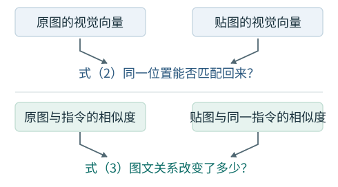
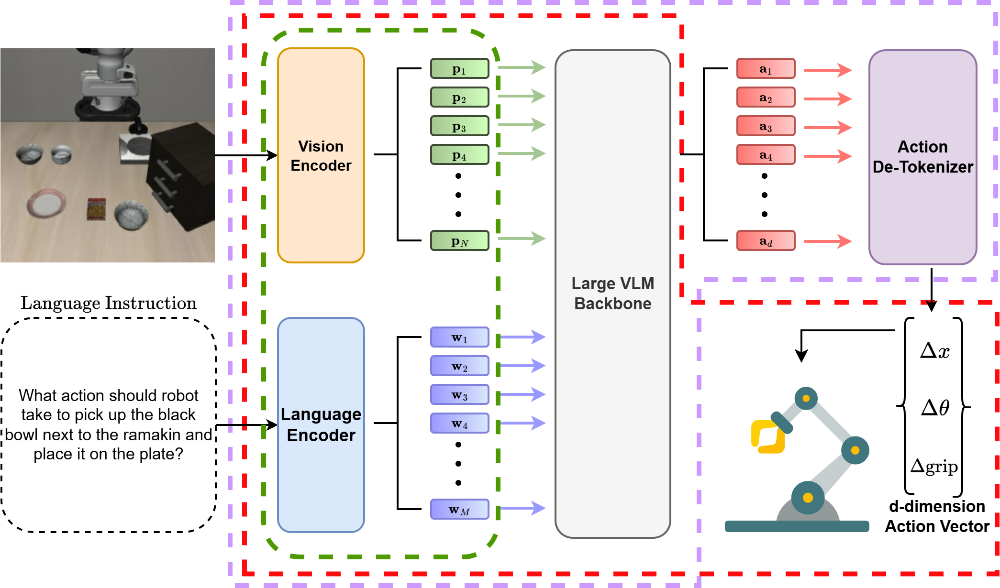
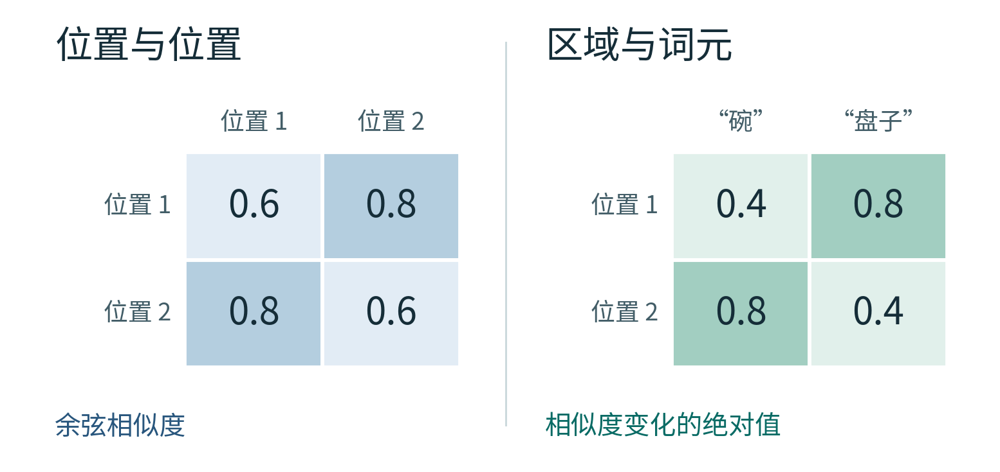
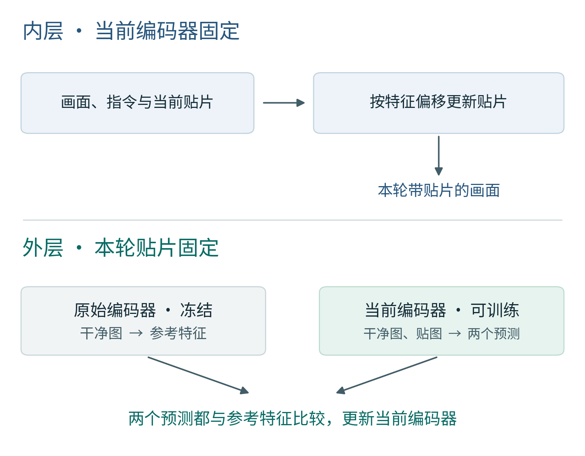
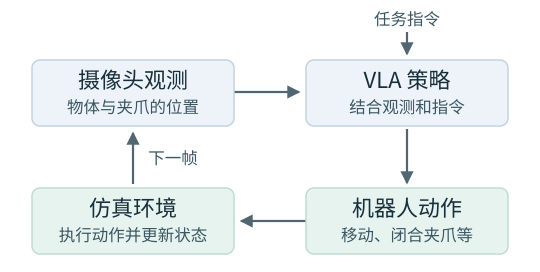
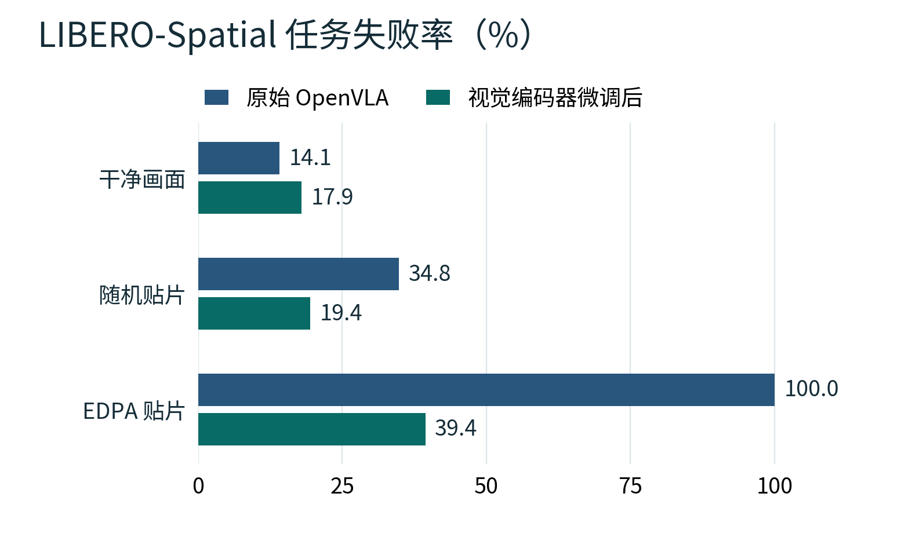
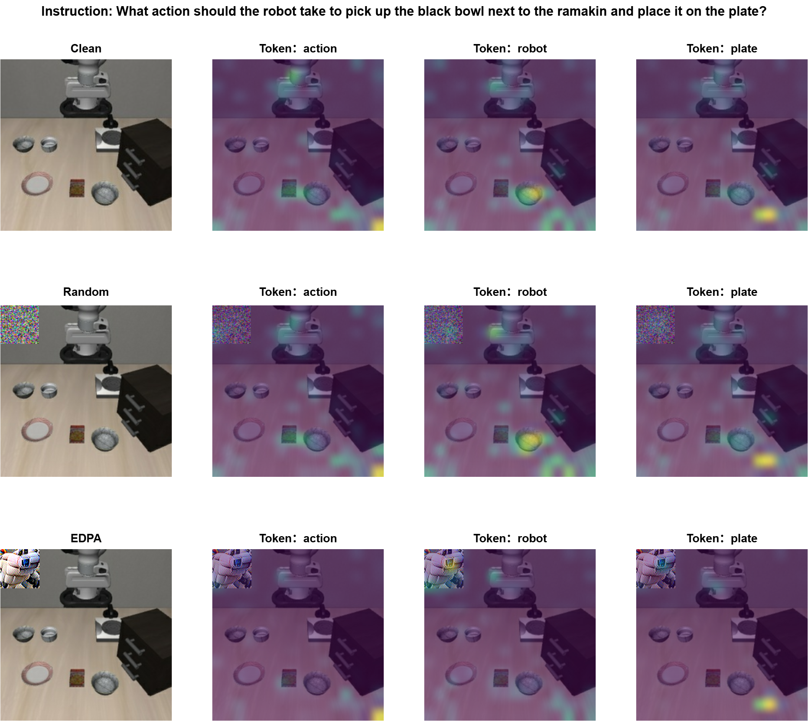

本文阅读的是 **《Model-agnostic Adversarial Attack and Defense for Vision-Language-Action Models》**（《面向视觉–语言–动作模型的模型无关对抗攻击与防御》）。作者为 Haochuan Xu、Yun Sing Koh、Shuhuai Huang、Zirun Zhou、Di Wang、Jun Sakuma 和 Jingfeng Zhang。以下公式、图表编号和实验结果均按 **arXiv:2510.13237v1，2025 年 10 月 15 日**发布的版本解读。[arXiv 原文](https://arxiv.org/abs/2510.13237v1) · [作者项目主页](https://edpa-attack.github.io/)

## 为什么提出 EDPA？ {#why-edpa}

视觉–语言–动作模型（VLA）根据摄像头画面和语言指令预测机器人下一步的动作。Wang 等人已经在 OpenVLA 上发现，画面里出现一块对抗贴片，就可能让机械臂完不成原来的任务。Xu 等人接下来想问：**换一种 VLA，能否用同一套方法研究它对贴片的敏感性？** [论文引言](https://arxiv.org/html/2510.13237v1#S1) · [Wang 等人的前作](https://arxiv.org/abs/2411.13587)

难点在于，**已有方法把攻击目标写在动作输出上**。UADA 利用 OpenVLA 的离散动作 token，衡量预测动作偏离示范动作的程度。UPA 则取机械臂动作向量中代表三维位移的分量，衡量运动方向的偏差。换一个直接输出连续动作的 VLA，原来用于比较的离散 token 就没有了。换一种机械臂控制接口，也要重新确认哪些分量表示空间位移。因此，这些目标很难跨模型直接复用。[论文 §2.2 与表 1](https://arxiv.org/html/2510.13237v1#S2.SS2)

**作者因此把目标往前移到编码器产生的特征上。不同 VLA 的动作生成方式可以不同，但都要先把摄像头画面编码成特征。** 如果一块贴片足以改变模型对场景的表示，以及它对画面与指令关系的判断，下游的动作预测就可能受到干扰。这是 EDPA 要检验的假设。标题里的 *model-agnostic* 指这套比较方法可以跨动作表示使用，计算时仍需访问相关编码器。[查看笔记中的论文 Figure 1](#paper-figure-1) · [论文 §3.2](https://arxiv.org/html/2510.13237v1#S3.SS2)

这个假设也引出论文的第二项工作：如果让编码器在有贴片时仍能提取接近干净画面的特征，机器人能否恢复一部分任务表现？作者据此设计了视觉编码器的防御微调，并用 LIBERO 仿真里的任务失败率检验两项方法。[论文 §3.3](https://arxiv.org/html/2510.13237v1#S3.SS3) · [实验设置](https://arxiv.org/html/2510.13237v1#S4.SS1)

## EDPA 比较哪两种变化？ {#two-comparisons}

假设指令是“把红杯子放到托盘里”。取同一帧画面的干净版和带贴片版，两者配同一句指令。图像编码器把每幅画面转成一组视觉向量，每个向量对应一个图像块。文字也按 token 转成向量。这里的 *embedding* 就是这些供模型后续处理的向量表示。[论文 §3.1](https://arxiv.org/html/2510.13237v1#S3.SS1)

- **图像对图像（patch contrastive loss，式 2）。** 杯子和托盘还在原处，但模型提取的视觉特征可能已经变了。取原图杯沿处的向量，与带贴片图中各个位置的向量比较，看杯沿原来所在的位置还能否匹配回来。对整幅图的所有位置都做这项比较，就能衡量贴片对视觉表示的影响。[论文式（2）](https://arxiv.org/html/2510.13237v1#S3.E2)
- **图像对指令（image-instruction alignment loss，式 3）。** 仍然看杯沿处，这次比较该位置分别和指令里表示“红杯子”“托盘”的文字 token 有多相似。对同一个图像位置和同一个词元，各算一次贴片前、贴片后的相似度，再看两者相差多少。把所有位置与词元的变化取平均，就得到图文对齐损失。[论文式（3）](https://arxiv.org/html/2510.13237v1#S3.E3)

为什么两项都要保留？不同 VLA 利用图文对应关系的能力不同。如果某个模型的视觉向量发生了偏移，但它们与指令词元的相似度变化很小，单看第二项就容易漏掉这次变化。第一项直接比较视觉表示，补上了这一点。[论文 §3.2](https://arxiv.org/html/2510.13237v1#S3.SS2)

## 第一部分：EDPA 怎样从图像和指令中学习共享贴片？

### 论文原图 Figure 1：OpenVLA 的编码与动作预测 {#paper-figure-1}

*Xu 等，论文图 1。绿色虚线（EDPA）止于视觉和文字向量，紫色（UADA）延伸到动作 token，红色（UPA）延伸到解码后的控制量。* [论文原图及图注](https://arxiv.org/html/2510.13237v1#S2.F1) · [放大查看](./paper-fig1-openvla.webp)

对一帧图像 \(v\) 和一条指令 \(t\)，论文将预测动作 \(a\) 的过程简写为

$$
\begin{aligned}
P&=\mathcal E_v(v),\\
W&=\mathcal E_t(t),\\
a&=f(P,W).
\end{aligned}
$$

- **Vision Encoder** 生成 \(N\) 个视觉向量 \(P=(p_1,\ldots,p_N)\)。以本仓库的 OpenVLA 为例，视觉主干先提取特征，投影层再把每个位置的向量映射到语言模型的输入维度 \(d\)。
- **Language Encoder** 提供 \(M\) 个文字向量 \(W=(w_1,\ldots,w_M)\)。OpenVLA 实现按 token ID 查询输入嵌入表，因此同一条指令配原图或贴图时，得到同一组 \(w_j\)。
- **Large VLM Backbone** 接收这些向量，经多层计算得到用于预测动作的隐藏状态。EDPA 的两项损失取前两项产生的表示，动作是否改变由后续实验检验。[论文 §3.1](https://arxiv.org/html/2510.13237v1#S3.SS1) · [OpenVLA 的两处取特征接口](https://github.com/trustmlyoungscientist/EDPA_attack_defense/blob/3b52691/utils/openvla/__init__.py#L69)

### 式（1）如何得到同一帧的两个版本？

设 \(v\) 是尺寸为 \(H\times W\times C\) 的原图，\(\delta\) 是尺寸为 \(h\times w\times C\) 的贴片。论文用 \(p\) 表示覆盖整张图的二值掩码。为明确两个张量怎样对齐，这里把贴片放到所选位置后的整图大小张量写成 \(\tilde\delta\)。式（1）可写为

$$
\begin{aligned}
v' &= v\oplus\delta\\
   &= (1-p)\odot v+p\odot\tilde\delta .
\end{aligned}
$$

\(\odot\) 表示逐元素相乘，掩码在各颜色通道上共用。\(p=0\) 的位置取原图像素，\(p=1\) 的位置取贴片像素。论文实验用一块完整的方形贴片。位置可以变化，被学习的是贴片的颜色值。这里的掩码 \(p\) 与下文带下标的视觉向量 \(p_i\) 是两个不同的量。[论文式（1）](https://arxiv.org/html/2510.13237v1#S3.E1)

将 \(v\) 和 \(v'\) 分别送进同一个视觉编码器。记 \(p_i=[\mathcal E_v(v)]_i\)，\(p'_i=[\mathcal E_v(v')]_i\)。撇号表示输入中出现了贴片，下标 \(i\) 表示视觉 token 的空间位置。两幅图像的像素坐标对齐，所以第 \(i\) 个位置仍然对应第 \(i\) 个位置。

### 式（2）怎样衡量同一位置的匹配优势？

固定原图位置 \(i\)。令 \(s_{ij}\) 表示它与贴图后位置 \(j\) 的余弦相似度，\(q_{ij}\) 表示把这一行相似度做 softmax 后的匹配权重：

$$
\begin{aligned}
s_{ij} &= \cos(p_i,p'_j),\\
q_{ij} &= \frac{\exp(s_{ij}/\tau)}
                  {\sum_{k=1}^{N}\exp(s_{ik}/\tau)} .
\end{aligned}
$$

这里 \(\cos(x,y)=x^\top y/(\lVert x\rVert_2\lVert y\rVert_2)\)，\(\tau\) 是温度系数，决定 softmax 对相似度差异的敏感程度。式（2）取每行中对应**同一空间位置**的 \(q_{ii}\)，求负对数并对所有位置取平均：

$$
\mathcal L_{\mathrm{patch}}
=-\frac1N\sum_{i=1}^{N}\log q_{ii}.
$$

若某个位置的 \(q_{ii}\) 从 0.8 降到 0.3，该位置的损失就从 0.22 升到 1.20。由于一行权重之和为 1，其余位置得到的总权重必然增加，但并未指定偏向哪一个位置。这里的“匹配”是研究者构造的度量。推理中的机器人直接消费当前图像的视觉特征。[论文式（2）](https://arxiv.org/html/2510.13237v1#S3.E2)

### 式（3）怎样衡量图像与指令的关系变化？

这一次，\(j\) 遍历的是**指令中的文字 token**。分别用原图和贴图构造两张 \(N\times M\) 的图文相似度表：

$$
\begin{aligned}
C_{ij}&=\cos(p_i,w_j),\\
C'_{ij}&=\cos(p'_i,w_j).
\end{aligned}
$$

式（3）对两张表中对应元素的差取绝对值，再求平均：

$$
\begin{aligned}
\Delta_{ij} &= \left|C'_{ij}-C_{ij}\right|,\\
\mathcal L_{\mathrm{align}} &=
\frac1{NM}\sum_{i=1}^{N}\sum_{j=1}^{M}\Delta_{ij}.
\end{aligned}
$$

文字向量 \(w_j\) 相同，变化来自视觉向量。某一对图文相似度由 0.8 升到 0.9，另一对由 0.8 降到 0.7，两者对求和的贡献都是 0.1。这里比较的是图文向量间的相似度，注意力权重则是另一种量。阅读 arXiv 网页版时，可以直接按公式中的下标辨认：式（2）是图像块对比，式（3）是图文对齐变化。[论文式（3）](https://arxiv.org/html/2510.13237v1#S3.E3)

*损失计算示意（本文绘制）。左图每一行的正确位置都在对角线上。取 \(\tau=1\)，其权重约为 0.45，式（2）约为 0.80。右图展示的是相似度的绝对变化，式（3）等于四格均值 0.60。两图的列代表不同对象。数值仅用于手算。*

### 式（4）为什么一个训练集会学出一块贴片？

输入是一批来自机器人轨迹的图像和对应的任务指令。对每条记录，先按式（1）构造贴图，再按式（2）和式（3）为这条记录打分。记 \(\mathcal D\) 为这些图像与指令的分布，用 \(J\) 简写单个样本的分数。按**论文的权重约定**，式（4）为

$$
\begin{gathered}
J=\alpha_1\mathcal L_{\mathrm{patch}}
 +(1-\alpha_1)\mathcal L_{\mathrm{align}},\\
\delta^*=\underset{\delta}{\arg\max}\;
   \mathbb E_{\mathcal D}[J(v,t,\delta)] .
\end{gathered}
$$

读这行时，先看期望号的内外。**取平均的是不同样本，待学习的量始终是同一个 \(\delta\)**。在一次独立的贴片训练中，同一批和后续批次都为这块贴片提供训练信号。模型权重固定，输出是共享贴片。论文还单独在 LIBERO-Spatial 上学习贴片，再迁移到其他任务套件，检验共享贴片能泛化多远。[论文式（4）](https://arxiv.org/html/2510.13237v1#S3.E4) · [迁移实验，附录 B](https://arxiv.org/html/2510.13237v1#A2)

为什么写 \(\arg\max\)？从“匹配回原位置”看，较大的 \(\mathcal L_{\mathrm{patch}}\) 表示匹配变差；从“寻找有效扰动”看，作者希望观察到这种变化。式（4）给出的是**特征偏移这个代理目标**。如果变化主要发生在与当前动作无关的特征上，机器人仍然可能完成任务。

### OpenVLA 的代码怎样实现 EDPA？ {#openvla-implementation}

以官方仓库中的 OpenVLA 实现为例，顺着一批数据可以看到式（1）到（4）分别落在哪一步。

1. **准备原图、贴图和指令。** 入口 `cp_openvla.py` 从离线轨迹读相机帧和对应指令。每张原图都有自己的贴图版本，两者配同一条指令。一批图像共用一份 RGB 贴片张量，每张图的放置位置可以不同。[数据入口](https://github.com/trustmlyoungscientist/EDPA_attack_defense/blob/3b52691/cp_openvla.py#L89) · [贴图实现](https://github.com/trustmlyoungscientist/EDPA_attack_defense/blob/3b52691/VLAAttacker/pytorch/EDPA.py#L73)
2. **提取三组特征。** 原图和贴图都经过 `vision_backbone` 和 `projector`，各得到一组 \(B\times N\times d\) 的视觉向量。指令的 token ID 通过输入嵌入表得到 \(B\times M\times d\) 的文字向量。\(B\) 是批大小，\(N\) 是视觉位置数，\(M\) 是指令 token 数，\(d\) 是投影后的特征维度。三组向量都在进入语言模型主干之前取出。[特征提取接口](https://github.com/trustmlyoungscientist/EDPA_attack_defense/blob/3b52691/utils/openvla/__init__.py#L69)
3. **计算特征偏移。** `compute_loss` 为每张图构造一个 \(N\times N\) 的图像块相似度矩阵，以对角线作为正确位置，用交叉熵得到 \(\mathcal L_{\mathrm{patch}}\)。随后计算贴图前后两张 \(N\times M\) 的图文相似度矩阵，统计对应元素之差的绝对值，使用掩码排除填充 token。两项各用自己的指数滑动平均做尺度归一化，再加权合成一个批次分数。[损失实现](https://github.com/trustmlyoungscientist/EDPA_attack_defense/blob/3b52691/VLAAttacker/pytorch/EDPA.py#L113)
4. **把分数的梯度传回贴片。** `generate_one_step` 把原图和指令的特征作为固定参照，保留贴图分支的计算图。由此可计算批次分数对贴片像素的梯度。更新只作用于贴片，同一份张量随后传给下一批图像。训练得到的贴片再用于 LIBERO 的闭环评估。[单轮计算](https://github.com/trustmlyoungscientist/EDPA_attack_defense/blob/3b52691/VLAAttacker/pytorch/EDPA.py#L186) · [论文 §4.2](https://arxiv.org/html/2510.13237v1#S4.SS2)

对照论文和代码时要留意两个约定。**式（2）以原图位置为起点，在贴图中找对应位置。仓库反过来，以贴图位置为起点，在原图中找对应位置。** 对角线的匹配关系相同，softmax 归一化的方向相反，所以损失数值可以不同。式（4）的 \(\alpha_1\) 乘在图像块对比项上，仓库的参数 `alpha` 乘在图文对齐项上。[论文式（2）与式（4）](https://arxiv.org/html/2510.13237v1#S3.SS2) · [仓库的权重说明](https://github.com/trustmlyoungscientist/EDPA_attack_defense/blob/3b52691/readme.md#L70)

## 第二部分：从原始编码器到防御微调后的编码器

### 式（5）的两个预测为什么共用一个参考？

初始化时，保留原始视觉编码器 \(E_0\)，复制出权重相同的可训练编码器 \(E_\theta\)。对每条样本分别计算三个特征：

$$
\begin{aligned}
z_0 &= E_0(v),\\
z_{\mathrm{clean}} &= E_\theta(v),\\
z_{\mathrm{adv}} &= E_\theta(v\oplus\delta).
\end{aligned}
$$

\(z_0\) 是**原始编码器看干净图**的结果，这一项在训练中始终作为参照。将论文式（5）按每个样本的两项误差展开：

$$
\begin{gathered}
d_{\mathrm{clean}} = \lVert z_{\mathrm{clean}}-z_0\rVert_2^2,\\
d_{\mathrm{adv}} = \lVert z_{\mathrm{adv}}-z_0\rVert_2^2,\\
D = \alpha_2 d_{\mathrm{clean}}+(1-\alpha_2)d_{\mathrm{adv}},\\
\theta^* = \underset{\theta}{\arg\min}\;\mathbb E_{v\sim\mathcal D}[D].
\end{gathered}
$$

第一项约束正常画面的表示，第二项要求当前编码器从带贴片的画面中恢复接近干净参考的表示。两项都小，才同时满足这两个要求。每帧图像都有自己的 \(z_0\)，所以碗的位置真的发生变化时，对应的参考特征也可以变化。式（4）的 \(\alpha_1\) 权衡两种**扰动度量**，式（5）的 \(\alpha_2\) 权衡两种**特征恢复误差**。[论文式（5）](https://arxiv.org/html/2510.13237v1#S3.E5)

*防御微调示意（本文据 Algorithm 1 绘制）。同一轮里，“当前编码器”在两个阶段指同一份权重。上半图结束时改变的是贴片，下半图结束时改变的是编码器。*

### Algorithm 1 从输入到输出

1. **输入一批图像和指令。** 保留 \(E_0\) 作为冻结参考。外层循环开始时，\(E_\theta\) 是目前已学到的编码器。
2. **准备本轮的扰动画面。** 内层固定 \(E_\theta\)，用 EDPA 衡量当前贴片对这批样本的影响。得到的贴图进入本轮防御训练。伪代码中 \(K\) 表示内层的更新次数，贴片跨轮保留，并按重置周期重新初始化。
3. **更新编码器。** 固定本轮贴片，由 \(E_0\) 计算干净参考，由 \(E_\theta\) 计算干净和贴图两种预测。最小化式（5）时，只有 \(\theta\) 被更新。攻击生成阶段需要区分“参与特征计算”和“参数发生更新”：编码器可以在固定权重时传递输入对损失的影响。
4. **输出微调后的视觉编码器。** 经过多轮训练，把 \(E_{\theta^*}\) 接回 VLA。执行任务时，模型直接处理当前摄像头画面；冻结的参考分支只在训练中提供目标。[论文 Algorithm 1](https://arxiv.org/html/2510.13237v1#S3.SS3)

## 从特征偏移到任务失败，中间隔着一次闭环实验

“拿起饼干盒旁边的黑碗，放到盘子上”是 LIBERO 的一条真实指令。一次定位偏差可能在后续观测中被纠正，也可能让夹爪错过目标。因此效果要用整个回合的结果来判断。[LIBERO 官方任务清单](https://github.com/Lifelong-Robot-Learning/LIBERO/blob/master/libero/libero/benchmark/libero_suite_task_map.py)

*闭环评估示意（本文绘制）。这一帧预测的动作会改变下一帧中夹爪与物体的位置。* [论文 §4.1](https://arxiv.org/html/2510.13237v1#S4.SS1)

LIBERO-Spatial 有十个以空间关系区分目标物体的任务。每次试验让模型根据画面和指令输出动作，仿真环境执行动作并返回新画面。失败率是未在规定步数内完成任务的回合占比，即 \(\mathrm{FR}=1-\mathrm{SuccessRate}\)。作者在四个 LIBERO 套件上评估，表 2 报告三个随机种子的汇总结果。下图取其中的 Spatial 套件。[LIBERO 官方任务表](https://github.com/Lifelong-Robot-Learning/LIBERO/blob/master/libero/libero/benchmark/libero_suite_task_map.py) · [论文 §4.1–4.2](https://arxiv.org/html/2510.13237v1#S4.SS1)

*OpenVLA 失败率（本文据论文表 2 的均值重绘），单位为百分比，越低越好。随机贴片与 EDPA 贴片尺寸相同。* [原表与各项波动范围](https://arxiv.org/html/2510.13237v1#S4.T2)

先固定原始模型：干净画面与随机贴片之间相差 20.7 个百分点，EDPA 又比随机贴片高 65.2 个百分点。再固定 EDPA 条件比较两种模型：防御将失败率降低了 60.6 个百分点。回到干净画面，微调后的失败率反而高了 3.8 个百分点。这个代价解释了为什么式（5）还要保留干净分支。

### 同一帧画面里，文字 token 的注意力怎样变化？

*Xu 等，论文附录 A 图 4。先看左列确认三个条件，再沿同一词元的列纵向比较。作者对 OpenVLA 最后一层的多个注意力头取平均，观察到 EDPA 条件下贴片区域得到更多注意力，一些原本突出的物体区域减弱。* [论文原图及分析](https://arxiv.org/html/2510.13237v1#A1.F4) · [放大查看](./paper-fig4-attention.webp)

读这张图要区分两个量。式（3）测量的是**主干输入处的向量余弦相似度**，热图展示的则是**经过主干多层计算后的注意力权重**。后者提供了一条可能的解释；判断这种变化是否影响任务完成，仍要回到表 2 的闭环统计。

这个结果回答了开头的问题：在这组仿真任务里，按特征偏移学习的贴片确实能够干扰动作执行，而恢复干净表示的训练能挽回部分任务表现。论文还在 OpenVLA-OFT 和 π₀ 上评估了攻击，防御实验主要针对 OpenVLA。多相机实验对主相机和腕部相机分别施加贴片；同一实体贴片在不同视角下的投影一致性，仍是作者列出的限制。[论文 §4.3](https://arxiv.org/html/2510.13237v1#S4.SS3) · [论文 §6](https://arxiv.org/html/2510.13237v1#S6)

## 研究启发：先定义特征偏移，再用闭环实验验证 {#research-takeaway}

这篇论文最值得借鉴的是，作者先把一个难以直接优化的问题变成**可计算的代理目标**。在离线图像上，同一帧贴图前后可以直接比较。式（2）度量同一位置的视觉特征还能否对应，式（3）度量画面与指令的相似关系改变了多少。作者用这两个量给贴片打分，再让 VLA 在 LIBERO 中执行完整任务，用**任务失败率**检验这项选择有没有影响机器人行为。[论文 §3.2](https://arxiv.org/html/2510.13237v1#S3.SS2) · [论文 §4.1–4.2](https://arxiv.org/html/2510.13237v1#S4.SS1)

这两步回答不同的问题。特征分数回答“模型内部的表示变了多少”，闭环实验回答“机器人还能不能完成任务”。表 2 的同尺寸随机贴片是关键对照，它让作者估计学习出来的图案比同样面积的随机图案多带来多少任务失败。要进一步把特征分数用作**逐回合预警**，就要单独验证分数能否在失败前区分高风险和低风险的动作。[论文表 2](https://arxiv.org/html/2510.13237v1#S4.T2)

做 VLA 安全研究时，可以复用同样的两步。比如从同一个仿真状态出发，用干净画面和红杯短暂被遮挡的画面，分别配上“抓红杯”和“抓蓝杯”两条可行指令。先给**与当前任务相关的视觉特征变化**打分，再执行各条件下模型预测的动作段，记录是否误触其他物体或掉落。如果在相同误报率下，结合指令的分数比全图特征偏移更早发现这些事件，就有证据表明任务信息能改善预警。任务成功率也要一起记录，才能看到安全干预对任务完成的影响。
