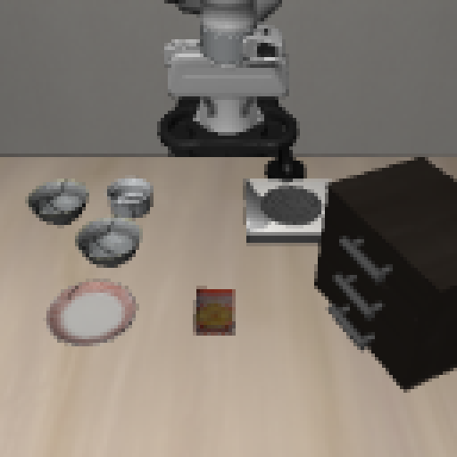

给机器人一句“把黑碗放到盘子里”，模型是怎么把这句话和一张相机图像变成夹爪运动的？从一次已经跑通的仿真检查开始，把图像、动作 token 和 `env.step()` 接起来。

## LIBERO 和 MuJoCo 各做什么？



*图 1。运行 `OffScreenRenderEnv` 并执行一步后保存的主相机画面。原图是 128 × 128 像素，为便于阅读放大展示。*

LIBERO 提供任务语言、物体布局和成功条件。MuJoCo 根据机械臂、物体和控制输入计算下一时刻的状态，再由仿真相机生成画面。`OffScreenRenderEnv` 直接把相机图像交给代码。在这次检查里，`env.step([0, 0, 0, 0, 0, 0, -1])` 执行的是手写的等待动作，验证了场景加载、物理步进和相机输出。

如果要描述一种机械臂的结构，URDF 用 `<link>` 表示底座和连杆，用 `<joint>` 描述各刚体怎么连接、绕哪根轴转，以及关节限位。MuJoCo 的原生格式 MJCF 还能配置执行器和仿真相关参数。这里 LIBERO 通过 robosuite 创建的是 Franka Panda 场景，任务文件用 BDDL 描述黑碗、盘子和目标关系。 [LIBERO 任务示例](https://github.com/Lifelong-Robot-Learning/LIBERO#task) · [ROS 2 的 URDF 教程](https://github.com/ros2/ros2_documentation/blob/jazzy/source/Tutorials/Intermediate/URDF/Building-a-Movable-Robot-Model-with-URDF.rst) · [MuJoCo 建模说明](https://mujoco.readthedocs.io/en/stable/modeling.html)

## DINOv2 和 SigLIP 怎样处理同一张图？

**DINOv2** 从图像本身学习视觉特征。预训练时，同一张图的不同裁剪和遮挡区域提供学习信号，学生网络学习预测教师网络给出的特征。**SigLIP** 在图文对上学习，用成对的 sigmoid 损失提高匹配图像与描述的相似度。OpenVLA 取这两个模型的图像特征。任务指令经 Llama 2 的 tokenizer 和词嵌入进入另一条输入路径。 [DINOv2 原论文](https://arxiv.org/abs/2304.07193) · [SigLIP 原论文](https://arxiv.org/abs/2303.15343) · [OpenVLA 原论文](https://proceedings.mlr.press/v270/kim25c.html)


*图 2。以 LIBERO-Spatial 检查点为例，省略批次维。形状 `[256, 1024]` 表示 256 个图像块，每块用 1024 个数表示。*

1. **从像素到图像块向量。** 两条分支分别归一化同一张 224 × 224 的 RGB 图像。每条分支按 14 × 14 像素切块，得到 16 × 16 个位置。一个小块包含 `14 × 14 × 3 = 588` 个像素通道值，线性投影把它变成 DINOv2 的 1024 维向量，或 SigLIP 的 1152 维向量。
2. **从单个图像块到包含上下文的特征。** 加入位置后，Transformer 的自注意力让每个位置利用其他位置的信息。比如一块黑色弧线可以结合附近的碗沿与盘子来更新表示。OpenVLA 取两条分支倒数第二层的图像块特征。
3. **从两套特征到 Llama 2 输入。** 同一个位置的两个向量沿特征维拼起来，得到 `1024 + 1152 = 2176` 维。位置数仍是 256。MLP 把每个向量映射到 4096 维，代码把它们插在文本起始 token 后面。 [检查点配置](https://huggingface.co/openvla/openvla-7b-finetuned-libero-spatial/blob/main/config.json) · [视觉特征提取和投影](https://github.com/William-wAng618/roboticAttack/blob/main/prismatic/extern/hf/modeling_prismatic.py#L63) · [视觉与文本合并](https://github.com/William-wAng618/roboticAttack/blob/main/prismatic/extern/hf/modeling_prismatic.py#L365)

## 七个动作 token 是七步吗？

七个 token 对应 **同一个控制步的七个分量**。前三个是末端平移增量，接着三个是旋转增量，最后一个是夹爪指令。Llama 2 根据画面和指令预测第一个 token，再把已生成的 token 放进上下文，逐个预测后面的分量。仓库的基线评估关闭采样。

动作 token 占用原词表末尾的一段 ID。训练时，每个归一化动作数值被量化成离散索引，再映射成 token。推理时，`predict_action()` 逆向查到量化区间的中心，再按数据集统计量把适用的分量反归一化。评估代码转换夹爪值后，把这个向量传给 `env.step()`。机械臂执行完，下一帧画面进入下一轮推理。 [动作 tokenizer](https://github.com/William-wAng618/roboticAttack/blob/main/prismatic/vla/action_tokenizer.py#L30) · [生成与解码](https://github.com/William-wAng618/roboticAttack/blob/main/prismatic/extern/hf/modeling_prismatic.py#L506) · [仿真评估循环](https://github.com/William-wAng618/roboticAttack/blob/main/experiments/robot/libero/run_libero_eval.py#L196)

## 训练数据里的 RLDS 和 LeRobot 是什么关系？

一次完整的“把碗放到盘子里”示范是一个 episode。它可以存成 RLDS，也可以存成 LeRobotDataset。RLDS 把数据组织成 episode 里的有序 step，`is_first` 和 `is_last` 标记轨迹边界，奖励和环境终止标记是可选字段。LeRobotDataset v3 的典型布局用 Parquet 存逐步动作和状态，用 MP4 存相机画面，再用元数据找每条轨迹。 [RLDS 格式说明](https://github.com/google-research/rlds) · [LeRobotDataset v3 文档](https://huggingface.co/docs/lerobot/lerobot-dataset-v3)

### 一个 RLDS episode 长什么样？

假设夹爪已经抓着碗。把“移动到盘子上方 → 张开夹爪 → 看到碗落在盘子上”简化成两次动作和三帧观测。下面用 YAML 展示逻辑结构，`<RGB 帧 …>` 代指图像数据，数字也只是示意。 [RLDS step 字段规范](https://github.com/google-research/rlds#dataset-format) · [LIBERO 主相机字段配置](https://github.com/William-wAng618/roboticAttack/blob/main/prismatic/vla/datasets/rlds/oxe/configs.py#L645)

```yaml
steps:
  - is_first: true
    is_last: false
    is_terminal: false
    observation:
      image: "<RGB 帧 0：夹着碗>"
    language_instruction: "put the black bowl on the plate"
    action: [0.20, 0, 0, 0, 0, 0, 1]

  - is_first: false
    is_last: false
    is_terminal: false
    observation:
      image: "<RGB 帧 1：碗在盘子上方>"
    language_instruction: "put the black bowl on the plate"
    action: [0, 0, 0, 0, 0, 0, -1]

  - is_first: false
    is_last: true
    is_terminal: true
    observation:
      image: "<RGB 帧 2：碗在盘子上>"
    language_instruction: "put the black bowl on the plate"
    action: [0, 0, 0, 0, 0, 0, 0]  # 仅为保留字段形状的占位值
```

**动作与它执行前看到的图像配对。** 第一条记录把帧 0 和「向右移动」配在一起，执行后才得到帧 1。第二条记录把帧 1 和「张开夹爪」配在一起。第三条记录保存最终观测，`is_last: true` 时这一条的 `action` 无效。示例没有填 `reward`，仍然可以用前两条的图像、指令和动作做模仿学习。 [RLDS 规范](https://github.com/google-research/rlds#dataset-format)

这里的 `RLDSBatchTransform` 从示范取出**当前相机帧、任务语言和示范动作**。示范动作编码后放进答案位置，作为模型要预测的标签。自己回看这段代码时，可以对照图 2 的最后两格。训练时是「动作 → token」，执行时是「token → 动作」。 [训练样本转换](https://github.com/William-wAng618/roboticAttack/blob/main/prismatic/vla/datasets/datasets.py#L40)

## OpenVLA 的训练目标函数是什么？

原版 OpenVLA 用**交叉熵**监督动作 token。设当前画面为 \(I\)，指令为 \(s\)，示范动作编码为 \(a_1, \ldots, a_7\)。把一条样本的动作部分写成公式，就是让真实动作 token 的负对数概率变小。

$$
\mathcal{L}_{\mathrm{action}} = -\sum_{i=1}^{7} \log p_\theta(a_i \mid I, s, a_{<i})
$$

例如预测第三个分量 \(a_3\) 时，**训练**给模型的是示范里的 \(a_1, a_2\)，这叫 *teacher forcing*。到了**推理**，前两个 token 由模型自己生成。仓库通过把提示词的标签设为 `IGNORE_INDEX` 排除这些位置的损失，默认还监督序列末尾的停止 token。式子只写了七个动作位置。每个位置上，真实 token 的预测概率越高，对应的交叉熵就越低。 [OpenVLA 原论文](https://proceedings.mlr.press/v270/kim25c.html) · [标签掩码代码](https://github.com/William-wAng618/roboticAttack/blob/main/prismatic/vla/datasets/datasets.py#L55)

拿夹爪分量举例。如果图像显示夹爪刚好到达碗沿，示范的下一步是闭合，模型给正确 token 的概率为 `0.8` 时，这个位置的损失约为 `0.22`。如果只给 `0.1` 的概率，损失就增至约 `2.30`。训练直接用示范给出的正确 token 计算这个损失，因此不需要先让机械臂完成一轮任务再拿成功奖励。

接着读 [笔记（二）]()，可以对照这套动作预测流程，理解四种损失如何使用示范 token、模型输出和预设目标。
