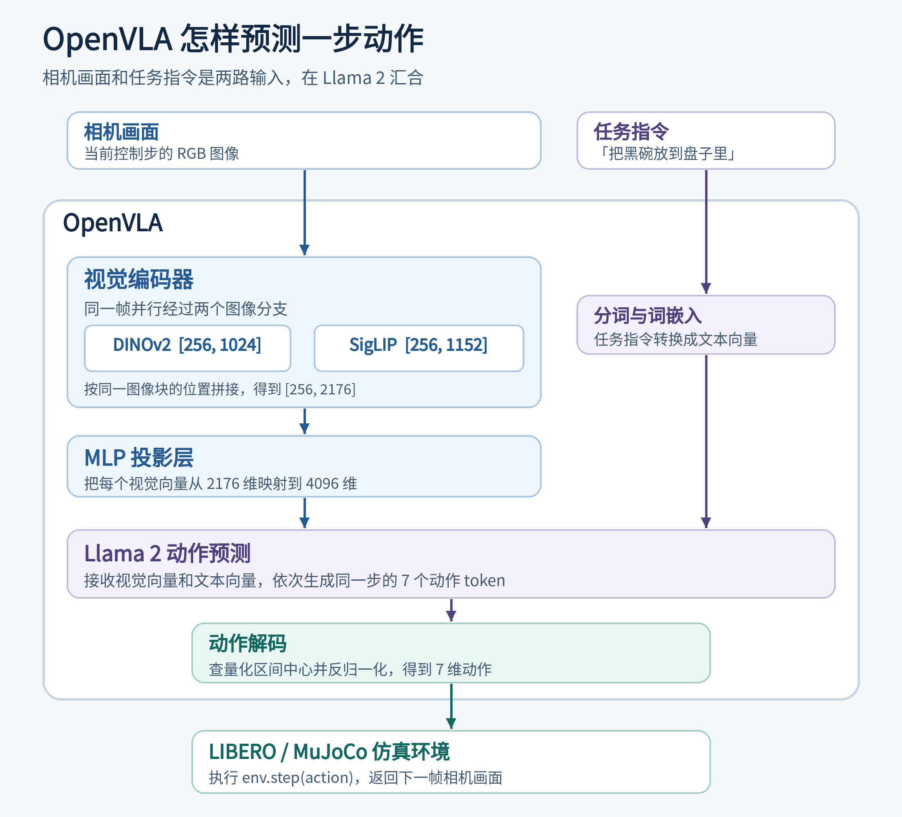
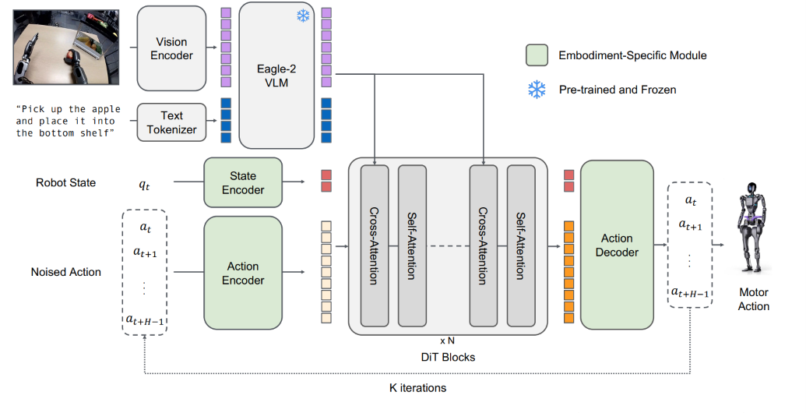

**阅读论文**　*Exploring the Adversarial Vulnerabilities of Vision-Language-Action Models in Robotics*（Taowen Wang 等，ICCV 2025） [&#91;1&#93;](#ref-1)

论文问的是，**任务指令固定时，只改变相机画面，能在多大程度上改变机械臂的动作和任务结果？** 要跟上论文的方法，需要先弄清图像进了 OpenVLA 的哪个模块、动作又在哪里生成。

以「把黑碗放到盘子里」为例。在每个控制步，**OpenVLA 读一帧相机画面和这条指令，预测机械臂下一步的动作。** 仿真环境执行这个动作，给出新的画面，模型再预测下一步。

## OpenVLA 里面有哪些模块？

**DINOv2 和 SigLIP 是 OpenVLA 内部视觉编码器的两个并行分支。** OpenVLA 把两者提取的图像特征合在一起，由投影层把它们转换成 Llama 2 能接收的向量。 [&#91;2&#93; 图 2](#ref-2)

| OpenVLA 的模块 | 收到什么 | 交给下一部分什么 |
| --- | --- | --- |
| **视觉编码器（DINOv2 + SigLIP）** | 同一帧相机图像 | 两条分支各自提取的图像特征，按同一图像块位置拼接 |
| **MLP 投影层** | 拼接后的视觉特征 | 和 Llama 2 词嵌入宽度一致的视觉向量 |
| **Llama 2** | 视觉向量和任务指令的文本向量 | 当前控制步的动作 token |



*图 1。以 LIBERO-Spatial 检查点为例。大框是 OpenVLA，框外的仿真环境负责执行动作。*

## 推理时怎样用图像和指令预测一步动作？

### DINOv2 和 SigLIP 怎样处理同一张图？

**在 OpenVLA 中，两条分支都负责从同一帧 RGB 画面提取特征。** 其中 SigLIP 用的是预训练模型的图像编码器。「把黑碗放到盘子里」这条任务指令则由 Llama 2 分词和转换成文本向量。 [&#91;2&#93; §3.1](#ref-2)

两条分支的差异来自各自的预训练。**DINOv2** 用同一张图的不同裁剪和遮挡区域学习图像特征，学生网络学习预测教师网络给出的特征。**SigLIP** 用图文对做预训练，通过 sigmoid 损失提高匹配图像与描述的相似度。OpenVLA 原论文还提到，加入 DINOv2 特征有助于空间推理。 [&#91;3&#93;](#ref-3) · [&#91;4&#93;](#ref-4) · [&#91;2&#93; §3.1](#ref-2)

以 LIBERO-Spatial 检查点为例，两个分支把画面调整为 224 × 224，并分别按各自的统计量归一化。按 14 × 14 切块后，有 16 × 16 个图像块。每块的 `14 × 14 × 3 = 588` 个像素通道值先映射成向量，再经 Transformer 利用其他图像块提供的上下文。

OpenVLA 取两条分支倒数第二层的图像块特征。DINOv2 得到 `[256, 1024]`，SigLIP 得到 `[256, 1152]`。前一个数是图像块数，后一个数是每块向量的宽度。 [检查点配置](https://huggingface.co/openvla/openvla-7b-finetuned-libero-spatial/blob/main/config.json) · [视觉编码器源码](https://github.com/William-wAng618/roboticAttack/blob/a0bef50/prismatic/extern/hf/modeling_prismatic.py#L63)

### 图像特征怎样和指令汇合？

同一个图像块位置有两个向量，分别来自 DINOv2 和 SigLIP。把它们沿特征维拼起来，每个位置就有 `1024 + 1152 = 2176` 维，仍然是 256 个位置。**MLP 投影层**再把每个向量映射到 Llama 2 使用的 4096 维。这时，图像和指令都变成了同样宽度的向量序列。代码将视觉向量插入文本起始 token 后面，Llama 2 根据这两类信息预测动作。 [视觉特征投影和序列合并](https://github.com/William-wAng618/roboticAttack/blob/a0bef50/prismatic/extern/hf/modeling_prismatic.py#L365)

### 七个动作 token 是七步吗？

七个 token 对应**同一个控制步的七个分量**。前三个是末端平移增量，接着三个是旋转增量，最后一个是夹爪指令。Llama 2 根据画面和指令预测第一个 token，再把已生成的 token 放进前文，逐个预测后面的分量。仓库的基线评估关闭采样。 [&#91;2&#93;](#ref-2) · [生成动作 token](https://github.com/William-wAng618/roboticAttack/blob/a0bef50/prismatic/extern/hf/modeling_prismatic.py#L506)

动作 token 占用词表末尾的一段 ID，其中每个 token 代表一个量化区间。`predict_action()` 查到这个区间的中心，再按数据集统计量对适用的分量做反归一化，得到可交给控制器的数值。七个分量解码完成后，评估脚本调整夹爪值，再一次性将这个动作向量传给 `env.step()`。 [动作 tokenizer](https://github.com/William-wAng618/roboticAttack/blob/a0bef50/prismatic/vla/action_tokenizer.py#L30) · [动作解码](https://github.com/William-wAng618/roboticAttack/blob/a0bef50/prismatic/extern/hf/modeling_prismatic.py#L520) · [仿真评估循环](https://github.com/William-wAng618/roboticAttack/blob/a0bef50/experiments/robot/libero/run_libero_eval.py#L212)

### LIBERO 和 MuJoCo 各做什么？

OpenVLA 给出动作，**LIBERO** 提供任务指令、场景布局和成功条件，**MuJoCo** 负责物理步进。执行 `env.step()` 后返回的新一帧相机画面，会重新经过 OpenVLA 的视觉编码器。这样才形成从「看画面」到「执行」再回到「看画面」的闭环。


*图 2。运行 `OffScreenRenderEnv`，用手写的等待动作 `[0, 0, 0, 0, 0, 0, -1]` 验证物理步进与相机输出。原图是 128 × 128 像素，为便于阅读放大展示。*

这个 LIBERO 场景通过 robosuite 创建 Franka Panda，任务文件用 BDDL 描述黑碗、盘子和目标关系。描述机械臂结构时，URDF 用 `<link>` 表示底座和连杆，用 `<joint>` 表示关节连接、转轴和限位。MuJoCo 的原生格式 MJCF 还能配置执行器和仿真参数。 [LIBERO 任务示例](https://github.com/Lifelong-Robot-Learning/LIBERO#task) · [ROS 2 的 URDF 教程](https://github.com/ros2/ros2_documentation/blob/jazzy/source/Tutorials/Intermediate/URDF/Building-a-Movable-Robot-Model-with-URDF.rst) · [MuJoCo 建模说明](https://mujoco.readthedocs.io/en/stable/modeling.html)

## OpenVLA 怎样从示范学会预测动作？

前面的一步推理只需要画面和指令。训练样本会为这两个输入补上一项**示范动作**。同样一张夹爪靠近碗沿的画面，示范可以告诉模型这一步应该继续移动还是闭合夹爪。

### 训练数据里的 RLDS 和 LeRobot 是什么关系？

一次完整的“把碗放到盘子里”示范是一个 episode。它可以存成 RLDS，也可以存成 LeRobotDataset。RLDS 把数据组织成 episode 里的有序 step，`is_first` 和 `is_last` 标记轨迹边界，奖励和环境终止标记是可选字段。LeRobotDataset v3 的典型布局用 Parquet 存逐步动作和状态，用 MP4 存相机画面，再用元数据找每条轨迹。 [RLDS 格式说明](https://github.com/google-research/rlds) · [LeRobotDataset v3 文档](https://huggingface.co/docs/lerobot/lerobot-dataset-v3)

#### 一个 RLDS episode 长什么样？

假设夹爪已经抓着碗。把“移动到盘子上方 → 张开夹爪 → 看到碗落在盘子上”简化成两次动作和三帧观测。下面用 YAML 展示逻辑结构，`<RGB 帧 …>` 代指图像数据，数字也只是示意。 [RLDS step 字段规范](https://github.com/google-research/rlds#dataset-format) · [LIBERO 主相机字段配置](https://github.com/William-wAng618/roboticAttack/blob/main/prismatic/vla/datasets/rlds/oxe/configs.py#L645)

```yaml
steps:
  - is_first: true
    is_last: false
    is_terminal: false
    observation:
      image: "<RGB 帧 0：夹着碗>"
    language_instruction: "put the black bowl on the plate"
    action: [0.20, 0, 0, 0, 0, 0, 1]

  - is_first: false
    is_last: false
    is_terminal: false
    observation:
      image: "<RGB 帧 1：碗在盘子上方>"
    language_instruction: "put the black bowl on the plate"
    action: [0, 0, 0, 0, 0, 0, -1]

  - is_first: false
    is_last: true
    is_terminal: true
    observation:
      image: "<RGB 帧 2：碗在盘子上>"
    language_instruction: "put the black bowl on the plate"
    action: [0, 0, 0, 0, 0, 0, 0]  # 仅为保留字段形状的占位值
```

**动作与它执行前看到的图像配对。** 第一条记录把帧 0 和「向右移动」配在一起，执行后才得到帧 1。第二条记录把帧 1 和「张开夹爪」配在一起。第三条记录保存最终观测，`is_last: true` 时这一条的 `action` 无效。示例没有填 `reward`，仍然可以用前两条的图像、指令和动作做模仿学习。 [RLDS 规范](https://github.com/google-research/rlds#dataset-format)

仓库的 `RLDSBatchTransform` 从每条示范记录取出当前相机帧、任务指令和示范动作。图像与指令仍然走图 1 的两条输入路径。示范动作被编码成七个 token，放在答案位置，供模型计算预测损失。 [训练样本转换](https://github.com/William-wAng618/roboticAttack/blob/a0bef50/prismatic/vla/datasets/datasets.py#L40)

### OpenVLA 的训练目标函数是什么？

原版 OpenVLA 用**交叉熵**监督动作 token。设当前画面为 \(I\)，指令为 \(s\)，示范动作编码为 \(a_1, \ldots, a_7\)。把一条样本的动作部分写成公式，就是让真实动作 token 的负对数概率变小。

$$
\mathcal{L}_{\mathrm{action}} = -\sum_{i=1}^{7} \log p_\theta(a_i \mid I, s, a_{<i})
$$

例如预测第三个分量 \(a_3\) 时，**训练**给模型的是示范里的 \(a_1, a_2\)，这叫 *teacher forcing*。到了**推理**，前两个 token 由模型自己生成。仓库通过把提示词的标签设为 `IGNORE_INDEX` 排除这些位置的损失，默认还监督序列末尾的停止 token。式子只写了七个动作位置。每个位置上，真实 token 的预测概率越高，对应的交叉熵就越低。 [&#91;2&#93;](#ref-2) · [标签掩码代码](https://github.com/William-wAng618/roboticAttack/blob/main/prismatic/vla/datasets/datasets.py#L55)

拿夹爪分量举例。如果图像显示夹爪刚好到达碗沿，示范的下一步是闭合，模型给正确 token 的概率为 `0.8` 时，这个位置的损失约为 `0.22`。如果只给 `0.1` 的概率，损失就增至约 `2.30`。训练直接用示范给出的正确 token 计算这个损失，因此不需要先让机械臂完成一轮任务再拿成功奖励。

## GR00T N1 的自注意力和交叉注意力分别看什么？



*图 3。NVIDIA 的 GR00T N1 架构图。上方的紫色和蓝色 token 是图像和指令。下方的红色和浅橙色 token 是机器人状态和当前带噪的动作序列。来源为 GR00T N1 原论文图 3。* [&#91;5&#93; §2.1](#ref-5)

沿着图从左到右读。Eagle-2 先把相机画面和「把苹果放到底层架子」的指令变成**图文特征**。与此同时，状态编码器把机器人的当前状态变成向量，动作编码器把当前这轮的带噪动作序列变成向量。**状态和动作进入 DiT，图文特征作为交叉注意力的条件。** [&#91;5&#93; §2.1](#ref-5)

| DiT 里的层 | Query（Q，发起查询） | Key 和 Value（K、V，提供信息） | 更新结果 |
| --- | --- | --- | --- |
| **交叉注意力** | 当前层的状态与动作 token | Eagle-2 输出的图文 token | 状态和动作表征读入与任务有关的视觉和语言信息 |
| **自注意力** | 当前层的状态与动作 token | 同一组状态与动作 token | 各个动作时间步结合机器人当前状态和同一动作块里的其他步 |

图里两类层交替出现。交叉注意力把「苹果在哪里、要放到哪一层」这类信息带入动作表征。自注意力让同一段里的靠近、抓取和移动可以互相参考。两种注意力都在更新 **DiT 的状态／动作序列**，Eagle-2 的图文特征由上方那条路提供。 [&#91;5&#93; §2.1](#ref-5)

每轮 DiT 计算结束后，动作解码器把对应未来各步的隐向量投影回动作空间，给出**这轮要怎么更新整段动作**。图底部的 `K iterations` 是重复更新的轮数，右侧的 `a_t … a_{t+H−1}` 则是动作块里的 `H` 个控制步。推理从噪声开始，经过多轮更新，最终得到连续的动作序列。 [&#91;5&#93; §2.1](#ref-5)

## π 系列和原版 OpenVLA 怎样生成动作？

| 模型 | 图像、指令和机器人状态怎么进入模型 | 推理时动作怎么出来 |
| --- | --- | --- |
| **原版 OpenVLA（本文的 LIBERO 检查点）** | DINOv2 和 SigLIP 提取的视觉特征与指令一起进入 Llama 2 | 自回归地逐个生成动作 token，一个 token 对应当前控制步的一个动作分量。最后把这些 token 解码成数值 [&#91;2&#93;](#ref-2) |
| **π₀** | PaliGemma 的权重处理图像和指令，动作专家的权重处理机器人状态和带噪动作 | 用流匹配多轮更新整段连续动作，每轮同时更新动作块中的各步 [&#91;6&#93;](#ref-6) |
| **π₀.₅** | 在 π₀ 的思路上加入高层子任务预测。论文的分层推理先生成文字子任务，再把它作为低层动作的条件。机器人状态离散化后作为输入 token | 预训练使用 FAST 动作 token，最终部署时由动作专家用流匹配生成连续动作块 [&#91;7&#93; §IV](#ref-7) |
| **GR00T N1** | Eagle-2 编码图像和指令，独立的 DiT 用交叉注意力读取图文特征，用自注意力融合机器人状态和动作序列 | 用流匹配多轮更新整段连续动作，再交给机器人执行 [&#91;5&#93; §2.1](#ref-5) |

**π₀ 的图文和动作在哪里汇合？** 图文、机器人状态、动作分别占据同一个 Transformer 输入序列的不同区块。图文用 VLM 权重，状态和动作使用动作专家权重。掩码允许动作读图文与状态，也允许动作块内的各步双向注意；图文区块只读图文。这种信息交换发生在**同一层的自注意力**里。对照上面的图，GR00T N1 则有独立的 DiT 交叉注意力层专门读取 Eagle-2 的输出。π₀.₅ 同样通过共享注意力连接图文和连续动作。 [&#91;6&#93; 附录 A-B](#ref-6) · [&#91;7&#93; 附录 A-E](#ref-7)

**π₀-FAST** 是 π 系列里的自回归版本。它先把整段动作压缩成一串离散 token，再逐个生成 token 并解码回动作块。读这些模型时，可以先确认**一个 token 表示什么**。原版 OpenVLA 的一个动作 token 表示一个分量的量化区间，π₀ 连续动作分支里的一个动作 token 是某一控制步整条动作向量的嵌入。 [&#91;2&#93;](#ref-2) · [&#91;6&#93;](#ref-6) · [&#91;8&#93;](#ref-8)

论文改动的是图 1 上方的**相机画面**，随后观察变化怎样传到动作预测和实际执行。[笔记（二）]() 从这个研究问题出发，讲三种方法与 UMA 基线，以及作者为什么同时看动作偏差和任务失败率。

## 参考文献

#### [1] Exploring the Adversarial Vulnerabilities of Vision-Language-Action Models in Robotics {#ref-1}

Taowen Wang, Cheng Han, James Liang, Wenhao Yang, Dongfang Liu, Luna Xinyu Zhang, Qifan Wang, Jiebo Luo, and Ruixiang Tang. *Proceedings of the IEEE/CVF International Conference on Computer Vision (ICCV)*, 2025, pp. 6948–6958. [CVF 正式版 PDF](https://openaccess.thecvf.com/content/ICCV2025/papers/Wang_Exploring_the_Adversarial_Vulnerabilities_of_Vision-Language-Action_Models_in_Robotics_ICCV_2025_paper.pdf) · [arXiv 网页版](https://arxiv.org/html/2411.13587v4)

#### [2] OpenVLA: An Open-Source Vision-Language-Action Model {#ref-2}

Moo Jin Kim, Karl Pertsch, Siddharth Karamcheti, et al. *Proceedings of the 8th Conference on Robot Learning*, PMLR 270, 2025, pp. 2679–2713. [PMLR 论文](https://proceedings.mlr.press/v270/kim25c.html) · [arXiv 网页版](https://arxiv.org/html/2406.09246)

#### [3] DINOv2: Learning Robust Visual Features without Supervision {#ref-3}

Maxime Oquab, Timothée Darcet, Théo Moutakanni, et al. *Transactions on Machine Learning Research*, 2024. [OpenReview 论文](https://openreview.net/forum?id=a68SUt6zFt)

#### [4] Sigmoid Loss for Language Image Pre-Training {#ref-4}

Xiaohua Zhai, Basil Mustafa, Alexander Kolesnikov, and Lucas Beyer. *Proceedings of the IEEE/CVF International Conference on Computer Vision (ICCV)*, 2023, pp. 11975–11986. [CVF 论文](https://openaccess.thecvf.com/content/ICCV2023/html/Zhai_Sigmoid_Loss_for_Language_Image_Pre-Training_ICCV_2023_paper.html)

#### [5] GR00T N1: An Open Foundation Model for Generalist Humanoid Robots {#ref-5}

NVIDIA. arXiv:2503.14734, 2025. [论文 §2.1 与图 3](https://arxiv.org/html/2503.14734v2#S2.SS1)

#### [6] π₀: A Vision-Language-Action Flow Model for General Robot Control {#ref-6}

Kevin Black, Noah Brown, Danny Driess, et al. arXiv:2410.24164, 2024. [论文全文](https://arxiv.org/html/2410.24164v1)

#### [7] π₀.₅: a Vision-Language-Action Model with Open-World Generalization {#ref-7}

Physical Intelligence. arXiv:2504.16054, 2025. [论文全文](https://arxiv.org/html/2504.16054v1)

#### [8] FAST: Efficient Action Tokenization for Vision-Language-Action Models {#ref-8}

Karl Pertsch, Kyle Stachowicz, Brian Ichter, et al. arXiv:2501.09747, 2025. [论文全文](https://arxiv.org/html/2501.09747v1)
