**阅读论文**　*Exploring the Adversarial Vulnerabilities of Vision-Language-Action Models in Robotics*（Taowen Wang 等，ICCV 2025） [&#91;1&#93;](#ref-1)

[笔记（一）]() 已经讲过 OpenVLA 怎样把图像和指令变成一步动作。这里从论文的问题出发，追踪视觉变化怎样影响动作和任务。

## 论文概览

### 研究动机

视觉语言动作模型的输出会交给机器人执行。对 OpenVLA 来说，两个动作 token 分别落在相邻区间和相距很远的区间，虽然都偏离示范 token，解码出的控制量却可能差很多。执行一步后，机械臂位置和下一帧画面也会变，偏差可能在接下来的控制中累积。任务最终是否完成只给出一个回合结果，作者还想知道**机械臂到底偏了多少、往哪里偏**。 [&#91;1&#93; §1、§3.1](#ref-1)

### 研究问题

**保持任务指令和 OpenVLA 权重固定，仅改变相机画面，能否让机械臂的动作偏离示范、改变平移方向，或者接近预设动作？** 作者再用闭环实验检验这些变化会不会影响任务完成，并考察贴片换到其他 OpenVLA 检查点上时的效果。论文里的 *adversarial patch* 是相机画面中的扰动图案，上一篇的 ViT *image patch* 是编码器切出的图像小块。 [&#91;1&#93; §3–4](#ref-1)

### 论文的创新贡献在哪里？

1. **把机器人的动作特点写进损失。** UADA 针对动作数值偏离，UPA 针对三维末端平移的方向和距离，TMA 针对预设动作。论文用只压低示范 token 概率的 UMA 做分类基线。 [&#91;1&#93; §3.2–3.4、§4.1](#ref-1)
2. **用 NAD 补充任务失败率 FR。** NAD 衡量单步动作偏离示范的程度，FR 衡量整轮任务有没有失败。表 1(a) 中，UMA 和 UADA 的 FR 可以相同，NAD 仍有差别。 [&#91;1&#93; §3.5、表 1(a)](#ref-1)
3. **在不同模型和任务中检验影响。** 作者在四个 LIBERO 套件中做闭环与迁移评估，并在 UR10e 上单独报告了 UADA 的真机攻击成功率。 [&#91;1&#93; §4.2–4.3](#ref-1)

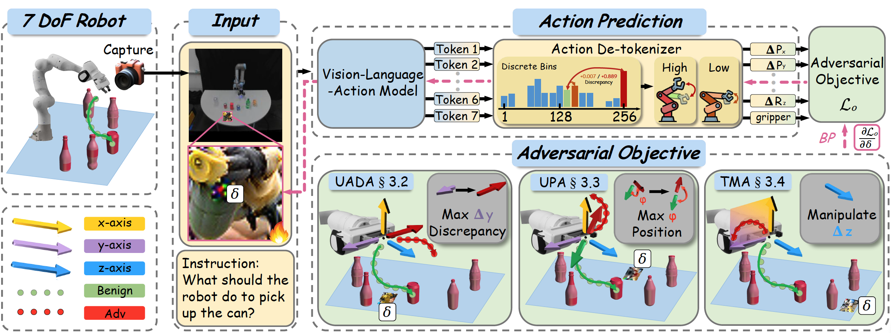

*论文框架图。图像输入到动作解码是上一篇的模型流程，图下方的三种目标说明作者如何给模型的动作预测打分。图来自 Wang 等人的项目主页。* [作者项目主页](https://vlaattacker.github.io/) · [CC BY-SA 4.0](https://creativecommons.org/licenses/by-sa/4.0/)

## 图 3 怎么看执行轨迹？

图 3 把研究问题落到具体任务上。以第一组的放黑碗任务为例，指令相同，几条轨迹显示改变画面后机械臂实际走的路线有何差异。

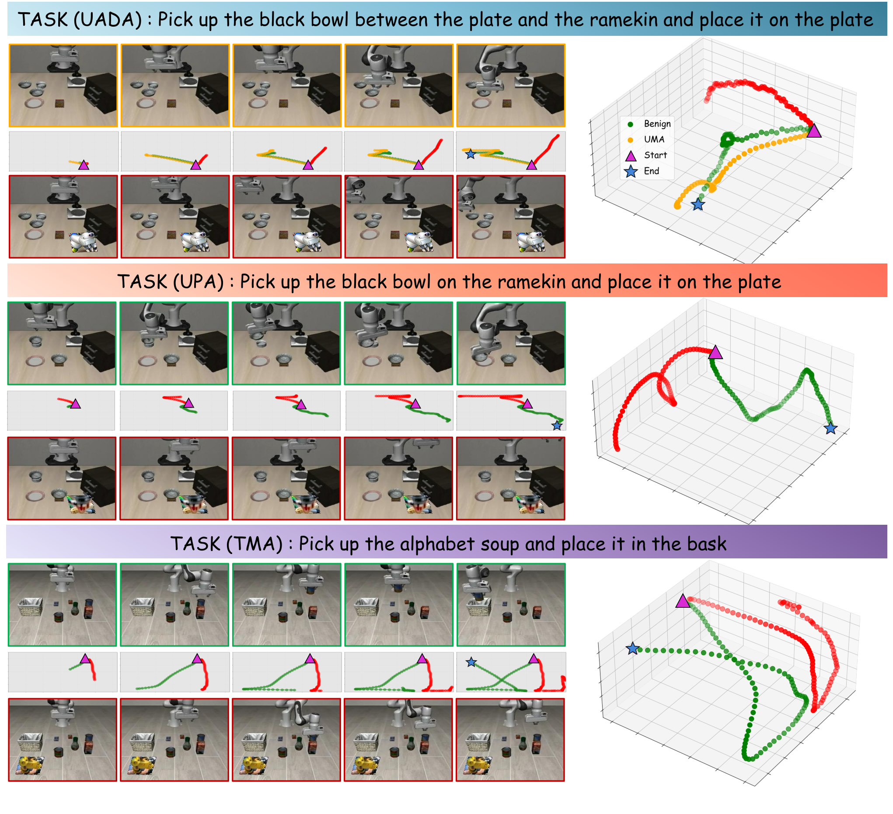

*论文图 3。左侧从左向右展示执行中的相机帧，中间的窄条画出相应时刻的二维轨迹，右侧汇总整段三维轨迹。紫色三角是起点，蓝色星星是成功终点。绿色是正常轨迹，红色是每组对应的扰动轨迹，第一组的橙色是 UMA 基线。* [&#91;1&#93; 图 3](#ref-1)

- **最上面是 UADA。** 要把盘子和小碗之间的黑碗放到盘子上。从紫色三角往外看，橙色 UMA 轨迹总体更接近绿色正常轨迹，红色 UADA 轨迹偏向另一侧。
- **中间是 UPA。** 要把小碗上的黑碗放到盘子上。红线从共同起点绕向另一侧，绿色正常轨迹沿另一条路线到达蓝星。
- **下面是 TMA。** 要把字母汤罐放进篮子。作者在这个示例中观察到，红色轨迹在选中的 \(x\) 方向上运动范围缩小。三组轨迹各展示一个执行示例，整体失败率看表 1、表 2。 [&#91;1&#93; §4.3](#ref-1)

把右图读作末端的执行轨迹。OpenVLA 输出的是一步的控制指令，调用 `env.step(action)` 后，仓库可以从环境返回的 `obs["robot0_eef_pos"]` 读取末端三维位置。用这些位置按时序就能画出同类轨迹。论文没有注明图 3 的具体取样方式，公开仓库中也未找到绘图脚本，因此这里无法确认原图使用的字段和采样间隔。 [&#91;1&#93; 图 3](#ref-1) · [仓库仿真循环](https://github.com/William-wAng618/roboticAttack/blob/a0bef50/experiments/robot/libero/run_libero_eval_args_geo_batch.py#L211)

## UADA、UPA、TMA 分别关心什么？

假设夹爪正准备向右靠近黑碗。为了能在纸上画出来，图里只看左右和上下两个位移分量，示范动作是 `(+0.2, 0)`，向右移动 `0.2`。每一格都从这同一个示范动作出发。

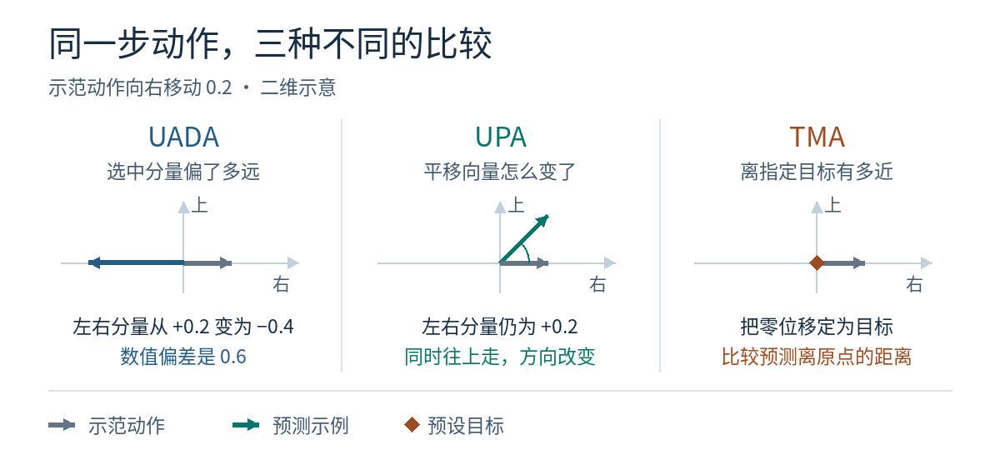

*图 1。灰色箭头是示范动作。彩色箭头是教学用的预测示例，菱形表示预先指定的目标。数值只用于说明概念，论文的 UPA 使用三维平移。*

| 方法 | 对比的对象 | 用黑碗任务理解 |
| --- | --- | --- |
| UMA（非定向操纵基线） | 示范动作 token 的概率 | 压低 `+0.2` 对应 token 的概率，具体偏到哪个区间由模型输出决定。 |
| UADA（非定向动作偏差） | 选中的动作分量离对应的示范值有多远 | 只看左右分量时，从 `+0.2` 变成 `−0.4`，偏差是 `0.6`。参照点是每个样本自己的示范动作。 |
| UPA（非定向位置感知） | 平移向量的方向差和两个向量之间的距离 | 从 `(+0.2, 0)` 变成 `(+0.2, +0.2)`。左右分量一样，但移动方向从正右变成斜右上。 |
| TMA（定向动作操纵） | 预测动作和预先指定的动作值有多接近 | 把零位移设为目标，就看预测是否接近 `(0, 0)`。参照点是事先给定的目标。 |

### UMA 的负交叉熵是什么意思？

在一个被选中的动作位置，设模型给示范 token 的概率为 \(p_{\mathrm{demo}}\)。普通交叉熵是 \(-\log p_{\mathrm{demo}}\)，UMA 取其相反数 \(\log p_{\mathrm{demo}}\)。最小化这一项会压低示范 token 的概率。表 1 用它做分类基线，比较引入动作数值距离后，预测偏差和任务失败率怎样变化。 [&#91;1&#93; 式（10）](#ref-1)

## UADA 的损失怎么算？

示范动作在训练里有两个用途。预测 \(\Delta y\) 时，OpenVLA 会读取同一个控制步里示范的 \(\Delta x\) token 作为前文。计算 \(\Delta y\) 的损失时，示范的 \(\Delta y\) 真值又决定这一维选哪个端点。模型输出的区间概率经过加权得到软动作，再和选出的端点算平方差。 [&#91;1&#93; 式（2）–（4）](#ref-1) · [UADA 损失实现](https://github.com/William-wAng618/roboticAttack/blob/a0bef50/VLAAttacker/white_patch/UADA.py#L381)

这里两端取自动作分量的归一化范围。URDF 限位描述的是关节允许的位置范围，两者对应不同的物理量。 [&#91;1&#93; 式（1）–（2）](#ref-1)

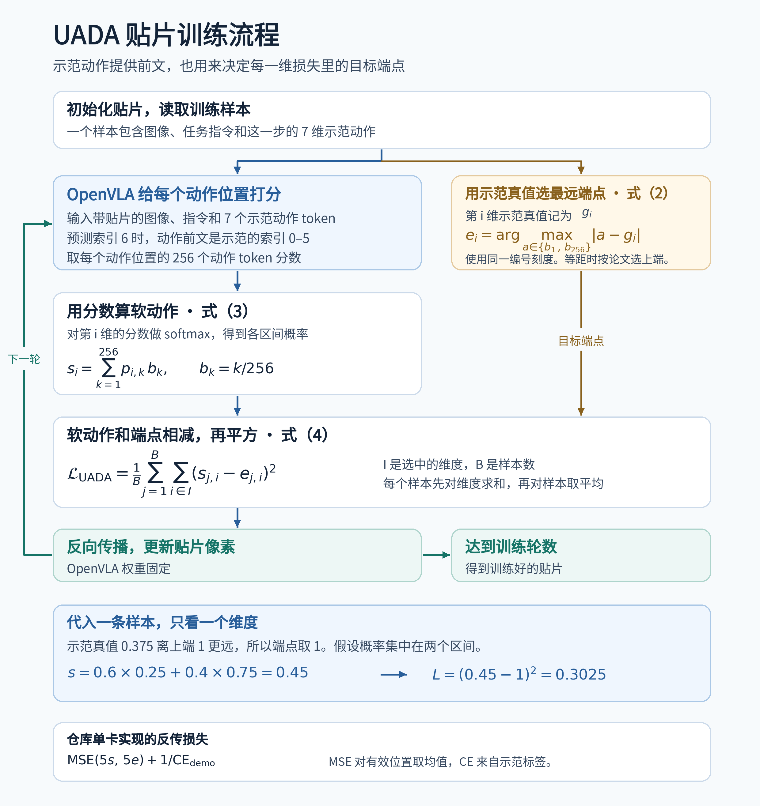

*示例统一使用归一化的区间编号。示范值 0.375 对应的最远端点是 1，软动作 0.45 与该端点的平方差是 0.3025。图底部列出了仓库单卡版本实际用于反向传播的损失。* [单卡版反向传播](https://github.com/William-wAng618/roboticAttack/blob/a0bef50/VLAAttacker/white_patch/UADA.py#L145)

## UPA 的损失怎么算？

UPA 比较**同一个时间步的两个三维末端平移向量**。\(\mathbf y^p\) 来自示范动作，\(\mathbf y^p_{\mathrm{adv}}\) 来自 OpenVLA 在扰动画面下的预测。三维指动作的 \((\Delta x,\Delta y,\Delta z)\)。式（5）里的 \(\|\cdot\|_2\) 是二范数。设 \(c\) 为两个向量的余弦相似度，\(d\) 为它们的欧氏距离，则有下式。 [&#91;1&#93; §3.3，式（5）](#ref-1)

$$
c = \frac{\mathbf y^p_{\mathrm{adv}}\cdot\mathbf y^p}{\|\mathbf y^p_{\mathrm{adv}}\|_2\,\|\mathbf y^p\|_2},\qquad
d = \|\mathbf y^p_{\mathrm{adv}}-\mathbf y^p\|_2,\qquad
\mathcal L_{\mathrm{UPA}}=\mathbb E_{(x,y)\sim\mathcal X}\left[\alpha c+\frac{\beta}{d}\right].
$$

余弦项描述方向差，距离项描述平移向量之间的差异。两个方向越背离，\(c\) 越小。向量距离越大，\(1/d\) 越小。\(\alpha\) 和 \(\beta\) 是两项的权重。

### 预测向量从哪里来？

OpenVLA 前向计算返回 token 分数 `logits`。仓库的 UPA 损失函数从中取出动作 token 的分数，在这些区间内做 `softmax`，再按概率加权区间编号。每个平移分量因此得到一个**连续软值**。示范动作则直接由标签 token 查到区间编号，两边都转换到同一套 `[0,1]` 刻度。余弦和欧氏距离直接用这两个数值向量计算。 [UPA `weighted_loss()`](https://github.com/William-wAng618/roboticAttack/blob/a0bef50/VLAAttacker/white_patch/UPA.py#L367)

### 论文式（5）和仓库实现的差异

| 来源 | 方向项 | 距离项 |
| --- | --- | --- |
| 论文式（5） | 对每条样本的 \(c\) 取平均 | 每条样本算 \(1/d\)，再取平均 |
| 仓库提交 `a0bef50` 的 `weighted_loss()` | 对每条样本的 \(c+1\) 取平均 | 先算批次平均距离 \(\overline d\)，再算 \(1/(\overline d+0.001)\) |

源码中 \(c+1\) 的 \(+1\) 是常数。固定权重 \(\alpha\) 时，它使批次损失多出 \(\alpha\)，对贴片像素求导仍得到相同的梯度。 [UPA 方向项](https://github.com/William-wAng618/roboticAttack/blob/a0bef50/VLAAttacker/white_patch/UPA.py#L382)

仓库还明确在归一化的区间编号上比较向量。把坐标平移到 `[0,1]` 会改变向量相对于原点的方向，所以源码里的余弦和直接用带正负的物理位移算出的余弦可以不同。读训练日志时，按源码的刻度和批次归约解释。 [&#91;1&#93; 正式版 §3.3](#ref-1) · [仓库实现](https://github.com/William-wAng618/roboticAttack/blob/a0bef50/VLAAttacker/white_patch/UPA.py#L377)

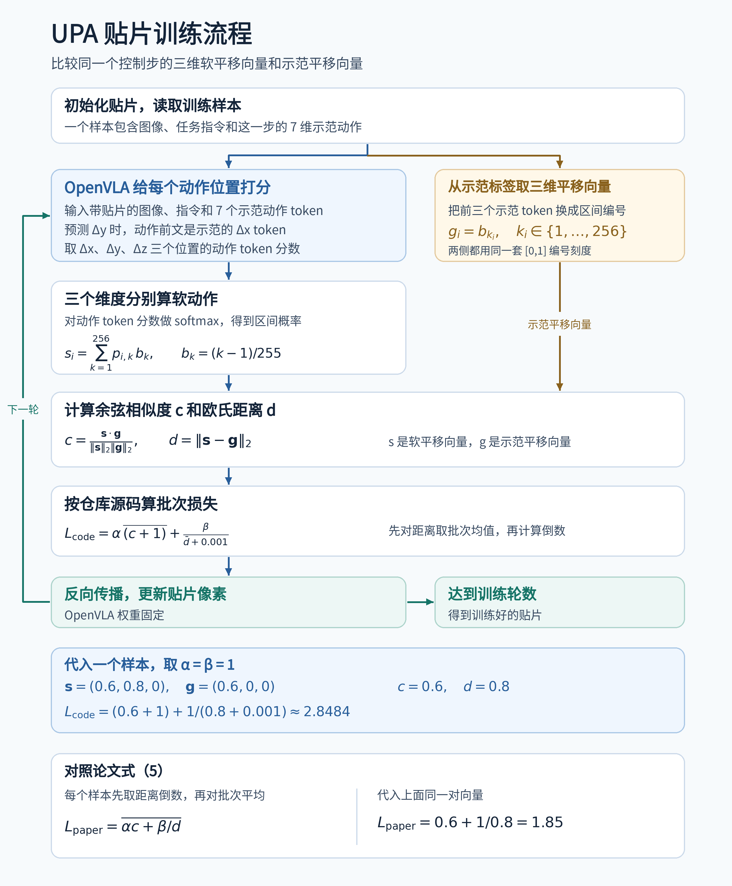

*算例中的向量在区间编号的 \([0,1]\) 刻度上。余弦相似度为 0.6，欧氏距离为 0.8。为方便手算，取两项权重都为 1，代入论文式（5）得 1.85，代入源码得约 2.8484。*

## TMA 的损失怎么算？

TMA 先确定动作维度和目标动作值，再把目标值编码成目标 token。同一实验设置下，样本共用这些目标。论文 §4.3 把被选中的动作分量设为 `0`。这里的 `0` 是动作值，进入损失前会转换成它对应的 token。 [&#91;1&#93; §3.4、§4.3](#ref-1)

式（6）在选中的维度集合 \(I\) 上使用**交叉熵**： [&#91;1&#93; 式（6）](#ref-1)

$$
\mathcal L_{\mathrm{TMA}}
=\mathbb E_{(x,y)\sim\mathcal X}
\left[\mathrm{CE}\big(\mathcal F(x+\delta)^I,\ y_T^I\big)\right].
$$

1. **确定目标 token。** \(y_T^I\) 是预设动作对应的一组标签，仓库忽略未选中的维度。
2. **计算交叉熵。** 对每个选中位置，取目标 token 的预测概率 \(p_T\)，该位置的损失是 \(-\log p_T\)。目标 token 概率越高，损失越小。
3. **归约损失。** 仓库把目标标签传给 OpenVLA。模型对有效位置取平均，计算出的 `output.loss` 用于反向传播。代码也会选出 token 并解码，供记录预测离目标多远。 [TMA 目标掩码](https://github.com/William-wAng618/roboticAttack/blob/a0bef50/VLAAttacker/white_patch/TMA.py#L91) · [交叉熵与解码统计](https://github.com/William-wAng618/roboticAttack/blob/a0bef50/VLAAttacker/white_patch/TMA.py#L142)

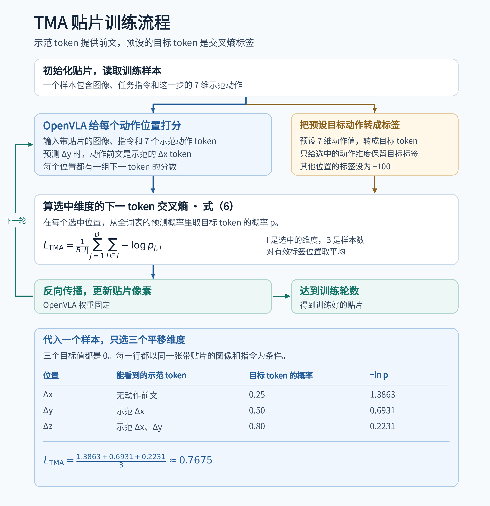

*同时选中 \(\Delta x,\Delta y,\Delta z\) 时，训练前向仍从示范取动作前文。预测 \(\Delta z\) 时，模型看到示范的 \(\Delta x,\Delta y\) token，再用预设的 \(\Delta z\) 目标 token 给这个位置打分。图中三个位置的损失平均为 0.7675。*

## 训练损失和仿真推理分别用什么？

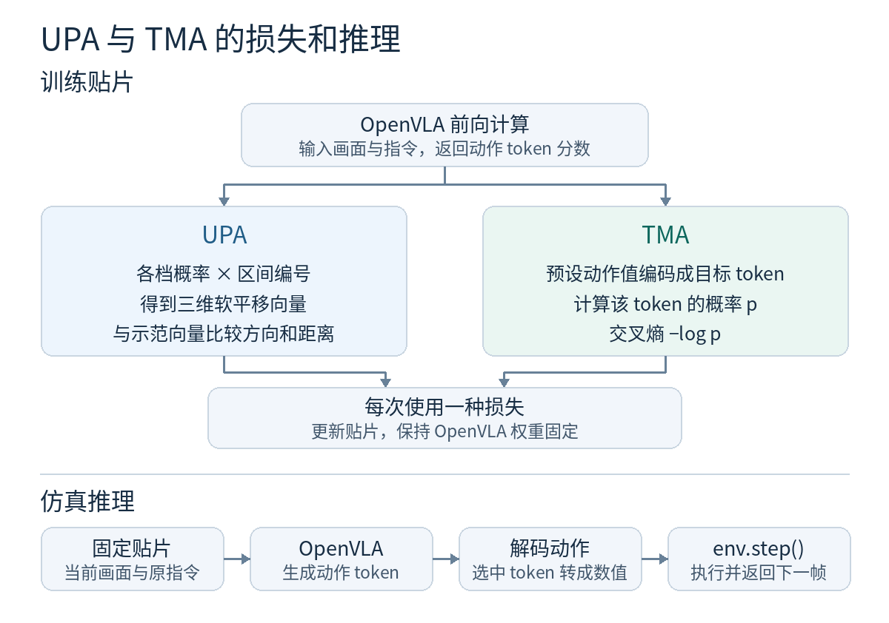

*笔记配图。上半部分按方法区分训练损失，下半部分是两者共享的仿真推理。原图与 Markdown 存在同一目录。*

**训练贴片时**，OpenVLA 权重保持固定，优化器更新贴片。每次选用一种目标。UPA 用软平移向量参加几何损失，TMA 用目标 token 参加交叉熵。 [&#91;1&#93; 算法 1](#ref-1)

**仿真推理时**，贴片与 OpenVLA 权重都固定。OpenVLA 接收当前画面和原任务指令，生成实际选中的动作 token，解码成动作并交给 `env.step()`。下一帧由环境返回。示范动作和预设目标可以分别用于评估偏差和目标接近程度。 [LIBERO 评估循环](https://github.com/William-wAng618/roboticAttack/blob/a0bef50/experiments/robot/libero/run_libero_eval_args_geo_batch.py#L204) · [动作解码](https://github.com/William-wAng618/roboticAttack/blob/a0bef50/prismatic/extern/hf/modeling_prismatic.py#L518)

### 如果模型输出的是关节角呢？

当模型直接输出关节动作时，UADA 仍可比较逐维数值，TMA 在动作仍编码成 token 的条件下也可用关节目标算交叉熵。UPA 若直接比较关节向量，衡量的是关节空间里的差异。若仍关心夹爪实际往哪边走，就要用正运动学得到末端位移。论文表 1、表 2 的结果都对应式（1）里的末端动作表示，关节角设置需要另做评估。 [&#91;1&#93; 式（1）](#ref-1) · [&#91;2&#93; 第 5 章](#ref-2)

## 实验设置与指标

### 论文固定了哪一版 OpenVLA 权重？

三种方法都使用论文的两套贴片生成设置。这里的「固定」指用已经训练好的检查点计算模型输出，贴片优化期间维持这套权重。 [&#91;1&#93; §4.2、表 1–2](#ref-1)

| 贴片生成设置 | 固定的 OpenVLA 检查点 | 用于优化贴片的示范数据 |
| --- | --- | --- |
| Simulation Setup | `openvla/openvla-7b-finetuned-libero-10` | LIBERO-Long，也叫 LIBERO-10 |
| Physical Setup | `openvla/openvla-7b` | BridgeData V2 |

两套设置的任务失败率都在 **LIBERO 仿真**中测量。评估时分别用 Spatial、Object、Goal、Long 的微调模型。表里的 `Long*` 表示评估模型和套件与贴片训练设置对齐，`△` 表示跨模型和套件的迁移评估。FR 后面的 `±` 是同一套件里不同任务失败率的标准差，`Avg` 是四个套件的平均失败率。 [&#91;1&#93; 表 1–2](#ref-1)

仓库的 UPA 和 TMA 示例脚本显式选择 `libero_spatial`，加载的是 `openvla/openvla-7b-finetuned-libero-spatial`。阅读论文数字时，以表格的模型与数据设置为准。 [UPA 权重选择](https://github.com/William-wAng618/roboticAttack/blob/a0bef50/VLAAttacker/UPA_wrapper.py#L30) · [TMA 权重选择](https://github.com/William-wAng618/roboticAttack/blob/a0bef50/VLAAttacker/TMA_wrapper.py#L30)

### FR 和 NAD 为什么要一起看？

- **FR（Failure Rate，失败率）**按回合统计。假如 100 次任务中成功了 80 次，FR 就是 `1 − 80% = 20%`。仓库的评估脚本记录成功率，论文用其补数报告失败率。 [LIBERO 评估代码](https://github.com/William-wAng618/roboticAttack/blob/main/experiments/robot/libero/run_libero_eval.py#L228)
- **NAD（Normalized Action Discrepancy，归一化动作偏差）**衡量预测动作离示范动作有多远。对每个所选维度，用实际偏差除以该维度的最大可能偏差，再对维度取平均。设动作范围是 `[-1, 1]`，示范动作是 `0.2`，预测为 `-0.1`。实际偏差是 `0.3`，离示范值最远的边界是 `-1`，最大可能偏差是 `1.2`，所以这个维度的 NAD 是 `25%`。 [&#91;1&#93; §3.5 和 §4.2](#ref-1)

表 1(a) 的 UADA **21.0% NAD** 按正文和公开代码判断，来自验证示范的离线比较。验证循环把带贴片的示范帧送入模型，解码选中的预测 token，与该样本的示范动作逐维比较。同一行的 **99.8% FR** 来自仿真闭环。论文没有列出汇总这个 NAD 数值的样本数或对应的运行日志。 [&#91;1&#93; §4.3](#ref-1) · [UADA 验证循环](https://github.com/William-wAng618/roboticAttack/blob/a0bef50/VLAAttacker/white_patch/UADA.py#L193) · [动作解码与偏差计算](https://github.com/William-wAng618/roboticAttack/blob/a0bef50/VLAAttacker/white_patch/UADA.py#L395)

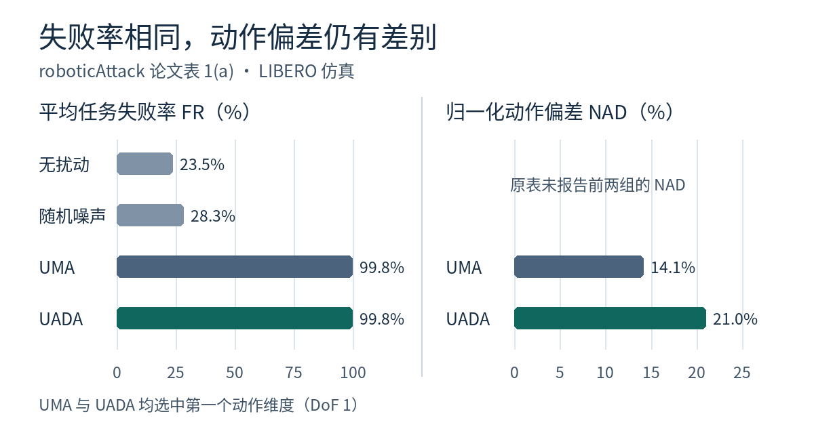

*图 2。根据论文表 1(a) 重绘。UMA 与 UADA 都取 DoF₁ 这一行。原表对无扰动和随机噪声两行的 NAD 留空。图中数值是论文报告的结果。*

图左的 UMA 和 UADA 平均失败率都到了 **99.8%**。单看这一列，两行几乎没有可区分的信息。图右给出了动作层面的区别，NAD 从 **14.1%** 到 **21.0%**，相差 **6.9 个百分点**。失败率已经接近上限时，仍可以用 NAD 比较动作偏离的程度。 [&#91;1&#93; 表 1(a)](#ref-1)

### 三种方法在相同动作维度下的结果

论文在 LIBERO 的 Spatial、Object、Goal 和 Long 四个套件里做闭环评估。每个套件有 10 个任务，每个任务跑 50 次，共 500 个回合。每次执行动作后用环境返回的新画面预测下一步。任务在步数上限内完成算成功，超时算失败。 [&#91;1&#93; §4.2](#ref-1)

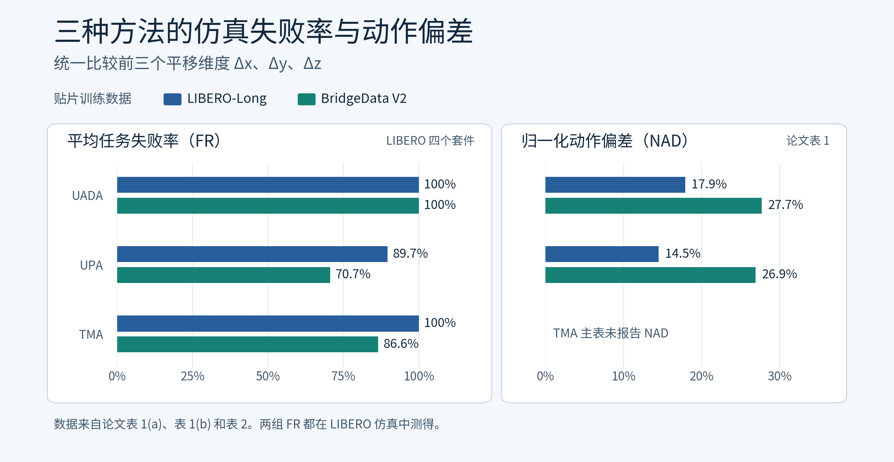

*对比统一选中 \(\Delta x,\Delta y,\Delta z\)。两种颜色代表贴片训练数据，所有 FR 都来自 LIBERO 仿真，并对四个套件取平均。NAD 采用论文表 1 报告的数值。TMA 的主结果表报告 FR，图 5(b) 另用 \(L_1\) 距离评估预测动作离预设目标有多远。* [&#91;1&#93; 表 1–2、图 5(b)](#ref-1)

用 BridgeData V2 训练贴片的那组里，UPA 和 UADA 的 NAD 接近，分别是 **26.9%** 和 **27.7%**，仿真 FR 却相差 **29.3 个百分点**。因此，报告单步偏差也需要配上闭环任务结果，才能看出任务完成受到了多大的影响。 [&#91;1&#93; 表 1(b)](#ref-1)

## 真机实验的「超过 43%」是什么意思？

论文在 **UR10e 真机**上共做了 **100 次试验**，涵盖抓取、放置和物体操纵。作者报告 **UADA 的真机攻击成功率超过 43%**，指这批试验中被计为攻击成功的比例。正文给的是汇总比例，图 4 展示的是其中一次执行对照。 [&#91;1&#93; §4.3 真机结果](#ref-1)

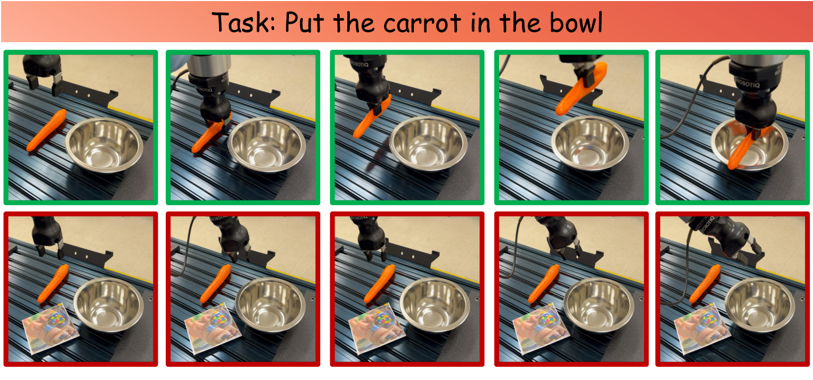

*论文图 4。读图时对照两排从接近胡萝卜到尝试放进碗里的变化。来源为 Wang 等人的 ICCV 2025 论文。* [&#91;1&#93; 图 4](#ref-1)

## 图 5 的消融与防御实验

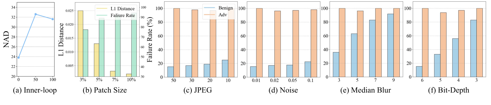

*论文图 5。(a) 和 (b) 比较训练设置，(c) 到 (f) 比较输入预处理防御。来源为 Wang 等人的 ICCV 2025 论文。* [&#91;1&#93; 图 5](#ref-1)

### §4.4 改一个设置，效果怎么变？

两组实验都选第 1 个动作维度，也就是末端的 \(x\) 方向平移。下面的数值由图近似读出。 [&#91;1&#93; §4.4](#ref-1)

| 子图 | 改了什么 | 测了什么，结果如何 |
| --- | --- | --- |
| **(a) UADA 内循环** | 外层取一批示范样本，内层在这批样本上重复更新贴片。图上比较标为 0、50、100 的三档。 | NAD 约为 24%、33%、32%。50 这一档在图中最高，作者考虑训练时间后选择了它。正文未说明 0 这一档的具体实现。 |
| **(b) TMA 贴片大小** | 贴片占输入图像的比例为 3%、5%、7%、10%。 | **黄柱读左轴**，到预设目标的 \(L_1\) 距离约从 0.025 降到 0.002。**绿柱读右轴**，任务失败率约从 78% 升到 94%。 |

图 (a) 衡量在所选维度上离**示范**多远，图 (b) 的 \(L_1\) 则衡量离**预设目标**多远。

### §4.5 蓝柱和橙柱要一起看

蓝色 **Benign** 是无贴片画面经过防御处理后的任务失败率。橙色 **Adv** 是带贴片画面经过同样处理后的失败率。评价防御时，以同条件的无防御结果为参照，希望橙柱下降，同时蓝柱保持低位。 [&#91;1&#93; §4.5](#ref-1)

| 子图 | 防御 | 横轴 |
| --- | --- | --- |
| **(c) JPEG** | 压缩画面 | 质量 50、30、20、10。质量越低，压缩越强。 |
| **(d) Noise** | 给画面加噪声 | 图中档位为 0.01、0.02、0.05、0.1。正文未说明参数是标准差还是方差。 |
| **(e) Median Blur** | 用邻域像素的中位数处理图像 | 窗口大小 3、5、7、9。 |
| **(f) Bit-Depth** | 减少可用的像素值等级 | 位深 6、5、4、3。位深越小，保留的像素等级越少。 |

右边四图的橙柱始终大约在 94%–100%。例如中值模糊窗口取 9 时，蓝柱约 92%，橙柱约 100%。两柱靠近主要是因为正常任务也变得难以完成。评估防御既要看受扰动时恢复了多少任务，也要看正常执行的代价。 [&#91;1&#93; 图 5(c)–(f)](#ref-1)

## §4.6 的讨论和论文结论

图 6 对照了 BridgeData V2 和 LIBERO 上生成的贴片。作者观察到一些图案在外观上像机械臂关节，并猜测固定视角和有限的机器人外观可能让模型依赖反复出现的视觉特征。外观相似是图中观察，视角和外观怎样影响模型是作者提出的解释。作者进一步提出扩充机器人交互训练场景，以及利用机械臂结构检查估计出的关节位置是否合理。 [&#91;1&#93; §4.6 与图 6](#ref-1)

论文用三种目标说明，视觉输入的变化可以反映为单步控制偏差，并在闭环中改变任务结果。本文最值得复用的实验设计是把**预测动作、执行轨迹和回合结果**对照起来，再用正常组检验防御的代价。 [&#91;1&#93; §5](#ref-1)

## 可以接着问的 VLA 安全问题

任务成功率和过程安全可以分别测量。例如碗最终放到了盘子上，机械臂途中仍可能碰到旁边的物体。后续可以从一个小型 LIBERO 实验开始，研究**相机帧延迟时，实时末端状态能否让执行前的检查更早发现越界风险**。先明确仿真中的禁入区，再用同一组初始状态比较不同检查方法，分别记录越界回合比例、安全完成率和正常回合的干预次数。 [&#91;3&#93;](#ref-3) [&#91;4&#93;](#ref-4)

## 参考文献

#### [1] Exploring the Adversarial Vulnerabilities of Vision-Language-Action Models in Robotics {#ref-1}

Taowen Wang, Cheng Han, James Liang, Wenhao Yang, Dongfang Liu, Luna Xinyu Zhang, Qifan Wang, Jiebo Luo, and Ruixiang Tang. *Proceedings of the IEEE/CVF International Conference on Computer Vision (ICCV)*, 2025, pp. 6948–6958. [CVF 正式版 PDF](https://openaccess.thecvf.com/content/ICCV2025/papers/Wang_Exploring_the_Adversarial_Vulnerabilities_of_Vision-Language-Action_Models_in_Robotics_ICCV_2025_paper.pdf) · [arXiv 网页版](https://arxiv.org/html/2411.13587v4)

#### [2] Modern Robotics: Mechanics, Planning, and Control {#ref-2}

Kevin M. Lynch and Frank C. Park. Cambridge University Press, 2017. [第 5 章：速度运动学与静力学](https://modernrobotics.northwestern.edu/chapters/chapter5/)

#### [3] SafeVLA-Bench: A Benchmark for the Success-Safety Gap in Vision-Language-Action Models {#ref-3}

Jialiang Fan, Weizhe Xu, Zijun Wang, Oleg Sokolsky, Insup Lee, and Fanxin Kong. arXiv:2606.00773, 2026. [arXiv 预印本](https://arxiv.org/abs/2606.00773)

#### [4] ActFovea: Runtime Safeguarding for VLA Policies via Spatiotemporal Visual-Action Consistency {#ref-4}

Wenda Yu, Tianshi Wang, Fengling Li, Xin Li, Jingjing Li, and Lei Zhu. arXiv:2607.29169, 2026. [arXiv 预印本](https://arxiv.org/abs/2607.29169)
