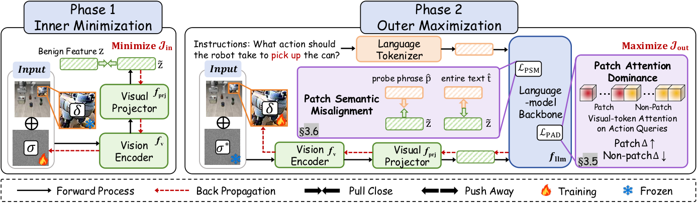
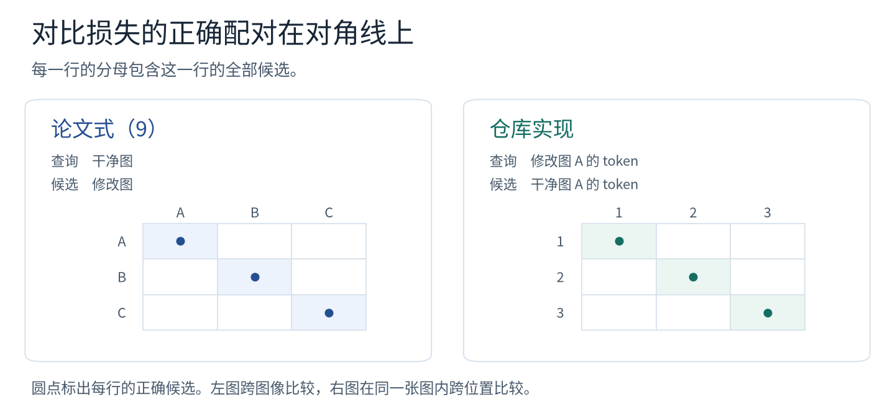
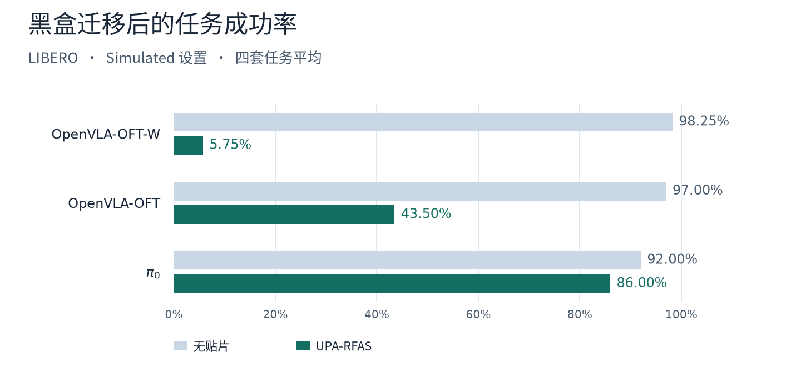

**阅读论文**　*When Robots Obey the Patch: Universal Transferable Patch Attacks on Vision-Language-Action Models*，Hui Lu 等，CVPR 2026。公式和表格编号采用 arXiv v3。[论文原文](https://arxiv.org/abs/2511.21192v3) · [CVPR 正式发表页](https://openaccess.thecvf.com/content/CVPR2026/html/Lu_When_Robots_Obey_the_Patch_Universal_Transferable_Patch_Attacks_on_CVPR_2026_paper.html)

## 通用性与迁移性

VLA（视觉–语言–动作）模型把相机画面和任务指令转成机器人动作。论文问的是，同一张视觉贴片在不同任务中复用之后，能否继续影响训练时没有用过的模型。**通用性**看的是同一图案能否跨样本和任务复用，**迁移性**看的是它能否跨模型产生效果。[论文引言与 §3.2](https://arxiv.org/html/2511.21192v3#S3.SS2)

**代理模型**提供视觉特征、注意力和梯度。仿真数据设置采用在 LIBERO-Long 上微调的 OpenVLA-7B，真实采集数据设置采用 OpenVLA-7B 与 BridgeData V2。作者在两种设置下分别学习贴片，再将固定图案交给下面的**目标模型**进行黑盒评估。[论文 §4](https://arxiv.org/html/2511.21192v3#S4)

- **OpenVLA-OFT-W** 在 Spatial、Object、Goal、Long 四个 LIBERO 套件上联合微调，评估时四套任务共用同一个检查点。结果见表 1。
- **OpenVLA-OFT** 按四个套件分别微调，评估每套任务时用对应的检查点。结果见表 1。
- **\\(\pi_0\\)** 与 OpenVLA 架构差异较大，作者用它检验跨架构迁移。结果见附录 D 表 5。

## 图 1 的两阶段训练

*Lu 等，论文 Figure 1。红色虚线表示梯度回传，火焰表示当前更新的量，雪花表示冻结。* [arXiv v3 原图与图注](https://arxiv.org/html/2511.21192v3#S1.F1) · [放大原图](./paper-figure-1.png)

一条训练记录提供相机画面 \\(x\\) 和指令 \\(c\\)。画面经过视觉编码器和投影层，得到一组空间位置对应的视觉 token。每个 token 都是一个向量。干净图的特征记作 \\(z\\)，修改图的特征记作 \\(\tilde z\\)。指令编码成文本 token，参与注意力和语义两项比较。[论文 §3.1 与图 1](https://arxiv.org/pdf/2511.21192v3#page=2)

*内外层对照示意。干净原图一路提供固定的参考特征。另一路从原图加上 \\(\sigma\\) 开始，再放入贴片 \\(\delta\\)。一批中的不同画面使用同一个贴片图案，图案在画面中的呈现可以变化。*

**内层固定当前贴片 \\(\delta\\)，为每张训练图找自己的 \\(\sigma\\)。** 内层压低特征损失，让带贴片画面的特征更接近干净原图。比如干净特征是 10，加入当前贴片后变成 16。若逐样本扰动把结果拉回 12，同一张贴片在这次比较中的剩余偏移就从 6 降到 2。这就是论文里“更难”的含义，指当前贴片在代理模型上的特征偏移更小。数字仅作示意。[论文 §3.4](https://arxiv.org/html/2511.21192v3#S3.SS4)

**外层固定各样本的 \\(\sigma^\ast\\)，更新共享贴片 \\(\delta\\)。** 外层的修改图同时包含内层找到的扰动和当前贴片。它用视觉特征、文字指令和模型内部的注意力形成一个综合分数。梯度穿过冻结的代理模型回到贴片像素，一批样本共同影响同一个图案。下一批从已经更新的图案继续，最后拿去评估的是 \\(\delta\\)。论文把训练对象描述为方形噪声贴片，初始图案的具体像素采样分布未在算法中给出。[论文图 1、§3.7 与附录 B](https://arxiv.org/html/2511.21192v3#S3.SS7)

## 四项损失怎么读

两阶段对分数采用不同的方向。内层最小化视觉特征项，外层最大化加入注意力和语义项的总分。\\(\lambda\\) 是各项权重。

$$
\begin{aligned}
\mathcal J_{\mathrm{tr}}
&=\mathcal L_1+\lambda_{\mathrm{con}}\mathcal L_{\mathrm{con}},\\
\mathcal J_{\mathrm{in}}
&=\mathcal J_{\mathrm{tr}},\\
\mathcal J_{\mathrm{out}}
&=\mathcal J_{\mathrm{tr}}
+\lambda_{\mathrm{PAD}}\mathcal L_{\mathrm{PAD}}\\
&\quad+\lambda_{\mathrm{PSM}}\mathcal L_{\mathrm{PSM}} .
\end{aligned}
$$

内层和外层共享视觉特征度量 \\(\mathcal J_{\mathrm{tr}}\\)，各阶段在自己的输入和固定变量下计算它。[论文 §3.7](https://arxiv.org/html/2511.21192v3#S3.SS7)

### 特征距离 L1

$$
\mathcal L_1=\lVert\tilde z-z\rVert_1
=\sum_d|\tilde z_d-z_d|.
$$

\\(d\\) 索引特征坐标。\\((1,2)\\) 和 \\((2,4)\\) 的对应坐标绝对差之和是 3，两向量的方向仍然相同。\\(\mathcal L_1\\) 衡量数值偏移，余弦相似度则衡量向量方向的接近程度。[论文 §3.3](https://arxiv.org/html/2511.21192v3#S3.SS3)

### 对比损失 Lcon

$$
\begin{aligned}
s_{ij}&=\frac{\cos(z_i,\tilde z_j)}{\tau},\\
p_{ii}&=\frac{e^{s_{ii}}}{\sum_j e^{s_{ij}}},\\
\mathcal L_{\mathrm{con}}&=-\frac{1}{N}\sum_i\log p_{ii}.
\end{aligned}
$$

式（9）固定一张干净图 \\(i\\)，与候选修改图 \\(j\\) 逐个比较。分子 \\(e^{s_{ii}}\\) 是同图配对的分数，分母是该行所有候选的分数之和，包含分子。假设两个候选的指数分数是 8 和 2，正确配对就占 \\(8/(8+2)=80\%\\)，其负对数约为 0.22。若两项都为 8，正确配对只占 50%，对应的损失增至约 0.69。即便正确配对的原始分数没变，其他候选也能削弱它的相对优势。[论文式（9）](https://arxiv.org/html/2511.21192v3#S3.SS3)

*配对示意。每行先给所有候选分配份额，再读取对角线上的正确配对。*

式（9）的 \\(i,j\\) 索引批内图像。仓库将投影层整组特征传给对比损失，张量形状为 **批大小 × 视觉 token 数 × 特征维度**。相似度矩阵按图独立计算。以带贴片图 A 的第 256 个 token 为例，候选是干净图 A 的所有 token，正确配对是干净图 A 的第 256 个 token。最后对各位置和各图取平均。内层压低这项损失，外层提高这项损失。[仓库对比损失](https://github.com/yuyi-sd/UPA-RFAS/blob/56634bc32ffc75edf1391a3d19db874d1274e231/white_patch/feature_space.py#L660)

### 注意力份额 PAD

**先把文本到视觉的权重归一化。** 设 \\(A^{(\ell)}_{qj}\\) 是第 \\(\ell\\) 层中，文本 token \\(q\\) 分给视觉 token \\(j\\) 的注意力权重，已经对各个注意力头取平均。固定 \\(q\\)，把它分给所有 \\(P\\) 个视觉 token 的权重加起来作为分母，得到这一层的视觉注意力份额：

$$
a^{(\ell)}_{qj}
=\frac{A^{(\ell)}_{qj}}
       {\sum_{k=1}^{P} A^{(\ell)}_{qk}}.
$$

干净图和修改图各自归一化。每层算完份额后，再对所选的层取平均，得到两张「文本 token × 视觉 token」的份额表。

**再对同一个配对做减法。** 固定同一个文本 token \\(q\\) 和同一个视觉位置 \\(j\\)，用修改图的份额减去干净图的份额：

$$
\Delta_{qj}=a_{qj}^{\mathrm{modified}}-a_{qj}^{\mathrm{clean}} .
$$

如果画面有 256 个视觉 token，一个文本 token 就对应一行 256 个变化值。举例只看位置 A 和 B，干净图的权重为 \\((0.10,0.30)\\)，修改图为 \\((0.10,0.10)\\)。A 的份额从 \\(0.10/0.40=25\%\\) 升到 \\(0.10/0.20=50\%\\)，增量是 **25 个百分点**。A 的原始权重在两图中都是 0.10。份额增加来自分给其他视觉位置的权重变少。

**最后汇总贴片区域。** 设 \\(m_j\\) 是贴片对位置 \\(j\\) 的覆盖权重。对每个选中的文本 token，将贴片区域的变化值按覆盖权重求和：

$$
d_{\mathrm{patch}}(q)=\sum_j m_j\,\Delta_{qj}.
$$

干净图里的参照是贴片将要覆盖的同一组位置。外层希望 \\(d_{\mathrm{patch}}(q)\\) 增大。因为一行视觉份额的总和固定为 100%，贴片区域总份额增加时，贴片外总份额会下降。贴片外的个别位置仍可能增加，式（16）也考察了贴片外增量最大的单个位置。[论文式（12）–（16）](https://arxiv.org/html/2511.21192v3#S3.SS5)

### 图文相似度 PSM

**先把贴片区域汇总成一个视觉向量。** 设 \\(\tilde z_j\\) 是修改图在位置 \\(j\\) 的视觉向量，\\(m_j\\) 是该位置的贴片覆盖权重。对贴片覆盖的视觉 token 做加权平均，再将得到的向量归一化为长度为 1 的 \\(\hat v\\)：

$$
\begin{aligned}
v &= \frac{\sum_j m_j\,\tilde z_j}{\sum_j m_j+\varepsilon},\\
\hat v &= \frac{v}{\lVert v\rVert_2}.
\end{aligned}
$$

贴片外的位置权重为 0。分母里的 \\(\varepsilon\\) 用于数值稳定。若贴片完整覆盖两个位置且忽略这一小项，\\(v\\) 就是这两个位置的向量平均。

**文字也各自汇总成向量。** 用 \\(\hat t\\) 表示整条当前指令的单位向量，例如对语言模型最后一层的指令 token 表征取平均，再归一化。每个探测短语也有自己的单位向量 \\(\hat p_k\\)。因此，同一块贴片区域会与整条指令比较一次，再与每个探测短语分别比较。

**最后算余弦相似度。** 余弦相似度把点积除以两边的向量长度。两边都归一化为单位向量后，分母就是 1，公式可直接写成点积：

$$
\begin{aligned}
s_{\mathrm{instr}} &= \hat v^\top\hat t,\\
s_k &= \hat v^\top\hat p_k.
\end{aligned}
$$

式（18）以 LogSumExp 聚合探测短语的相似度，并给整条当前指令的相似度负权重。探测短语的相似度变高，或与整条指令的相似度变低，都会推高 PSM。PAD 描述注意力分配到哪里，PSM 描述贴片区域的视觉向量与哪些文字向量方向更接近。[论文式（17）–（18）](https://arxiv.org/html/2511.21192v3#S3.SS6)

## 表 1 与表 5 的迁移结果

论文最终用**任务成功率（SR）**衡量机器人完成任务的比例。结果图取表 1 与表 5 中 Simulated 设置的四套任务平均值。相比无贴片，OpenVLA-OFT-W 的成功率下降 92.50 个百分点，OpenVLA-OFT 下降 53.50 个百分点，\\(\pi_0\\) 下降 6.00 个百分点。在 OpenVLA-OFT-W 上，表 1 所列基线最低把成功率降到 41.25%，UPA-RFAS 降到 5.75%。\\(\pi_0\\) 的结果显示迁移也发生在不同架构之间，效果幅度明显小于 OpenVLA 系列。[表 1 与附录 D 表 5](https://arxiv.org/html/2511.21192v3#S4)

*LIBERO 上的平均任务成功率，按论文表格绘制。Simulated 表示仿真数据一侧训练出的贴片。表 1、表 5 的 Physical 列也用 LIBERO 评估，对应真实采集数据一侧训练出的贴片。附录 F 单独展示了真机抓取、放置和操作的定性试验。* [论文 §4 与附录 F](https://arxiv.org/html/2511.21192v3#A6)

## 表 2 的消融结果

表 2 固定 OpenVLA-OFT 和 Physical 设置，比较移除组件后机器人任务成功率的变化。完整方法下的 SR 为 **61.50%**。移除 PAD 后升至 **62.50%**，移除 PSM 后升至 **63.50%**，移除整组特征目标 \\(\mathcal J_{\mathrm{tr}}\\) 后升至 **85.75%**。在这组实验里，移除整组特征目标带来的变化最大。表里的百分数衡量任务结果，模型内部四项分数的定义见前面的公式。[表 2 与 §4.2](https://arxiv.org/html/2511.21192v3#S4.SS2)

## 总结

UPA-RFAS 研究的是，**在一个 VLA 上学到的同一张贴片，能否跨任务复用，并影响训练时未接触的目标模型。** 作者冻结 OpenVLA 代理模型，在 LIBERO-Long 仿真数据和 BridgeData V2 真实采集数据两种设置下分别学习贴片。内层用逐样本扰动削弱当前贴片的影响，外层再用这些较难的样本更新共享贴片。外层同时衡量视觉特征偏移、原有特征配对的变化、注意力转移（PAD）和图文语义错位（PSM）。[论文图 1 与 §4](https://arxiv.org/html/2511.21192v3#S4)

**贴片能黑盒迁移，效果幅度随模型而变。** 在 LIBERO 的 Simulated 设置下，OpenVLA-OFT-W 的平均任务成功率从 **98.25% 降到 5.75%**，OpenVLA-OFT 从 **97.00% 降到 43.50%**，跨架构目标 \\(\pi_0\\) 从 **92.00% 降到 86.00%**。表 2 的消融中，移除整组视觉特征目标后，OpenVLA-OFT 的成功率在所测设置下从 **61.50% 回升到 85.75%**，是该表中变化最大的一项。[论文表 1、表 2 与附录 D](https://arxiv.org/html/2511.21192v3#S4)

表 1 的 Physical 列衡量的是用真实采集数据侧学到的贴片在 LIBERO 中的表现。真机试验在附录 F 中单独作定性展示。论文没有披露训练贴片时具体用了多少条轨迹、多少帧或怎样抽帧。[论文 §4 与附录 F–G](https://arxiv.org/html/2511.21192v3#A6)
